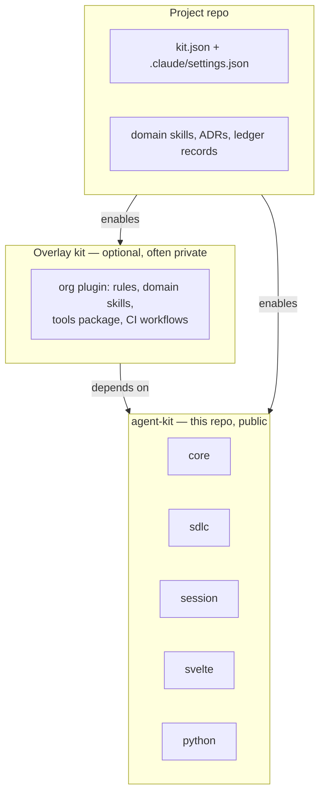

# agent-kit

**English** · [Українська](README.uk.md)

Claude Code plugins for a spec-first development workflow: SDLC work items, a session ledger,
worktree sessions and shared hooks. One source, installed into every project, so an improvement
lands everywhere at once instead of being copied repo by repo.

> **Status: design.** This is the target layout. Plugins are being extracted from per-project
> copies; anything marked _(planned)_ does not exist yet.

## How it fits together



Three layers, each with one owner:

| ID | Layer | Holds | Changes when |
| --- | --- | --- | --- |
| 1 | **agent-kit** (this repo) | What every project wants: the SDLC flow, the ledger, generic rules and hooks | Any project finds a gap in the shared workflow |
| 2 | **Overlay kit** | What a group of projects shares: house rules, domain skills, CI | That group's conventions change |
| 3 | **Project** | `kit.json` (paths, commands, options) and its own domain knowledge | Only that project is affected |

## Plugins

| ID | Plugin | Gives you | Needs |
| --- | --- | --- | --- |
| 1 | `core` | Chat-output and shell rules, check and sweep agents, `/check`, `/sweep`, `/dev`, edit and shell hooks, `kit doctor`, `/kit-adopt`, `/kit-inventory` | — |
| 2 | `sdlc` | `/sdlc-intent`, `/sdlc-plan`, `/sdlc-build`, `/sdlc-finish`, `/sdlc-status`; simplifier and verifier agents | `core`; uses `session` when enabled |
| 3 | `session` | Session ledger, `/handoff`, `/close-out`, `/close-siblings`, `/git`, worktree flow, commit script | `core` |
| 4 | `svelte` | Svelte 5 runes, Vitest and accessibility conventions | `core` |
| 5 | `python` | Python conventions | `core` |

## Quick start

```bash
claude plugin marketplace add 3meyc/agent-kit#stable
```

```bash
claude plugin install sdlc@agent-kit
```

Then add a `kit.json` to the project root — see [Using the kit](docs/using.md).

## Docs

| ID | Doc | Read it to |
| --- | --- | --- |
| 1 | [Architecture](docs/architecture.md) | See the layers, plugin dependencies, `kit.json` and release channels |
| 2 | [Using the kit](docs/using.md) | Install, configure a project, take updates |
| 3 | [Changing the kit](docs/changing.md) | Improve a skill or flow while working in a project, test it, release it |
| 4 | [Evolution](docs/evolution.md) | Why the kit exists, milestones, release log |

## License

[MIT](LICENSE)
