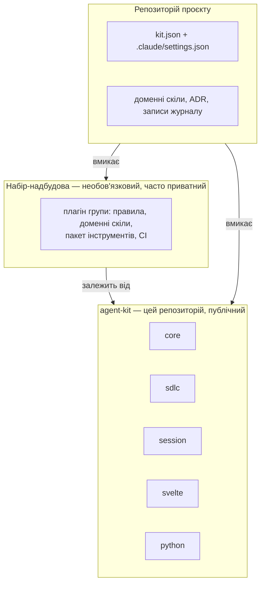

# agent-kit

[English](README.md) · **Українська**

Плагіни Claude Code для розробки за специфікацією: робочі елементи SDLC, журнал сесій (ledger),
сесії у worktree і спільні хуки. Одне джерело, встановлене в кожен проєкт: покращення одразу
доходить усюди, а не копіюється з репозиторію в репозиторій.

> **Статус: проєктування.** Тут описано цільову структуру. Плагіни виокремлюються з копій у
> проєктах; позначене _(заплановано)_ ще не існує.

## Як усе поєднано



Три шари, у кожного один власник:

| ID | Шар | Містить | Змінюється, коли |
| --- | --- | --- | --- |
| 1 | **agent-kit** (цей репозиторій) | Те, що потрібно кожному проєкту: процес SDLC, журнал сесій, загальні правила й хуки | Будь-який проєкт знаходить прогалину в спільному процесі |
| 2 | **Набір-надбудова** | Спільне для групи проєктів: власні правила, доменні скіли, CI | Змінюються домовленості цієї групи |
| 3 | **Проєкт** | `kit.json` (шляхи, команди, параметри) і власні доменні знання | Зміна стосується лише цього проєкту |

## Плагіни

| ID | Плагін | Що дає | Потребує |
| --- | --- | --- | --- |
| 1 | `core` | Правила виводу в чат і роботи з оболонкою, агенти перевірок і пошуку, `/check`, `/sweep`, `/dev`, `/change-review`, `/repo-audit`, хуки редагування й оболонки, `kit doctor`, `/kit-adopt`, `/kit-inventory` | — |
| 2 | `sdlc` | `/sdlc:intent`, `/sdlc:plan`, `/sdlc:build`, `/sdlc:finish`, `/sdlc:status`; агенти спрощення і перевірки | `core`; використовує `session`, якщо ввімкнено |
| 3 | `session` | Журнал сесій, `/handoff`, `/close-out`, `/close-siblings`, `/git`, процес worktree, скрипт коміту | `core` |
| 4 | `svelte` | Домовленості для Svelte 5 (руни), Vitest і доступності | `core` |
| 5 | `python` | Домовленості для Python | `core` |

## Швидкий старт

```bash
claude plugin marketplace add 3meyc/agent-kit#stable
```

```bash
claude plugin install sdlc@agent-kit
```

Далі додайте `kit.json` у корінь проєкту — див. [Використання набору](docs/using.uk.md).

## Документація

| ID | Документ | Прочитайте, щоб |
| --- | --- | --- |
| 1 | [Архітектура](docs/architecture.uk.md) | Побачити шари, залежності плагінів, `kit.json` і канали релізів |
| 2 | [Використання набору](docs/using.uk.md) | Встановити, налаштувати проєкт, отримувати оновлення |
| 3 | [Зміни в наборі](docs/changing.uk.md) | Покращити скіл чи процес під час роботи над проєктом, перевірити й випустити |
| 4 | [Еволюція](docs/evolution.uk.md) | Дізнатися, навіщо набір, етапи, журнал релізів |

## Ліцензія

[MIT](LICENSE)
