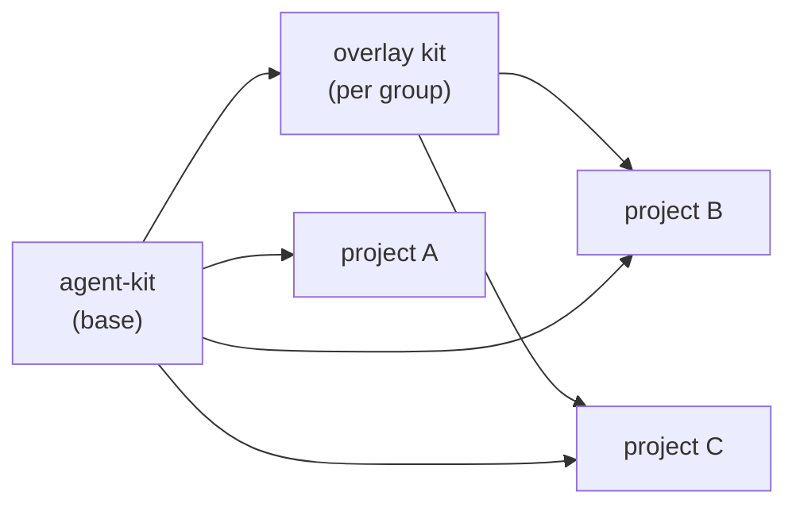
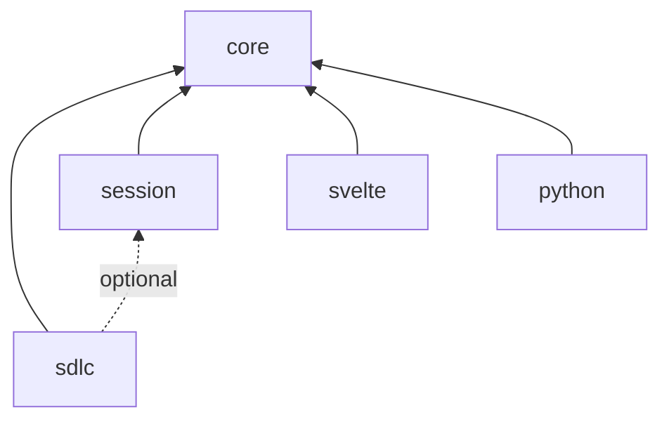
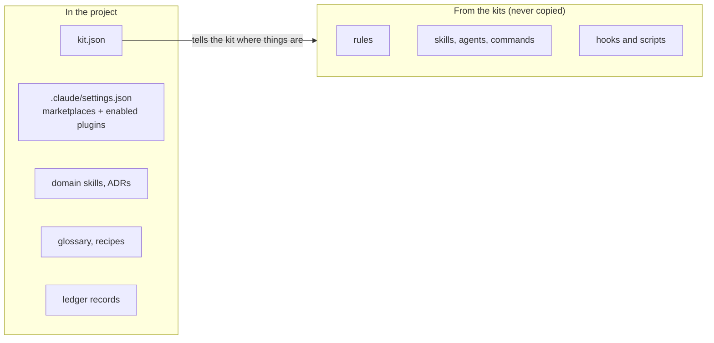
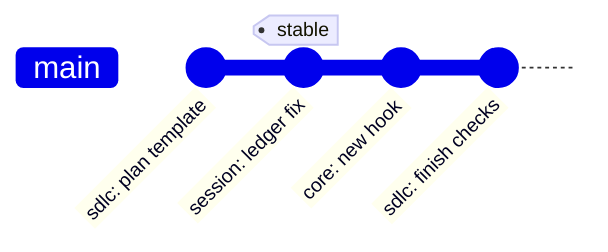

# Architecture

**English** · [Українська](architecture.uk.md)

## Layers



A project enables the base kit directly, and an overlay kit if it belongs to a group. An overlay
never copies base plugins: it declares a dependency on them.

## Plugin dependencies



| ID | Plugin | Contains |
| --- | --- | --- |
| 1 | `core` | Always-on rules, `check-runner` and `repo-sweep` agents, edit and shell hooks, `kit doctor`, `/kit-inventory`, `/kit-adopt`, `/change-review`, `/repo-audit`, docs parity check |
| 2 | `sdlc` | Five `/sdlc:*` skills, `sdlc:simplifier` and `sdlc:verifier` agents |
| 3 | `session` | Ledger hooks and scripts, `/handoff`, `/close-out`, `/close-siblings`, `/git` with the `git-ops` agent, worktree set-up and landing, the `evolution` pages |
| 4 | `svelte` | Svelte 5 conventions |
| 5 | `python` | Python conventions |

## What a project keeps



The glossary (domain terms) and the recipes (step-by-step guides for recurring tasks) describe
the project's own domain, so they stay in the project. The kit knows where they are from
`kit.json`: the SDLC skills read the glossary when a work item touches domain terms and offer a
matching recipe when planning. An overlay kit can add recipes and terms shared by its group.

## kit.json

The kit never hard-codes a project's layout. `kit.json` at the repo root names the paths and
commands the plugins use. Draft v1; the final shape lives in `schema/kit.schema.json`.

```json
{
  "$schema": "https://raw.githubusercontent.com/3meyc/agent-kit/stable/schema/kit.schema.json",
  "project": "my-app",
  "baseBranch": "dev",
  "itemPrefix": "APP",
  "ledger": true,
  "paths": {
    "docs": "docs",
    "decisions": "docs/decisions",
    "sdlc": "docs/sdlc",
    "glossary": "docs/glossary.md",
    "recipes": "docs/recipes",
    "ledger": ".claude/ledger",
    "evolution": "docs/evolution"
  },
  "commands": {
    "install": "pnpm install --frozen-lockfile",
    "dev": "pnpm run dev",
    "check": "pnpm run check",
    "test": "pnpm test",
    "build": "pnpm run build",
    "commitAudit": "npx some-audit --base HEAD~1 --only {files}"
  },
  "lintOnEdit": [
    { "command": "pnpm exec eslint --no-warn-ignored {file}", "match": ["*.ts", "*.svelte"] },
    { "command": "pnpm run i18n:check", "match": ["src/locales/*.json"] }
  ],
  "checks": { "i18n": ["pnpm run i18n:check", "pnpm run i18n:parity"] },
  "preflight": { "docs-review": { "description": "Docs review skill", "match": ["docs/**"], "remindAfter": 3 } },
  "hooks": { "off": ["ledger-stop"] },
  "devServer": { "port": 5173 }
}
```

`commands.commitAudit` runs after each commit that holds code, so the commit script names no
specific tool; `{files}` in it becomes the committed paths (also in `KIT_COMMIT_PATHS`), so the
audit can report only what the commit touched. `commands.install` sets up a fresh worktree (without
it, `session` guesses pnpm or npm from the lockfile), and `commands.dev` starts the dev server where
the desktop app's Browser pane is not available. `lintOnEdit` lints each edited file: one rule or a
list of rules, each a command where `{file}` is the quoted repo-relative path, and `match` globs
that pick the files it takes; every matching rule runs. `checks` names suites of commands for
`/core:check <suite>`, and `preflight` names optional steps whose skipped commits `session` counts.
`hooks.off` lists kit hooks this project skips: a plugin can't be switched off hook by hook, so each
kit hook reads this list and exits quietly when named.

Every plugin reads `kit.json` through the same module, `shared/kit-config.mjs`, vendored into each
plugin's `lib/`: it fills in the schema defaults and answers `hooks.off`.

## Release channels



| ID | Channel | Ref | Who uses it |
| --- | --- | --- | --- |
| 1 | latest | `dev` (`#dev`: a marketplace added with no ref follows the GitHub default branch) | One pilot project, and anyone testing a change. `main` holds only released work, the same commit as `stable` |
| 2 | stable | `stable` tag | Everyone else, and every overlay kit |

Plugins carry no `version` field, so each commit a ref points at counts as a new version. Moving
`stable` forward is the release; moving it back is the rollback.
