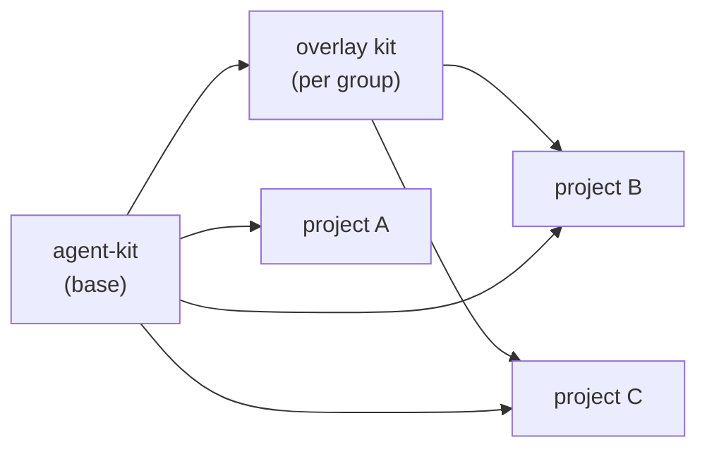
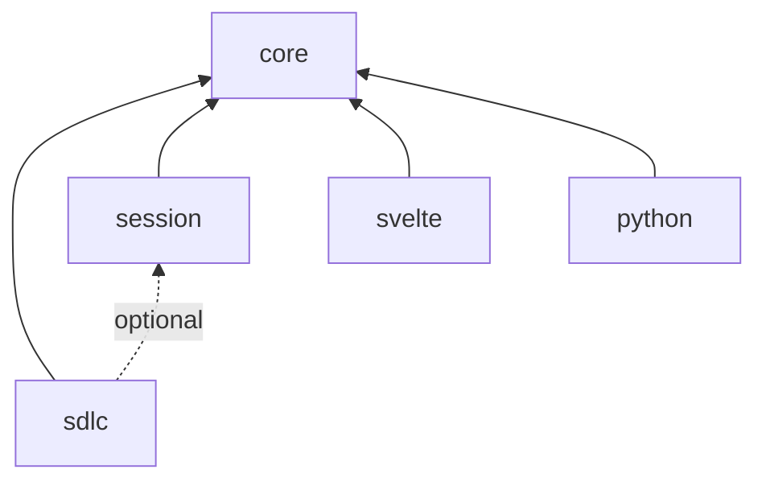
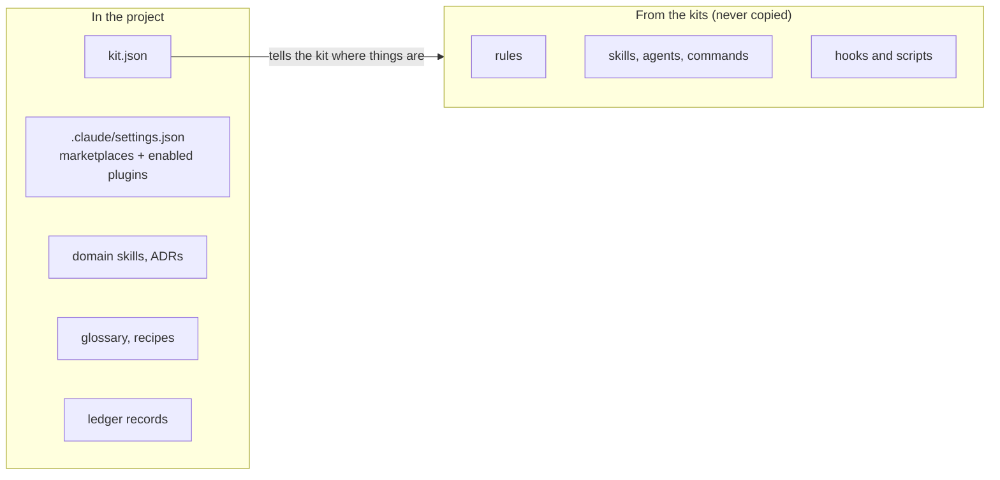
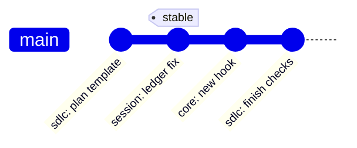

# Architecture

**English** · [Українська](architecture.uk.md)

## Layers



A project enables the base kit directly, and an overlay kit if it belongs to a group. An overlay
never copies base plugins: it declares a dependency on them.

## Plugin dependencies



| ID | Plugin | Contains |
| --- | --- | --- |
| 1 | `core` | Always-on rules, `check-runner` and `repo-sweep` agents, edit and shell hooks, `kit doctor` _(planned)_, `/kit-inventory` _(planned)_, `/kit-adopt` _(planned)_ |
| 2 | `sdlc` | Five `/sdlc-*` skills, `sdlc-simplifier` and `sdlc-verifier` agents |
| 3 | `session` | Ledger hooks and scripts, `/handoff`, `/close-out`, `/close-siblings`, `/git` with the `git-ops` agent, worktree set-up and landing |
| 4 | `svelte` | Svelte 5 conventions |
| 5 | `python` | Python conventions |

## What a project keeps



The glossary (domain terms) and the recipes (step-by-step guides for recurring tasks) describe
the project's own domain, so they stay in the project. The kit knows where they are from
`kit.json`: the SDLC skills read the glossary when a work item touches domain terms and offer a
matching recipe when planning. An overlay kit can add recipes and terms shared by its group.

## kit.json

The kit never hard-codes a project's layout. `kit.json` at the repo root names the paths and
commands the plugins use. Draft v1; the final shape lives in `schema/kit.schema.json`
_(planned)_.

```json
{
  "$schema": "https://raw.githubusercontent.com/3meyc/agent-kit/stable/schema/kit.schema.json",
  "project": "my-app",
  "baseBranch": "main",
  "itemPrefix": "APP",
  "ledger": true,
  "paths": {
    "docs": "docs",
    "decisions": "docs/decisions",
    "sdlc": "docs/sdlc",
    "glossary": "docs/glossary.md",
    "recipes": "docs/recipes",
    "ledger": ".claude/ledger"
  },
  "commands": {
    "check": "pnpm run check",
    "test": "pnpm test",
    "build": "pnpm run build"
  },
  "devServer": { "port": 5173 }
}
```

## Release channels



| ID | Channel | Ref | Who uses it |
| --- | --- | --- | --- |
| 1 | latest | `main` | One pilot project, and anyone testing a change |
| 2 | stable | `stable` tag | Everyone else, and every overlay kit |

Plugins carry no `version` field, so each commit a ref points at counts as a new version. Moving
`stable` forward is the release; moving it back is the rollback.
