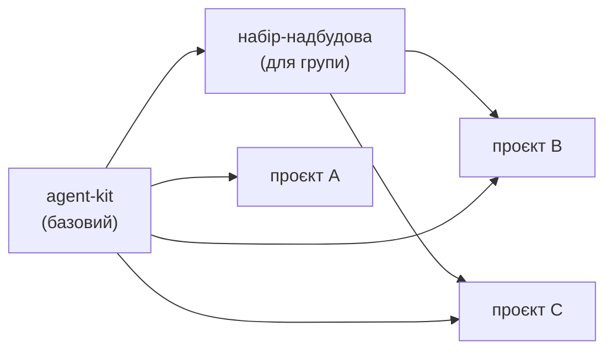
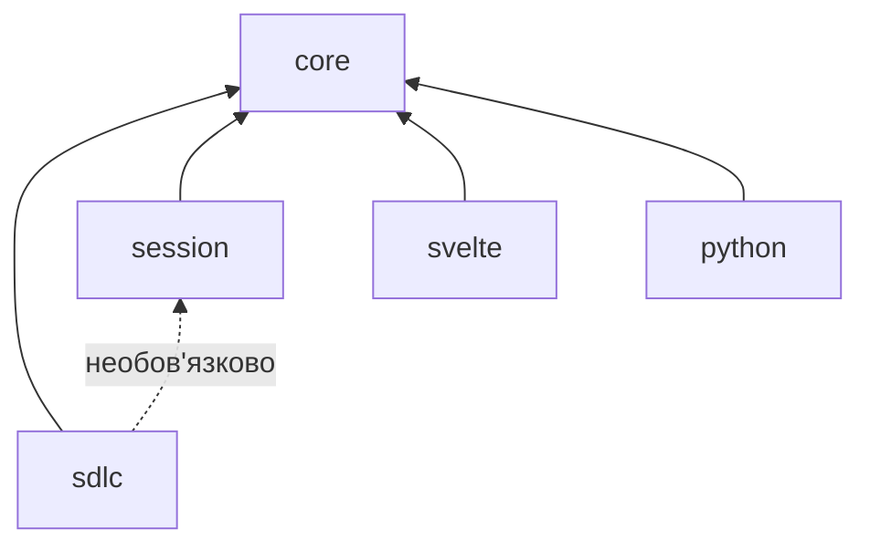
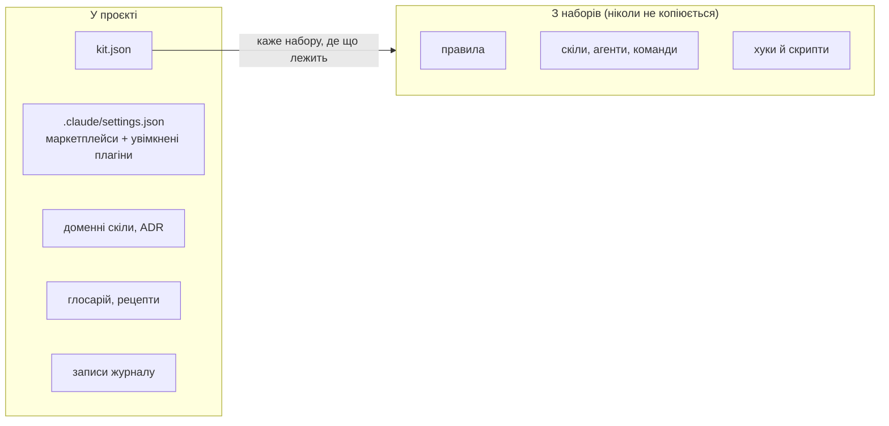
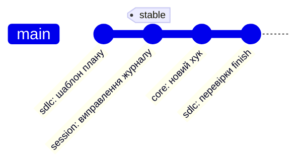

# Архітектура

[English](architecture.md) · **Українська**

## Шари



Проєкт вмикає базовий набір напряму, а якщо належить до групи — ще й набір-надбудову.
Надбудова ніколи не копіює базові плагіни: вона оголошує залежність від них.

## Залежності плагінів



| ID | Плагін | Містить |
| --- | --- | --- |
| 1 | `core` | Постійні правила, агенти `check-runner` і `repo-sweep`, хуки редагування й оболонки, `kit doctor`, `/kit-inventory`, `/kit-adopt`, перевірка парності документації |
| 2 | `sdlc` | П'ять скілів `/sdlc-*`, агенти `sdlc-simplifier` і `sdlc-verifier` |
| 3 | `session` | Хуки й скрипти журналу сесій, `/handoff`, `/close-out`, `/close-siblings`, `/git` з агентом `git-ops`, підготовка й злиття worktree, сторінки `evolution` |
| 4 | `svelte` | Домовленості для Svelte 5 |
| 5 | `python` | Домовленості для Python |

## Що лишається в проєкті



Глосарій (доменні терміни) і рецепти (покрокові інструкції для повторюваних задач) описують
домен самого проєкту, тож вони лишаються в проєкті. Набір знаходить їх через `kit.json`: скіли
SDLC читають глосарій, коли робочий елемент зачіпає доменні терміни, і пропонують відповідний
рецепт під час планування. Набір-надбудова може додати рецепти й терміни, спільні для своєї групи.

## kit.json

Набір ніколи не прописує структуру проєкту жорстко. `kit.json` у корені репозиторію називає
шляхи й команди, якими користуються плагіни. Це чернетка v1; остаточну форму задає
`schema/kit.schema.json`.

```json
{
  "$schema": "https://raw.githubusercontent.com/3meyc/agent-kit/stable/schema/kit.schema.json",
  "project": "my-app",
  "baseBranch": "dev",
  "itemPrefix": "APP",
  "ledger": true,
  "paths": {
    "docs": "docs",
    "decisions": "docs/decisions",
    "sdlc": "docs/sdlc",
    "glossary": "docs/glossary.md",
    "recipes": "docs/recipes",
    "ledger": ".claude/ledger",
    "evolution": "docs/evolution"
  },
  "commands": {
    "install": "pnpm install --frozen-lockfile",
    "dev": "pnpm run dev",
    "check": "pnpm run check",
    "test": "pnpm test",
    "build": "pnpm run build",
    "commitAudit": "npx some-audit --base HEAD~1 --only {files}"
  },
  "lintOnEdit": [
    { "command": "pnpm exec eslint --no-warn-ignored {file}", "match": ["*.ts", "*.svelte"] },
    { "command": "pnpm run i18n:check", "match": ["src/locales/*.json"] }
  ],
  "checks": { "i18n": ["pnpm run i18n:check", "pnpm run i18n:parity"] },
  "preflight": { "docs-review": { "description": "Docs review skill", "match": ["docs/**"], "remindAfter": 3 } },
  "hooks": { "off": ["ledger-stop"] },
  "devServer": { "port": 5173 }
}
```

`commands.commitAudit` запускається після кожного коміту з кодом, тож скрипт коміту не називає
конкретного інструмента; `{files}` у ній стає закоміченими шляхами (вони також є в
`KIT_COMMIT_PATHS`), тож аудит може показати лише те, що зачепив коміт. `commands.install` готує
новий worktree (без нього `session` вгадує pnpm чи npm за lock-файлом), а `commands.dev` запускає
dev-сервер там, де немає панелі Browser настільного застосунку. `lintOnEdit` перевіряє лінтером
кожен змінений файл: одне правило або список правил, кожне з командою, де `{file}` — шлях відносно
репозиторію в лапках, і шаблонами `match`, що вибирають її файли; запускається кожне правило, що
збіглося. `checks` називає набори команд для `/core:check <набір>`, а `preflight` — необов'язкові
кроки, пропущені коміти яких рахує `session`. `hooks.off` перелічує хуки набору, які цей проєкт
пропускає: плагін не можна вимкнути по одному хуку, тож кожен хук набору читає цей список і тихо
завершується, якщо його названо.

Усі плагіни читають `kit.json` одним модулем, `shared/kit-config.mjs`, скопійованим у `lib/`
кожного плагіна: він підставляє типові значення зі схеми й відповідає на `hooks.off`.

## Канали релізів



| ID | Канал | Посилання | Хто користується |
| --- | --- | --- | --- |
| 1 | latest | `main` | Один пілотний проєкт і кожен, хто перевіряє зміну |
| 2 | stable | тег `stable` | Усі інші та кожен набір-надбудова |

Плагіни не мають поля `version`, тож кожен коміт, на який указує посилання, вважається новою
версією. Перенесення `stable` уперед — це реліз; перенесення назад — відкат.
