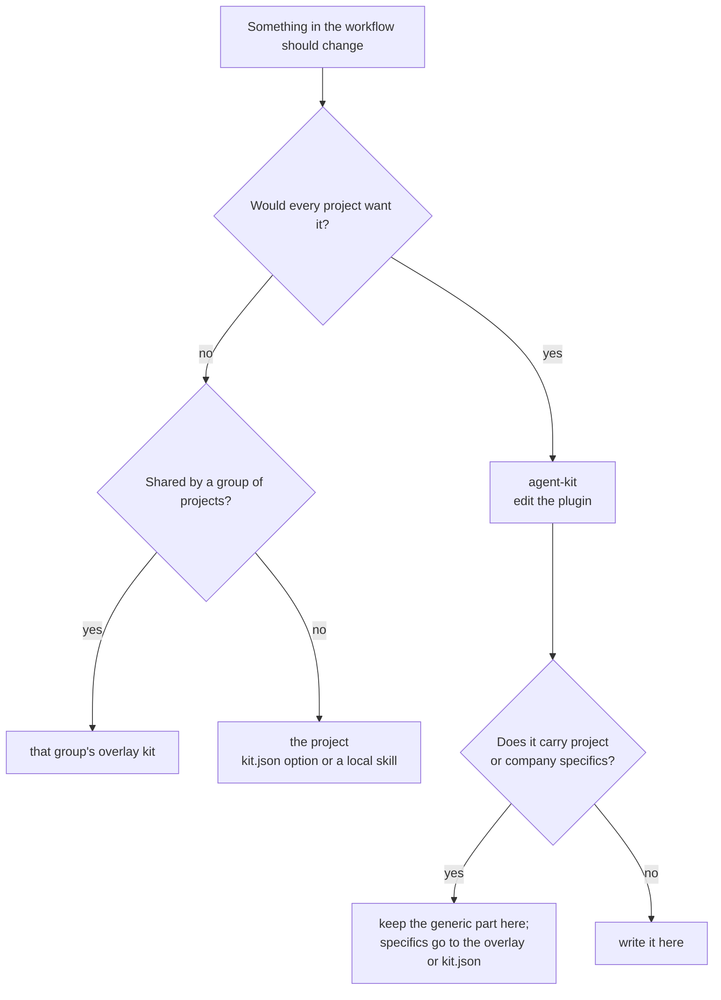
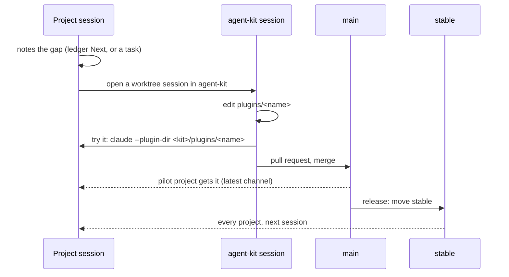

# Changing the kit

**English** · [Українська](changing.uk.md)

You are working in a project and an SDLC skill, a hook or a rule needs to change. This page is
where the change goes, how to try it, and how it reaches every project.

## The one rule

**Never fix a kit file inside a project.** Installed plugins live in Claude Code's plugin cache
and are overwritten on the next update; a copy in the project shadows the kit and starts drift.

## Where does the change go?

## The flow

1. **Note it.** In the project session, record the gap and carry on with the current behaviour.
   Don't patch locally to unblock yourself.
2. **Open a session in agent-kit** (its own worktree). Edit the plugin under `plugins/<name>/`.
3. **Try it from the project.** Start Claude in the project with the local plugin loaded:
   `claude --plugin-dir ~/path/to/agent-kit/plugins/sdlc` _(unverified: that it overrides the
   installed copy of the same name)_.
4. **Merge** through a pull request. The naming check in CI must pass (see below).
5. **Release** by moving `stable` to the merged commit and adding a line to
   [CHANGELOG.md](../CHANGELOG.md). A release script _(planned)_ does both.
6. **Roll back** by moving `stable` back to the previous release.

## Common cases

| ID | Case | Do |
| --- | --- | --- |
| 1 | A step in `/sdlc-plan` is missing or wrong | Flow above, plugin `sdlc` |
| 2 | Only one project needs a different path or command | Change that project's `kit.json` |
| 3 | A project needs an extra step the others don't | A local skill in the project; propose a `kit.json` option if a second project needs it |
| 4 | Urgent fix during a release | Flow above, then release at once; roll back if it misbehaves |
| 5 | Change found while working on private code | Write the generic part here; names, links and domain detail stay in the private overlay |

## Recipes and glossary: rules for agents

A recipe is a step-by-step guide for a recurring task; the glossary defines domain terms. Both
live where `kit.json` points (`paths.recipes`, `paths.glossary`). An overlay kit may add shared
ones. Agents follow these rules; the `sdlc` skills apply them during planning and finishing.

1. **Look first.** Before planning, check the project's recipe index for a matching recipe. The
   index lists the project's own recipes and any an overlay kit supplies.
2. **Fix what you followed.** If a recipe was wrong or missed a step, correct it in the same
   change. A recipe that comes from a kit is not edited in the project: record the fix in the
   ledger `## Next` and make it in that kit.
3. **Write the missing one.** When a task is likely to recur and has no recipe, add one to the
   project and to its index in the same change.
4. **Promote, don't copy.** When a second project needs the same recipe or term, move it to the
   shared overlay kit and replace the project copies with index links.
5. **Keep terms current.** A new or renamed domain term, enum value or identifier updates the
   glossary in the same change.
6. **Check.** Run the project's documentation check after editing either.

## Keeping this repo neutral

This repo is public. Plugin text, examples, docs, commits and issues carry no names, links or
notes from private projects or employers. Examples use neutral names (`my-app`, `APP-123`).
A naming check in CI (`scripts/naming-guard.mjs`) rejects a change that does.
