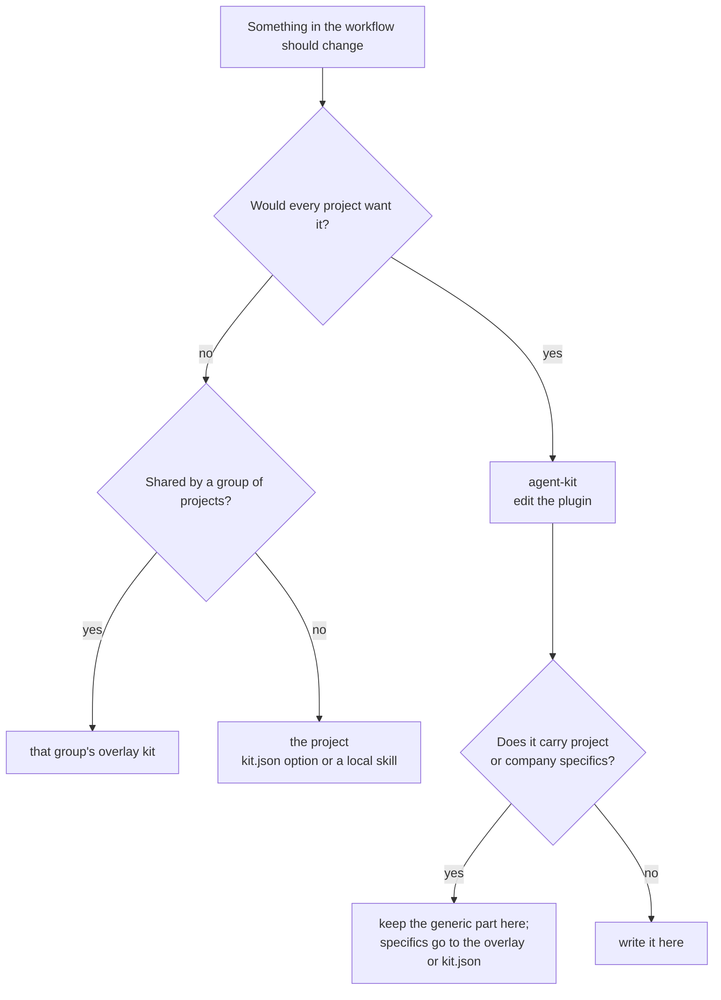
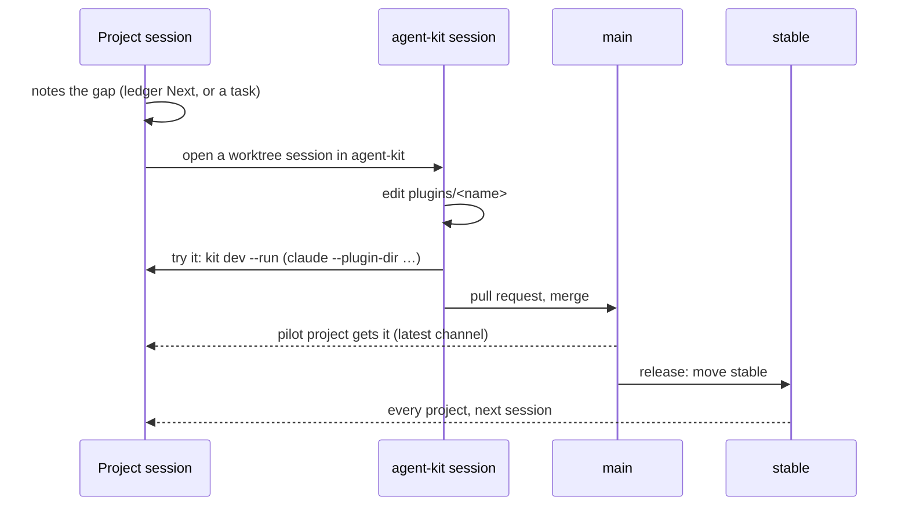

# Changing the kit

**English** · [Українська](changing.uk.md)

You are working in a project and an SDLC skill, a hook or a rule needs to change. This page is
where the change goes, how to try it, and how it reaches every project.

## The one rule

**Never fix a kit file inside a project.** Installed plugins live in Claude Code's plugin cache
and are overwritten on the next update; a copy in the project shadows the kit and starts drift.

## Where does the change go?



## The flow



1. **Note it.** In the project session, record the gap and carry on with the current behaviour.
   Don't patch locally to unblock yourself.
2. **Open a session in agent-kit** (its own worktree). Edit the plugin under `plugins/<name>/`.
   The kit's repo keeps no `.claude/settings.json`: `kit doctor` reads its
   `.claude-plugin/marketplace.json` and treats that marketplace and its plugins as the repo's
   own, so it asks neither to declare nor to enable them, and does not take the repo's tests for
   tests of kit-owned scripts.
3. **Try it from the project.** Run `kit dev` in the project ([using](using.md) § 7): it prints
   the `claude --plugin-dir …` command that loads every plugin the project enables from your local
   kit checkouts, base kit and overlays alike, with their dependencies, and `--run` starts it.
   Point it at the worktree you edit with `--checkout agent-kit=<path>`. A `--plugin-dir` copy
   replaces the installed plugin of the same name for that session, silently (Claude Code's plugin
   loading reference, Name conflicts), so check in that session that `/core:kit-doctor` lists it
   as loaded with `--plugin-dir`.
4. **Merge** through a pull request. The naming check in CI must pass (see below).
5. **Release** with `kit release` (next section): it moves the `## Unreleased` lines of
   [CHANGELOG.md](../CHANGELOG.md) under a dated entry, commits, and moves `stable` to that commit.
6. **Roll back** by moving `stable` back to the previous release.

## Releasing

`kit release` (core plugin) cuts a release of a kit repo in one checked step. Run it in the kit's
checkout, on `main`, after the work is merged and pulled:

```bash
kit release --summary "<one line on what this release changes>"
```

Without `--yes` it is a dry run: it runs every check and prints each step it would take. Run it
again with `--yes` and the same arguments to release. Outside Claude Code, where `kit` is not on
the PATH, `agent-kit release …` (the root package) or `node <agent-kit>/plugins/core/src/kit-cli.mjs
release …` runs the same command.

| ID | Step | Refuses when |
| --- | --- | --- |
| 1 | Tree | Not on the release branch; uncommitted or untracked files; `HEAD` ahead of or behind the remote branch |
| 2 | Tag on the remote | `stable` already points at `HEAD`, or at a commit outside the branch's history |
| 3 | Notes | `## Unreleased` is missing or empty; a release table has no summary for its new row; the notes files disagree on the release number |
| 4 | Evolution pages (when kept) | Never: it names a page in `paths.evolution` not changed since `stable`, to bring up to date first (`evolution status --since-release`, the `evolution` skill) |
| 5 | Base kit (overlay only) | The base kit's `stable` does not contain `release.base.needs` |
| 6 | Check | No check is set, or it fails. The dry run checks the tree as it is; `--yes` checks the written notes and puts them back on a failure |
| 7 | Commit and push | Commits only the notes as `chore(release): <nth> stable release` and pushes the branch, never forced |
| 8 | Move the tag | `git tag -fa stable -m "<date>: <nth> release"`, then `git push origin +refs/tags/stable`: the one forced push |
| 9 | Confirm | Reads the remote back: `stable^{}` and the branch must both name the release commit |

The release number is the count of existing entries plus one (dated `## YYYY-MM-DD` headings of a
changelog, or the last id of a release table), written as a word (`ninth`); the date is today's.
In a changelog, `--summary` follows the line "`stable` points at the commit that adds this entry."
and may be left out; a release table needs it, and a file with `lang` takes `--summary-<lang>`.

`kit.json` `release` sets the rest; every field is optional:

| ID | Field | Default | Meaning |
| --- | --- | --- | --- |
| 1 | `notes` | `["CHANGELOG.md"]` | Files that record releases, cut in one commit. A string is a changelog; `{ "path", "format": "table", "lang" }` is a release table: the file's last table gets a row like the one before it, with the id counted up, today's date and the summary in the last cell |
| 2 | `check` | `commands.check` | The command that must pass on the written notes |
| 3 | `branch`, `remote`, `tag` | `baseBranch`, `origin`, `stable` | What is released, where, under which tag |
| 4 | `base` | none | For an overlay: `{ "repo": "<git URL>", "needs": "ninth" }`. `needs` is a base release number or ordinal word (matched against the base's `chore(release): <nth> stable release` commits) or a commit; raise it when the overlay starts to use something newer |

An overlay that records its releases in a table and its Ukrainian mirror:

```json
{
  "release": {
    "notes": [
      { "path": "docs/evolution.md", "format": "table" },
      { "path": "docs/evolution.uk.md", "format": "table", "lang": "uk" }
    ],
    "base": { "repo": "https://github.com/owner/agent-kit.git", "needs": "ninth" }
  }
}
```

A push that fails leaves the release commit local and the tag unmoved; a tag push that fails
leaves the branch released and says how to move the tag by hand. Rolling back stays a manual tag
move.

## Common cases

| ID | Case | Do |
| --- | --- | --- |
| 1 | A step in `/sdlc-plan` is missing or wrong | Flow above, plugin `sdlc` |
| 2 | Only one project needs a different path or command | Change that project's `kit.json` |
| 3 | A project needs an extra step the others don't | A local skill in the project; propose a `kit.json` option if a second project needs it |
| 4 | Urgent fix during a release | Flow above, then release at once; roll back if it misbehaves |
| 5 | Change found while working on private code | Write the generic part here; names, links and domain detail stay in the private overlay |

## Recipes and glossary: rules for agents

A recipe is a step-by-step guide for a recurring task; the glossary defines domain terms. Both
live where `kit.json` points (`paths.recipes`, `paths.glossary`). An overlay kit may add shared
ones. Agents follow these rules; the `sdlc` skills apply them during planning and finishing.

1. **Look first.** Before planning, check the project's recipe index for a matching recipe. The
   index lists the project's own recipes and any an overlay kit supplies.
2. **Fix what you followed.** If a recipe was wrong or missed a step, correct it in the same
   change. A recipe that comes from a kit is not edited in the project: record the fix in the
   ledger `## Next` and make it in that kit.
3. **Write the missing one.** When a task is likely to recur and has no recipe, add one to the
   project and to its index in the same change.
4. **Promote, don't copy.** When a second project needs the same recipe or term, move it to the
   shared overlay kit and replace the project copies with index links.
5. **Keep terms current.** A new or renamed domain term, enum value or identifier updates the
   glossary in the same change.
6. **Check.** Run the project's documentation check after editing either.

## Keeping this repo neutral

This repo is public. Plugin text, examples, docs, commits and issues carry no names, links or
notes from private projects or employers. Examples use neutral names (`my-app`, `APP-123`).
A naming check in CI (`scripts/naming-guard.mjs`) rejects a change that does.
