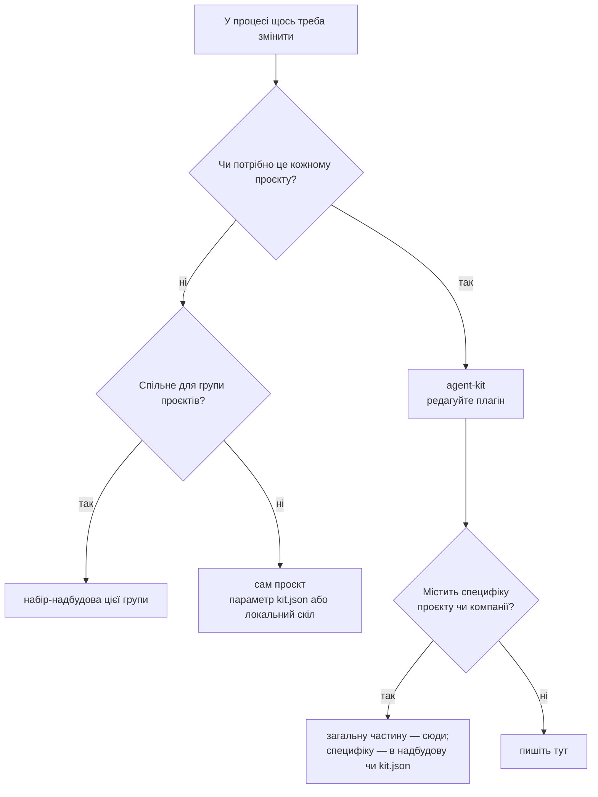
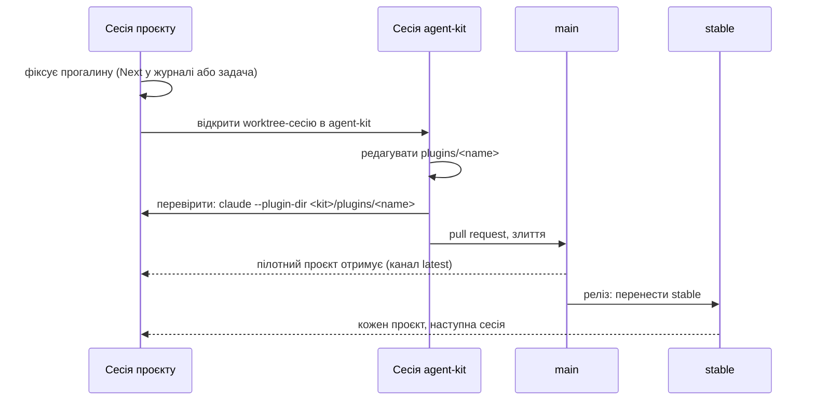

# Зміни в наборі

[English](changing.md) · **Українська**

Ви працюєте над проєктом, і скіл SDLC, хук чи правило потрібно змінити. Тут описано, куди йде
зміна, як її перевірити і як вона доходить до кожного проєкту.

## Головне правило

**Ніколи не виправляйте файл набору всередині проєкту.** Встановлені плагіни лежать у кеші
плагінів Claude Code і перезаписуються з наступним оновленням; копія в проєкті затуляє набір і
запускає розбіжність.

## Куди йде зміна?

## Процес

1. **Зафіксуйте.** У сесії проєкту запишіть прогалину й працюйте далі з поточною поведінкою.
   Не латайте локально, щоб розблокуватися.
2. **Відкрийте сесію в agent-kit** (окремий worktree). Редагуйте плагін у `plugins/<name>/`.
3. **Перевірте з проєкту.** Запустіть Claude у проєкті з локальним плагіном:
   `claude --plugin-dir ~/path/to/agent-kit/plugins/sdlc` _(не перевірено: чи це перекриває
   встановлену копію з тією самою назвою)_.
4. **Злийте** через pull request. Перевірка назв у CI має пройти (див. нижче).
5. **Випустіть**: перенесіть `stable` на злитий коміт і додайте рядок у
   [CHANGELOG.md](../CHANGELOG.md). Обидва кроки робить скрипт релізу _(заплановано)_.
6. **Відкотіть**, перенісши `stable` назад на попередній реліз.

## Типові випадки

| ID | Випадок | Що робити |
| --- | --- | --- |
| 1 | У `/sdlc-plan` бракує кроку або він хибний | Процес вище, плагін `sdlc` |
| 2 | Лише одному проєкту потрібен інший шлях чи команда | Змініть `kit.json` цього проєкту |
| 3 | Проєкту потрібен додатковий крок, якого не треба іншим | Локальний скіл у проєкті; запропонуйте параметр `kit.json`, коли знадобиться другому проєкту |
| 4 | Термінове виправлення під час релізу | Процес вище, одразу реліз; відкат, якщо поводиться погано |
| 5 | Зміна знайдена під час роботи з приватним кодом | Загальну частину — сюди; назви, посилання й доменні деталі лишаються в приватній надбудові |

## Рецепти й глосарій: правила для агентів

Рецепт — покрокова інструкція для повторюваної задачі; глосарій визначає доменні терміни. Обидва
лежать там, куди вказує `kit.json` (`paths.recipes`, `paths.glossary`). Набір-надбудова може
додати спільні. Агенти дотримуються цих правил; скіли `sdlc` застосовують їх під час планування
й завершення.

1. **Спершу пошукайте.** Перед плануванням перевірте індекс рецептів проєкту. Індекс перелічує
   власні рецепти проєкту й ті, що дає набір-надбудова.
2. **Виправте те, за чим ішли.** Якщо рецепт хибний або пропускає крок, виправте його в тій самій
   зміні. Рецепт із набору в проєкті не редагують: запишіть виправлення в `## Next` журналу й
   зробіть його в тому наборі.
3. **Напишіть відсутній.** Коли задача, ймовірно, повторюватиметься, а рецепта немає, додайте
   його в проєкт і в індекс у тій самій зміні.
4. **Переносьте, не копіюйте.** Коли той самий рецепт чи термін потрібен другому проєкту,
   перенесіть його в спільний набір-надбудову, а копії в проєктах замініть посиланнями в індексі.
5. **Тримайте терміни актуальними.** Новий чи перейменований доменний термін, значення enum або
   ідентифікатор оновлює глосарій у тій самій зміні.
6. **Перевірте.** Після редагування запустіть перевірку документації проєкту.

## Нейтральність репозиторію

Цей репозиторій публічний. Текст плагінів, приклади, документація, коміти й issues не містять
назв, посилань чи нотаток з приватних проєктів або від роботодавців. Приклади використовують
нейтральні назви (`my-app`, `APP-123`). Перевірка назв у CI _(заплановано)_ відхиляє зміну,
яка це порушує.
