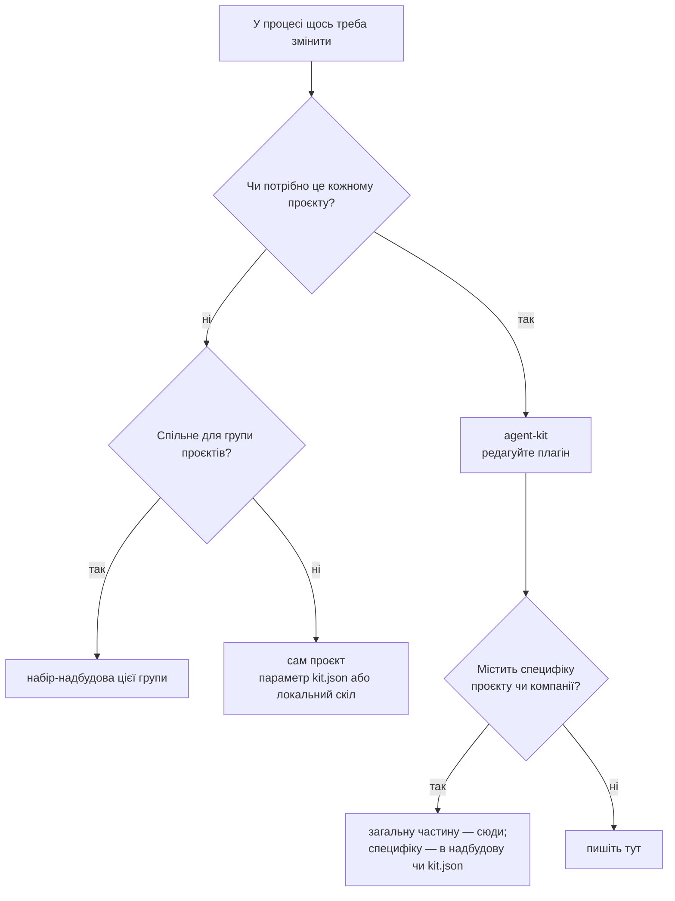
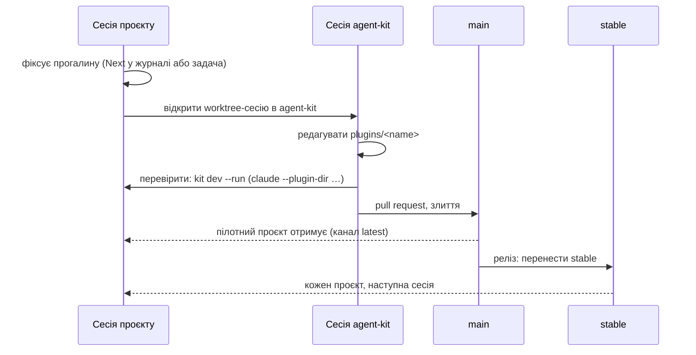

# Зміни в наборі

[English](changing.md) · **Українська**

Ви працюєте над проєктом, і скіл SDLC, хук чи правило потрібно змінити. Тут описано, куди йде
зміна, як її перевірити і як вона доходить до кожного проєкту.

## Головне правило

**Ніколи не виправляйте файл набору всередині проєкту.** Встановлені плагіни лежать у кеші
плагінів Claude Code і перезаписуються з наступним оновленням; копія в проєкті затуляє набір і
запускає розбіжність.

## Куди йде зміна?



## Процес



1. **Зафіксуйте.** У сесії проєкту запишіть прогалину й працюйте далі з поточною поведінкою.
   Не латайте локально, щоб розблокуватися.
2. **Відкрийте сесію в agent-kit** (окремий worktree). Редагуйте плагін у `plugins/<name>/`.
   Репозиторій кіта не має `.claude/settings.json`: `kit doctor` читає його
   `.claude-plugin/marketplace.json` і вважає цей marketplace та його плагіни власними для
   репозиторію, тож не вимагає ні оголошувати, ні вмикати їх і не вважає тести репозиторію
   тестами скриптів, якими володіє кіт.
3. **Перевірте з проєкту.** Запустіть у проєкті `kit dev` ([використання](using.uk.md) § 7): він
   друкує команду `claude --plugin-dir …`, що завантажує кожен увімкнений у проєкті плагін із
   ваших локальних копій наборів, базового й надбудов, разом із їхніми залежностями, а `--run`
   її запускає. Вкажіть worktree, який редагуєте: `--checkout agent-kit=<path>`. Копія з
   `--plugin-dir` на цю сесію мовчки заміняє встановлений плагін із тією самою назвою (довідник
   Claude Code про завантаження плагінів, Name conflicts), тож перевірте в цій сесії, що
   `/core:kit-doctor` показує його як завантажений з `--plugin-dir`.
4. **Злийте** через pull request. Перевірка назв у CI має пройти (див. нижче).
5. **Випустіть** командою `kit release` (наступний розділ): вона переносить рядки `## Unreleased`
   з [CHANGELOG.md](../CHANGELOG.md) під датований запис, комітить і переносить `stable` на цей коміт.
6. **Відкотіть**, перенісши `stable` назад на попередній реліз.

## Випуск

`kit release` (плагін core) випускає реліз репозиторію набору одним перевіреним кроком. Запускайте
її в робочій копії набору, на `main`, коли роботу злито й підтягнуто:

```bash
kit release --summary "<one line on what this release changes>"
```

Без `--yes` це пробний запуск: команда виконує всі перевірки й друкує кожен крок, який зробила б.
Запустіть її ще раз із `--yes` і тими самими аргументами, щоб випустити реліз. Поза Claude Code, де
`kit` немає в PATH, ту саму команду виконує `agent-kit release …` (кореневий пакет) або
`node <agent-kit>/plugins/core/src/kit-cli.mjs release …`.

| ID | Крок | Відмовляє, коли |
| --- | --- | --- |
| 1 | Робоча копія | Не на гілці релізу; є незакомічені чи невідстежувані файли; `HEAD` попереду або позаду віддаленої гілки |
| 2 | Тег на віддаленому | `stable` уже вказує на `HEAD` або на коміт поза історією гілки |
| 3 | Нотатки | `## Unreleased` немає або він порожній; для нового рядка таблиці релізів немає підсумку; файли нотаток не згодні щодо номера релізу |
| 4 | Сторінки еволюції (якщо є) | Ніколи: називає сторінку в `paths.evolution`, не змінену від `stable`, щоб її спершу оновили (`evolution status --since-release`, скіл `evolution`) |
| 5 | Базовий набір (лише надбудова) | `stable` базового набору не містить `release.base.needs` |
| 6 | Перевірка | Перевірку не задано, або вона падає. Пробний запуск перевіряє робочу копію як є; `--yes` перевіряє записані нотатки й повертає їх назад, якщо перевірка впала |
| 7 | Коміт і push | Комітить лише нотатки як `chore(release): <nth> stable release` і пушить гілку, ніколи примусово |
| 8 | Перенесення тегу | `git tag -fa stable -m "<date>: <nth> release"`, потім `git push origin +refs/tags/stable`: єдиний примусовий push |
| 9 | Підтвердження | Перечитує віддалений: `stable^{}` і гілка мають обидва вказувати на коміт релізу |

Номер релізу — кількість наявних записів плюс один (датовані заголовки `## YYYY-MM-DD` у changelog
або останній id таблиці релізів), записаний англійським словом (`ninth`); дата — сьогоднішня. У
changelog `--summary` іде після рядка "`stable` points at the commit that adds this entry." і його
можна пропустити; таблиці релізів він потрібен, а файл із `lang` бере `--summary-<lang>`.

Решту задає `release` у `kit.json`; кожне поле необов'язкове:

| ID | Поле | За замовчуванням | Значення |
| --- | --- | --- | --- |
| 1 | `notes` | `["CHANGELOG.md"]` | Файли, що записують релізи, змінюються одним комітом. Рядок — це changelog; `{ "path", "format": "table", "lang" }` — таблиця релізів: остання таблиця файлу отримує рядок, як попередній, з id на один більшим, сьогоднішньою датою й підсумком в останній клітинці |
| 2 | `check` | `commands.check` | Команда, що має пройти на записаних нотатках |
| 3 | `branch`, `remote`, `tag` | `baseBranch`, `origin`, `stable` | Що випускається, куди і під яким тегом |
| 4 | `base` | немає | Для надбудови: `{ "repo": "<git URL>", "needs": "ninth" }`. `needs` — номер релізу базового набору або порядкове слово (звіряється з комітами бази `chore(release): <nth> stable release`) чи коміт; підніміть його, коли надбудова починає користуватися чимось новішим |

Надбудова, що записує релізи в таблицю та її українське дзеркало:

```json
{
  "release": {
    "notes": [
      { "path": "docs/evolution.md", "format": "table" },
      { "path": "docs/evolution.uk.md", "format": "table", "lang": "uk" }
    ],
    "base": { "repo": "https://github.com/owner/agent-kit.git", "needs": "ninth" }
  }
}
```

Якщо push не вдався, коміт релізу лишається локальним, а тег не переноситься; якщо не вдався push
тегу, гілка вже випущена, і команда каже, як перенести тег вручну. Відкат лишається ручним
перенесенням тегу.

## Типові випадки

| ID | Випадок | Що робити |
| --- | --- | --- |
| 1 | У `/sdlc-plan` бракує кроку або він хибний | Процес вище, плагін `sdlc` |
| 2 | Лише одному проєкту потрібен інший шлях чи команда | Змініть `kit.json` цього проєкту |
| 3 | Проєкту потрібен додатковий крок, якого не треба іншим | Локальний скіл у проєкті; запропонуйте параметр `kit.json`, коли знадобиться другому проєкту |
| 4 | Термінове виправлення під час релізу | Процес вище, одразу реліз; відкат, якщо поводиться погано |
| 5 | Зміна знайдена під час роботи з приватним кодом | Загальну частину — сюди; назви, посилання й доменні деталі лишаються в приватній надбудові |

## Рецепти й глосарій: правила для агентів

Рецепт — покрокова інструкція для повторюваної задачі; глосарій визначає доменні терміни. Обидва
лежать там, куди вказує `kit.json` (`paths.recipes`, `paths.glossary`). Набір-надбудова може
додати спільні. Агенти дотримуються цих правил; скіли `sdlc` застосовують їх під час планування
й завершення.

1. **Спершу пошукайте.** Перед плануванням перевірте індекс рецептів проєкту. Індекс перелічує
   власні рецепти проєкту й ті, що дає набір-надбудова.
2. **Виправте те, за чим ішли.** Якщо рецепт хибний або пропускає крок, виправте його в тій самій
   зміні. Рецепт із набору в проєкті не редагують: запишіть виправлення в `## Next` журналу й
   зробіть його в тому наборі.
3. **Напишіть відсутній.** Коли задача, ймовірно, повторюватиметься, а рецепта немає, додайте
   його в проєкт і в індекс у тій самій зміні.
4. **Переносьте, не копіюйте.** Коли той самий рецепт чи термін потрібен другому проєкту,
   перенесіть його в спільний набір-надбудову, а копії в проєктах замініть посиланнями в індексі.
5. **Тримайте терміни актуальними.** Новий чи перейменований доменний термін, значення enum або
   ідентифікатор оновлює глосарій у тій самій зміні.
6. **Перевірте.** Після редагування запустіть перевірку документації проєкту.

## Нейтральність репозиторію

Цей репозиторій публічний. Текст плагінів, приклади, документація, коміти й issues не містять
назв, посилань чи нотаток з приватних проєктів або від роботодавців. Приклади використовують
нейтральні назви (`my-app`, `APP-123`). Перевірка назв у CI (`scripts/naming-guard.mjs`) відхиляє зміну,
яка це порушує.
