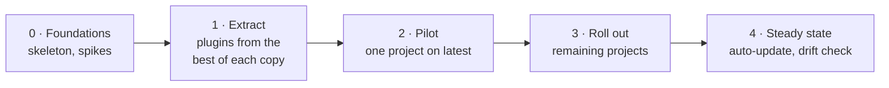

# Evolution

**English** · [Українська](evolution.uk.md)

## Why

The SDLC flow, the session ledger and the hooks started as files copied into each project. Each
copy improved on its own, so after a few months no two projects had the same version, and a fix
made in one never reached the others. The kit makes one copy the source and installs it
everywhere.

## Milestones

| ID | Milestone | Done when | Status |
| --- | --- | --- | --- |
| 0 | Foundations | Plugin behaviours confirmed (rules from hooks, cross-marketplace dependencies, local plugin override, auto-update on a moved tag) | Started 2026-11-09 |
| 1 | Extract | All five plugins load in a scratch project | — |
| 2 | Pilot | A full SDLC item runs on the kit with no local overrides; first `stable` | — |
| 3 | Roll out | No project carries a copy of a kit file | — |
| 4 | Steady state | Auto-update on; drift check in CI | — |

## Design decisions

| ID | Decision | Why |
| --- | --- | --- |
| 1 | Plugins, not a template repo | A template copies once and drifts; a plugin updates in place |
| 2 | No `version` field; the `stable` tag is the release | Every tag move is picked up with no version bookkeeping |
| 3 | `kit.json` instead of hard-coded paths | Projects lay out docs and ledgers differently |
| 4 | Ledger is opt-in (`ledger: true`) | Small projects don't need it; groups can require it in their overlay |
| 5 | Overlays depend on the base, never copy it | One source for shared parts |

## Releases

See [CHANGELOG.md](../CHANGELOG.md).
