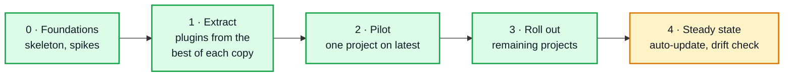

# Evolution

**English** · [Українська](evolution.uk.md)

## Why

The SDLC flow, the session ledger and the hooks started as files copied into each project. Each
copy improved on its own, so after a few months no two projects had the same version, and a fix
made in one never reached the others. The kit makes one copy the source and installs it
everywhere.

## Milestones

- Green: done
- Amber: still open

| ID | Milestone | Done when | Status |
| --- | --- | --- | --- |
| 0 | Foundations | Plugin behaviours confirmed (rules from hooks, cross-marketplace dependencies, local plugin override, auto-update on a moved tag) | Done 2026-11-09 |
| 1 | Extract | All five plugins load in a scratch project | Done 2026-11-09 |
| 2 | Pilot | A full SDLC item runs on the kit with no local overrides; first `stable` | Done 2026-11-10 |
| 3 | Roll out | No project carries a copy of a kit file | Done 2026-11-10 |
| 4 | Steady state | Auto-update on; drift check in CI | — |

## Design decisions

| ID | Decision | Why |
| --- | --- | --- |
| 1 | Plugins, not a template repo | A template copies once and drifts; a plugin updates in place |
| 2 | No `version` field; the `stable` tag is the release | Every tag move is picked up with no version bookkeeping |
| 3 | `kit.json` instead of hard-coded paths | Projects lay out docs and ledgers differently |
| 4 | Ledger is opt-in (`ledger: true`) | Small projects don't need it; groups can require it in their overlay |
| 5 | Overlays depend on the base, never copy it | One source for shared parts |
| 6 | Follow-ups are triaged against a charter into one backlog, not carded one session each | Sub-sessions spawned sub-sessions four levels deep, and deferred work scattered across hundreds of ledger records with no point where anyone asked whether it was needed |
| 7 | Chat answers draw Mermaid diagrams (colour groups, a numbered legend) and mark status with text symbols, not emoji | The desktop app's Code tab draws a diagram while a terminal shows its source, so both must read; emoji draw differently from system to system. The rule stays one line each and the detail lives in the `diagrams` skill, since the always-on rules are near their SessionStart budget |
| 8 | Triage gains an **Open** verdict, and its rows go in verdict order | Keep and Drop both mark the item done, so a check only the user can make by hand (on screen, behind a sign-in) left the inbox unchecked |
| 9 | UI polish runs one sub-session per area, its brief filled from the project's scope map (`paths.uiScopes`) | Each UI polish sub-session starts the same way: same harness, same rules, same checks for done |

## Releases

See [CHANGELOG.md](../CHANGELOG.md). Drawn release by release: how the kit is built in
[process-evolution.md](evolution/process-evolution.md), what its plugins give a project in
[features-evolution.md](evolution/features-evolution.md); both are brought up to date before each
release.
