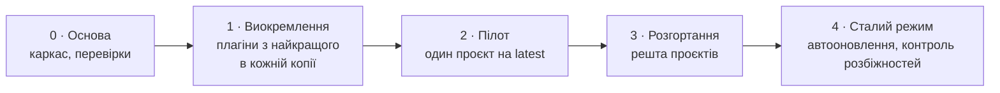

# Еволюція

[English](evolution.md) · **Українська**

## Навіщо

Процес SDLC, журнал сесій і хуки починалися як файли, скопійовані в кожен проєкт. Кожна копія
покращувалася сама по собі, тож за кілька місяців не лишилося двох проєктів з однаковою версією,
а виправлення в одному ніколи не доходило до інших. Набір робить одну копію джерелом і
встановлює її всюди.

## Етапи

| ID | Етап | Завершено, коли | Статус |
| --- | --- | --- | --- |
| 0 | Основа | Підтверджено поведінку плагінів (правила з хуків, залежності між маркетплейсами, локальне перекриття плагіна, автооновлення на перенесеному тезі) | Завершено 2026-11-09 |
| 1 | Виокремлення | Усі п'ять плагінів завантажуються в тестовому проєкті | Завершено 2026-11-09 |
| 2 | Пілот | Повний елемент SDLC проходить на наборі без локальних перекриттів; перший `stable` | Завершено 2026-11-10 |
| 3 | Розгортання | Жоден проєкт не має копії файлу набору | Завершено 2026-11-10 |
| 4 | Сталий режим | Автооновлення ввімкнене; контроль розбіжностей у CI | — |

## Проєктні рішення

| ID | Рішення | Чому |
| --- | --- | --- |
| 1 | Плагіни, а не шаблонний репозиторій | Шаблон копіюється раз і розходиться; плагін оновлюється на місці |
| 2 | Без поля `version`; реліз — це тег `stable` | Кожне перенесення тегу підхоплюється без обліку версій |
| 3 | `kit.json` замість жорстко прописаних шляхів | Проєкти по-різному розкладають документацію й журнали |
| 4 | Журнал вмикається явно (`ledger: true`) | Малим проєктам він не потрібен; групи можуть вимагати його у своїй надбудові |
| 5 | Надбудови залежать від базового набору, а не копіюють його | Одне джерело для спільного |
| 6 | Подальша робота проходить сортування за статутом і йде в один беклог, а не стає карткою сесії кожна | Підсесії породжували підсесії на чотири рівні вглиб, а відкладена робота розпорошувалась по сотнях записів журналу; ніхто не питав, чи вона потрібна |

## Релізи

Див. [CHANGELOG.md](../CHANGELOG.md) (англійською).
