# How the features grew

**English** · [Українська](features-evolution.uk.md)

What the kit's plugins give a project, in the order it landed, grouped by `stable` release. Each box is one feature or one release's worth of them; its Sources row names the CHANGELOG entry. The way of working over the same time: [process-evolution.md](process-evolution.md).

```mermaid
flowchart TD
  subgraph r1["1st stable, 11-10"]
    firstPlugins["[infrastructure] Five plugins from the best project copies<br/>SDLC stages, ledger, worktree flow, always-on rules"]
  end
  subgraph r2["2nd stable, 11-10"]
    sweep["[core] /sweep, worktree-aware linting<br/>a commit message check before each commit"]
  end
  subgraph r3["3rd stable, 11-11"]
    remoteRef["[core] Version check reads the remote ref<br/>no stale current from the cache"]
  end
  subgraph r4["4th stable, 11-11"]
    userScope["[core] Plugins at user scope only<br/>project-scope copies ran old kits"]
  end
  subgraph r5["5th stable, 11-11"]
    ownSource["[core] No false behind report<br/>for a plugin with a source of its own"]
  end
  subgraph r6["6th stable, 11-11"]
    strictDoctor["[core] kit doctor --strict in CI<br/>keeps kit-owned copies out"]
  end
  subgraph r7["7th stable, 11-11"]
    machineDoctor["[core] Doctor checks what the machine runs<br/>record rules in every ledger brief"]
  end
  subgraph r8["8th stable, 11-11"]
    ledgerTitle["[session] A hand-typed ledger title<br/>no longer blocks commits"]
  end
  subgraph r9["9th stable, 11-11"]
    kitReleaseF["[core] kit release<br/>a kit's release in one checked step"]
    evoPagesF["[session] Evolution pages<br/>process and features, one flowchart each"]
    sdlcLessons["[sdlc] Project lessons in the stages<br/>shared state modelled in the plan"]
    kitReleaseF --> evoPagesF --> sdlcLessons
  end
  subgraph r10["10th stable, 11-12"]
    kitDev["[core] kit dev<br/>try a kit change in a project"]
    autoClose["[session] The ledger closes settled Next items"]
    gapIssuesF["[sdlc] Kit gaps become kit-gap issues"]
    kitDev --> autoClose --> gapIssuesF
  end
  subgraph r11["11th stable, 11-12"]
    shortNames["[frameworks] Skill names drop the plugin prefix<br/>/sdlc:plan, svelte:runes"]
    devBranch["[session] dev integrates, main releases"]
    shortNames --> devBranch
  end
  subgraph r12["12th stable, 11-12"]
    changeReview["[core] /change-review and /repo-audit"]
    staleRemote["[session] worktree-flow stale-remote<br/>merged branches leave origin"]
    changeReview --> staleRemote
  end
  subgraph r13["13th stable, 11-13"]
    auditLessons["[core] Audits name an owner<br/>and look for every place with the defect"]
  end
  subgraph r14["14th stable, 11-14"]
    mainOnce["[session] Merged-tree steps run once<br/>in the main session"]
  end
  subgraph r15["15th stable, 11-14"]
    backlog["[session] Charter, triage and /backlog"]
    adoptInstall["[session] worktree adopt reinstalls dependencies"]
    backlog --> adoptInstall
  end
  subgraph r16["16th stable, 11-16"]
    kitTools["[core] kit tools installs rtk, CodeGraph, Fallow<br/>the kit runs their hooks"]
    oneLine["[core] Commands in a row as one line"]
    kitTools --> oneLine
  end
  subgraph r17["17th stable, 11-16"]
    gitDep["[infrastructure] Installs as a git dependency again<br/>hooks:install, not prepare"]
  end
  subgraph r18["18th stable, 11-16"]
    dotfiles["[core] kit dotfiles<br/>your ~/.claude layer on every machine"]
  end
  subgraph r19["19th stable, 11-20"]
    uiFixes["[session] /ui-fixes<br/>one UI polish sub-session per area"]
    chatDiagrams["[core] Mermaid diagrams and text markers in chat"]
    triageOpen["[session] Triage in verdict order, Open verdict"]
    uiFixes --> chatDiagrams --> triageOpen
  end
  subgraph r20["20th stable, 11-20"]
    docsCatch["[infrastructure] Docs catch up with the 19th stable<br/>every diagram in colour groups"]
  end
  r1 --> r2 --> r3 --> r4 --> r5 --> r6 --> r7 --> r8 --> r9 --> r10
  r10 --> r11 --> r12 --> r13 --> r14 --> r15 --> r16 --> r17 --> r18 --> r19 --> r20

  classDef core fill:#a5d8ff,stroke:#1c7ed6,color:#0b3f75
  classDef sdlc fill:#d0bfff,stroke:#7048e8,color:#3b1f9e
  classDef session fill:#ffec99,stroke:#f08c00,color:#5c3d00
  classDef frameworks fill:#d8f5a2,stroke:#66a80f,color:#3a5f0b
  classDef infrastructure fill:#dee2e6,stroke:#495057,color:#212529
  classDef planned stroke-dasharray:5 5
  class sweep,remoteRef,userScope,ownSource,strictDoctor,machineDoctor,kitReleaseF,kitDev,changeReview,auditLessons,kitTools,oneLine,dotfiles,chatDiagrams core
  class sdlcLessons,gapIssuesF sdlc
  class ledgerTitle,evoPagesF,autoClose,devBranch,staleRemote,mainOnce,backlog,adoptInstall,triageOpen,uiFixes session
  class shortNames frameworks
  class firstPlugins,gitDep,docsCatch infrastructure
```

## Legend

1. **Releases** run top to bottom; boxes inside a release are in commit order. When each landed is in the **When** column of the Sources table.
2. **Tags and colors**: the `[tag]` that opens a box names the plugin it changed: **core** blue, **sdlc** violet, **session** yellow, **frameworks** green (`svelte`, `python`), **infrastructure** gray (the marketplace, packaging, docs). A dashed box is planned and turns solid once its work is on the base branch.
3. Box text is what a user gets, not how it was built.

## Sources

| Node | When | Source |
| --- | --- | --- |
| Five plugins | 2026-11-10 | CHANGELOG 2026-11-10, first `stable` |
| /sweep, worktree-aware linting | 2026-11-10 | CHANGELOG 2026-11-10, second `stable` |
| Version check reads the remote ref | 2026-11-11 | CHANGELOG 2026-11-11, third `stable` |
| Plugins at user scope only | 2026-11-11 | CHANGELOG 2026-11-11, fourth `stable` |
| No false behind report | 2026-11-11 | CHANGELOG 2026-11-11, fifth `stable` |
| kit doctor --strict in CI | 2026-11-11 | CHANGELOG 2026-11-11, sixth `stable` |
| Doctor checks what the machine runs | 2026-11-11 | CHANGELOG 2026-11-11, seventh `stable` |
| Hand-typed ledger title | 2026-11-11 | CHANGELOG 2026-11-11, eighth `stable` |
| kit release | 2026-11-11 | CHANGELOG 2026-11-11, ninth `stable` |
| Evolution pages | 2026-11-11 | CHANGELOG 2026-11-11, ninth `stable` |
| Project lessons in the stages | 2026-11-11 | CHANGELOG 2026-11-11, ninth `stable` |
| kit dev | 2026-11-12 | CHANGELOG 2026-11-12, tenth `stable` |
| Ledger closes settled Next items | 2026-11-12 | CHANGELOG 2026-11-12, tenth `stable` |
| Kit gaps become kit-gap issues | 2026-11-12 | CHANGELOG 2026-11-12, tenth `stable` |
| Skill names drop the plugin prefix | 2026-11-12 | CHANGELOG 2026-11-12, eleventh `stable` |
| dev integrates, main releases | 2026-11-12 | CHANGELOG 2026-11-12, eleventh `stable` |
| /change-review and /repo-audit | 2026-11-12 | CHANGELOG 2026-11-12, twelfth `stable` |
| worktree-flow stale-remote | 2026-11-12 | CHANGELOG 2026-11-12, twelfth `stable` |
| Audits name an owner | 2026-11-13 | CHANGELOG 2026-11-13, thirteenth `stable` |
| Merged-tree steps run once | 2026-11-14 | CHANGELOG 2026-11-14, fourteenth `stable` |
| Charter, triage and /backlog | 2026-11-14 | CHANGELOG 2026-11-14, fifteenth `stable` |
| worktree adopt reinstalls dependencies | 2026-11-14 | CHANGELOG 2026-11-14, fifteenth `stable` |
| kit tools | 2026-11-16 | CHANGELOG 2026-11-16, sixteenth `stable` |
| Commands in a row as one line | 2026-11-16 | CHANGELOG 2026-11-16, sixteenth `stable` |
| Installs as a git dependency again | 2026-11-16 | CHANGELOG 2026-11-16, seventeenth `stable` |
| kit dotfiles | 2026-11-16 | CHANGELOG 2026-11-16, eighteenth `stable` |
| /ui-fixes | 2026-11-18 | CHANGELOG 2026-11-20, nineteenth `stable` |
| Mermaid diagrams and text markers | 2026-11-19 | CHANGELOG 2026-11-20, nineteenth `stable` |
| Triage in verdict order, Open | 2026-11-19 | CHANGELOG 2026-11-20, nineteenth `stable` |
| Docs catch up with the 19th stable | 2026-11-20 | CHANGELOG 2026-11-20, twentieth `stable` |
