# Як зростали функції

[English](features-evolution.md) · **Українська**

Що плагіни набору дають проєкту, у порядку появи, згруповане за релізами `stable`. Кожен блок — одна функція або набір функцій одного релізу; його рядок у «Джерелах» називає розділ CHANGELOG. Спосіб роботи за той самий час: [process-evolution.uk.md](process-evolution.uk.md).

```mermaid
flowchart TD
  subgraph r1["1-й stable, 11-10"]
    firstPlugins["[infrastructure] П'ять плагінів із найкращих копій у проєктах<br/>стадії SDLC, журнал, worktree, постійні правила"]
  end
  subgraph r2["2-й stable, 11-10"]
    sweep["[core] /sweep, лінт з урахуванням worktree<br/>перевірка повідомлення перед кожним комітом"]
  end
  subgraph r3["3-й stable, 11-11"]
    remoteRef["[core] Перевірка версії читає віддалений ref<br/>без застарілого «актуально» з кешу"]
  end
  subgraph r4["4-й stable, 11-11"]
    userScope["[core] Плагіни лише в області користувача<br/>копії в області проєкту запускали старі набори"]
  end
  subgraph r5["5-й stable, 11-11"]
    ownSource["[core] Без хибного «відстає»<br/>для плагіна з власним джерелом"]
  end
  subgraph r6["6-й stable, 11-11"]
    strictDoctor["[core] kit doctor --strict у CI<br/>не пускає копії файлів набору"]
  end
  subgraph r7["7-й stable, 11-11"]
    machineDoctor["[core] Doctor перевіряє, що запускає машина<br/>правила запису в кожному брифі журналу"]
  end
  subgraph r8["8-й stable, 11-11"]
    ledgerTitle["[session] Назва запису, набрана вручну,<br/>більше не блокує коміти"]
  end
  subgraph r9["9-й stable, 11-11"]
    kitReleaseF["[core] kit release<br/>реліз набору одним перевіреним кроком"]
    evoPagesF["[session] Сторінки еволюції<br/>процес і функції, по діаграмі на кожну"]
    sdlcLessons["[sdlc] Уроки проєктів у стадіях<br/>спільний стан моделюється в плані"]
    kitReleaseF --> evoPagesF --> sdlcLessons
  end
  subgraph r10["10-й stable, 11-12"]
    kitDev["[core] kit dev<br/>спробувати зміну набору в проєкті"]
    autoClose["[session] Журнал закриває вирішені пункти Next"]
    gapIssuesF["[sdlc] Прогалини набору стають issue kit-gap"]
    kitDev --> autoClose --> gapIssuesF
  end
  subgraph r11["11-й stable, 11-12"]
    shortNames["[frameworks] Назви скілів без префікса плагіна<br/>/sdlc:plan, svelte:runes"]
    devBranch["[session] dev інтегрує, main — релізи"]
    shortNames --> devBranch
  end
  subgraph r12["12-й stable, 11-12"]
    changeReview["[core] /change-review і /repo-audit"]
    staleRemote["[session] worktree-flow stale-remote<br/>злиті гілки зникають з origin"]
    changeReview --> staleRemote
  end
  subgraph r13["13-й stable, 11-13"]
    auditLessons["[core] Аудити називають власника<br/>і шукають кожне місце з тим самим дефектом"]
  end
  subgraph r14["14-й stable, 11-14"]
    mainOnce["[session] Кроки на злитому дереві<br/>один раз у головній сесії"]
  end
  subgraph r15["15-й stable, 11-14"]
    backlog["[session] Статут, сортування і /backlog"]
    adoptInstall["[session] worktree adopt перевстановлює залежності"]
    backlog --> adoptInstall
  end
  subgraph r16["16-й stable, 11-16"]
    kitTools["[core] kit tools ставить rtk, CodeGraph, Fallow<br/>набір запускає їхні хуки"]
    oneLine["[core] Команди поспіль одним рядком"]
    kitTools --> oneLine
  end
  subgraph r17["17-й stable, 11-16"]
    gitDep["[infrastructure] Знову ставиться як git-залежність<br/>hooks:install, а не prepare"]
  end
  subgraph r18["18-й stable, 11-16"]
    dotfiles["[core] kit dotfiles<br/>ваш шар ~/.claude на кожній машині"]
  end
  subgraph r19["19-й stable, 11-20"]
    uiFixes["[session] /ui-fixes<br/>одна підсесія шліфування UI на область"]
    chatDiagrams["[core] Діаграми Mermaid і текстові позначки в чаті"]
    triageOpen["[session] Сортування за вердиктами, вердикт Open"]
    uiFixes --> chatDiagrams --> triageOpen
  end
  subgraph r20["20-й stable, 11-20"]
    docsCatch["[infrastructure] Документація наздоганяє 19-й stable<br/>кожна діаграма в кольорових групах"]
  end
  r1 --> r2 --> r3 --> r4 --> r5 --> r6 --> r7 --> r8 --> r9 --> r10
  r10 --> r11 --> r12 --> r13 --> r14 --> r15 --> r16 --> r17 --> r18 --> r19 --> r20

  classDef core fill:#a5d8ff,stroke:#1c7ed6,color:#0b3f75
  classDef sdlc fill:#d0bfff,stroke:#7048e8,color:#3b1f9e
  classDef session fill:#ffec99,stroke:#f08c00,color:#5c3d00
  classDef frameworks fill:#d8f5a2,stroke:#66a80f,color:#3a5f0b
  classDef infrastructure fill:#dee2e6,stroke:#495057,color:#212529
  classDef planned stroke-dasharray:5 5
  class sweep,remoteRef,userScope,ownSource,strictDoctor,machineDoctor,kitReleaseF,kitDev,changeReview,auditLessons,kitTools,oneLine,dotfiles,chatDiagrams core
  class sdlcLessons,gapIssuesF sdlc
  class ledgerTitle,evoPagesF,autoClose,devBranch,staleRemote,mainOnce,backlog,adoptInstall,triageOpen,uiFixes session
  class shortNames frameworks
  class firstPlugins,gitDep,docsCatch infrastructure
```

## Легенда

1. **Релізи** йдуть згори донизу; блоки всередині релізу — у порядку комітів. Коли з'явився кожен, видно в колонці **When** таблиці «Джерела».
2. **Теги і кольори**: `[тег]` на початку блока називає плагін, який він змінив: **core** синій, **sdlc** фіолетовий, **session** жовтий, **frameworks** зелений (`svelte`, `python`), **infrastructure** сірий (маркетплейс, пакування, документація). Пунктирний блок — запланований; він стає суцільним, щойно його робота потрапила в базову гілку.
3. Текст блока — це те, що отримує користувач, а не як це зроблено.

## Джерела

| Node | When | Source |
| --- | --- | --- |
| Five plugins | 2026-11-10 | CHANGELOG 2026-11-10, перший `stable` |
| /sweep, worktree-aware linting | 2026-11-10 | CHANGELOG 2026-11-10, другий `stable` |
| Version check reads the remote ref | 2026-11-11 | CHANGELOG 2026-11-11, третій `stable` |
| Plugins at user scope only | 2026-11-11 | CHANGELOG 2026-11-11, четвертий `stable` |
| No false behind report | 2026-11-11 | CHANGELOG 2026-11-11, п'ятий `stable` |
| kit doctor --strict in CI | 2026-11-11 | CHANGELOG 2026-11-11, шостий `stable` |
| Doctor checks what the machine runs | 2026-11-11 | CHANGELOG 2026-11-11, сьомий `stable` |
| Hand-typed ledger title | 2026-11-11 | CHANGELOG 2026-11-11, восьмий `stable` |
| kit release | 2026-11-11 | CHANGELOG 2026-11-11, дев'ятий `stable` |
| Evolution pages | 2026-11-11 | CHANGELOG 2026-11-11, дев'ятий `stable` |
| Project lessons in the stages | 2026-11-11 | CHANGELOG 2026-11-11, дев'ятий `stable` |
| kit dev | 2026-11-12 | CHANGELOG 2026-11-12, десятий `stable` |
| Ledger closes settled Next items | 2026-11-12 | CHANGELOG 2026-11-12, десятий `stable` |
| Kit gaps become kit-gap issues | 2026-11-12 | CHANGELOG 2026-11-12, десятий `stable` |
| Skill names drop the plugin prefix | 2026-11-12 | CHANGELOG 2026-11-12, одинадцятий `stable` |
| dev integrates, main releases | 2026-11-12 | CHANGELOG 2026-11-12, одинадцятий `stable` |
| /change-review and /repo-audit | 2026-11-12 | CHANGELOG 2026-11-12, дванадцятий `stable` |
| worktree-flow stale-remote | 2026-11-12 | CHANGELOG 2026-11-12, дванадцятий `stable` |
| Audits name an owner | 2026-11-13 | CHANGELOG 2026-11-13, тринадцятий `stable` |
| Merged-tree steps run once | 2026-11-14 | CHANGELOG 2026-11-14, чотирнадцятий `stable` |
| Charter, triage and /backlog | 2026-11-14 | CHANGELOG 2026-11-14, п'ятнадцятий `stable` |
| worktree adopt reinstalls dependencies | 2026-11-14 | CHANGELOG 2026-11-14, п'ятнадцятий `stable` |
| kit tools | 2026-11-16 | CHANGELOG 2026-11-16, шістнадцятий `stable` |
| Commands in a row as one line | 2026-11-16 | CHANGELOG 2026-11-16, шістнадцятий `stable` |
| Installs as a git dependency again | 2026-11-16 | CHANGELOG 2026-11-16, сімнадцятий `stable` |
| kit dotfiles | 2026-11-16 | CHANGELOG 2026-11-16, вісімнадцятий `stable` |
| /ui-fixes | 2026-11-18 | CHANGELOG 2026-11-20, дев'ятнадцятий `stable` |
| Mermaid diagrams and text markers | 2026-11-19 | CHANGELOG 2026-11-20, дев'ятнадцятий `stable` |
| Triage in verdict order, Open | 2026-11-19 | CHANGELOG 2026-11-20, дев'ятнадцятий `stable` |
| Docs catch up with the 19th stable | 2026-11-20 | CHANGELOG 2026-11-20, двадцятий `stable` |
