# How the way of working grew

**English** · [Українська](process-evolution.uk.md)

The stages of how this kit is built (its checks, CI, branches, releases and docs rules) in the order they landed. Each box is one change; its Sources row names the commit. The features built over the same time: [features-evolution.md](features-evolution.md).

```mermaid
flowchart TD
  subgraph s1["Stage 1: one source"]
    skeleton["[tooling] Marketplace skeleton<br/>five plugins, kit.json schema, naming guard in CI"]
    docsParity["[docs] Bilingual docs<br/>a .uk.md mirror per page, parity check"]
    sharedCode["[tooling] Shared code in shared/<br/>vendored into each plugin, CI checks the copies"]
    pilot["[sdlc] Pilot on a real project<br/>first stable"]
    skeleton --> docsParity --> sharedCode --> pilot
  end
  subgraph s2["Stage 2: releases and branches"]
    kitRelease["[git] kit release<br/>one checked step moves stable"]
    gapIssues["[docs] Gaps as kit-gap issues<br/>not numbered lists in project ledgers"]
    kitFleet["[tooling] Weekly fleet check<br/>dropped the same day: checks stay manual"]
    devMain["[git] dev integrates, main releases<br/>kit release fast-forwards main"]
    kitRelease --> gapIssues --> kitFleet --> devMain
  end
  subgraph s3["Stage 3: every OS"]
    lfCi["[tooling] LF checkouts, CI on three OSes<br/>Linux, macOS, Windows non-blocking"]
    prePush["[git] Naming guard before every push<br/>pre-push hook, opt-out for contributors"]
    hooksInstall["[tooling] hooks:install, not prepare<br/>pnpm installs the kit as a git dependency"]
    lfCi --> prePush --> hooksInstall
  end
  subgraph s4["Stage 4: docs in step"]
    docsCatchUp["[docs] Docs catch up with each release<br/>diagrams in colour groups with a legend"]
    evoPages["[docs] Evolution pages<br/>process and features, once per release"]
    docsCatchUp --> evoPages
  end
  pilot --> kitRelease
  devMain --> lfCi
  hooksInstall --> docsCatchUp

  classDef agentConfig fill:#a5d8ff,stroke:#1c7ed6,color:#0b3f75
  classDef tooling fill:#dee2e6,stroke:#495057,color:#212529
  classDef ledger fill:#ffec99,stroke:#f08c00,color:#5c3d00
  classDef sdlc fill:#d0bfff,stroke:#7048e8,color:#3b1f9e
  classDef git fill:#96f2d7,stroke:#0ca678,color:#054d3b
  classDef docs fill:#d8f5a2,stroke:#66a80f,color:#3a5f0b
  classDef planned stroke-dasharray:5 5
  class skeleton,sharedCode,kitFleet,lfCi,hooksInstall tooling
  class docsParity,gapIssues,docsCatchUp,evoPages docs
  class pilot sdlc
  class kitRelease,devMain,prePush git
```

## Legend

1. **Stages** run top to bottom; boxes inside a stage are in commit order. When each landed is in the **When** column of the Sources table.
2. **Tags and colors**: the `[tag]` that opens a box names the part of the workflow it changed, and its color follows the tag: **agent config** blue (rules, skills, agents, always-on context), **tooling** gray (hooks, MCP, scripts, CI), **ledger** yellow, **sdlc** violet (the work-item loop), **git** teal (branches, worktrees, landing), **docs** green (design rules, decision records, docs review). A dashed box is planned.
3. Box text is the change, not the tool's whole feature list.

## Sources

| Node | When | Source |
| --- | --- | --- |
| Marketplace skeleton | 2026-11-09 | `feat: L1 skeleton — marketplace, plugin manifests, kit.json schema, naming guard (#1)` |
| Bilingual docs | 2026-11-09 | `feat(core): rules hook, agents, check/dev, shell and lint hooks, kit doctor/adopt/inventory, docs parity (#4)` |
| Shared code in shared/ | 2026-11-09 | `feat(integration): shared kit.json reader, schema lintOnEdit/dev/install, session kit-owned, update docs (#7)` |
| Pilot on a real project | 11-09 → 11-10 | `feat: pilot fixes for lint rules, check suites, preflight counters and doctor (#8)`; CHANGELOG 2026-11-10, first `stable` |
| kit release | 2026-11-11 | `feat(core): add kit release to cut a stable release in one checked step` |
| Gaps as kit-gap issues | 2026-11-11 | `feat(sdlc,session): track kit gaps as issues in the kit's repo` |
| Weekly fleet check | 2026-11-12 | `feat(core): kit fleet checks a repo list through the GitHub API, weekly`; `revert: drop kit fleet; the repo check stays manual` |
| dev integrates, main releases | 2026-11-12 | `feat(core,session,sdlc): make dev the default integration branch`; `feat(core): kit release fast-forwards main from dev; agent-kit integrates on dev` |
| LF checkouts, CI on three OSes | 2026-11-15 | `chore: check every file out with LF line endings`; `ci: run the checks on Linux, macOS and Windows` |
| Naming guard before every push | 2026-11-15 | `fix(naming-guard): run before every push, with an opt-out for contributors` |
| hooks:install, not prepare | 2026-11-16 | `fix: install the git hooks with hooks:install, not prepare` |
| Docs catch up with each release | 2026-11-20 | `docs: catch the human docs up with the nineteenth stable`; `docs: colour every diagram, start the evolution pages, retire the design banner` |
| Evolution pages | 2026-11-20 | `docs: colour every diagram, start the evolution pages, retire the design banner` |
