# Як зростав спосіб роботи

[English](process-evolution.md) · **Українська**

Етапи того, як будується цей набір (його перевірки, CI, гілки, релізи й правила документації), у порядку, в якому вони з'являлися. Кожен блок — одна зміна; його рядок у «Джерелах» називає коміт. Функції, створені за той самий час: [features-evolution.uk.md](features-evolution.uk.md).

```mermaid
flowchart TD
  subgraph s1["Етап 1: одне джерело"]
    skeleton["[tooling] Каркас маркетплейсу<br/>п'ять плагінів, схема kit.json, перевірка назв у CI"]
    docsParity["[docs] Двомовна документація<br/>дзеркало .uk.md на сторінку, перевірка парності"]
    sharedCode["[tooling] Спільний код у shared/<br/>копіюється в кожен плагін, CI перевіряє копії"]
    pilot["[sdlc] Пілот на справжньому проєкті<br/>перший stable"]
    skeleton --> docsParity --> sharedCode --> pilot
  end
  subgraph s2["Етап 2: релізи й гілки"]
    kitRelease["[git] kit release<br/>один перевірений крок переносить stable"]
    gapIssues["[docs] Прогалини як issue kit-gap<br/>а не нумеровані списки в журналах проєктів"]
    kitFleet["[tooling] Щотижнева перевірка репозиторіїв<br/>прибрана того ж дня: перевірки лишаються ручними"]
    devMain["[git] dev інтегрує, main — релізи<br/>kit release перемотує main"]
    kitRelease --> gapIssues --> kitFleet --> devMain
  end
  subgraph s3["Етап 3: кожна ОС"]
    lfCi["[tooling] LF у копіях, CI на трьох ОС<br/>Linux, macOS, Windows без блокування"]
    prePush["[git] Перевірка назв перед кожним push<br/>хук pre-push, вимикач для учасників"]
    hooksInstall["[tooling] hooks:install, а не prepare<br/>pnpm ставить набір як git-залежність"]
    lfCi --> prePush --> hooksInstall
  end
  subgraph s4["Етап 4: документація в ногу"]
    docsCatchUp["[docs] Документація наздоганяє кожен реліз<br/>діаграми в кольорових групах із легендою"]
    evoPages["[docs] Сторінки еволюції<br/>процес і функції, раз на реліз"]
    docsCatchUp --> evoPages
  end
  pilot --> kitRelease
  devMain --> lfCi
  hooksInstall --> docsCatchUp

  classDef agentConfig fill:#a5d8ff,stroke:#1c7ed6,color:#0b3f75
  classDef tooling fill:#dee2e6,stroke:#495057,color:#212529
  classDef ledger fill:#ffec99,stroke:#f08c00,color:#5c3d00
  classDef sdlc fill:#d0bfff,stroke:#7048e8,color:#3b1f9e
  classDef git fill:#96f2d7,stroke:#0ca678,color:#054d3b
  classDef docs fill:#d8f5a2,stroke:#66a80f,color:#3a5f0b
  classDef planned stroke-dasharray:5 5
  class skeleton,sharedCode,kitFleet,lfCi,hooksInstall tooling
  class docsParity,gapIssues,docsCatchUp,evoPages docs
  class pilot sdlc
  class kitRelease,devMain,prePush git
```

## Легенда

1. **Етапи** йдуть згори донизу; блоки всередині етапу — у порядку комітів. Коли з'явився кожен, видно в колонці **When** таблиці «Джерела».
2. **Теги і кольори**: `[тег]` на початку блока називає частину процесу, яку він змінив, а колір відповідає тегу: **agent config** синій (правила, скіли, агенти, постійний контекст), **tooling** сірий (хуки, MCP, скрипти, CI), **ledger** жовтий, **sdlc** фіолетовий (цикл робочих елементів), **git** бірюзовий (гілки, worktree, злиття), **docs** зелений (правила дизайну, записи рішень, огляд документації). Пунктирний блок — запланований.
3. Текст блока — це зміна, а не повний перелік можливостей інструмента.

## Джерела

| Node | When | Source |
| --- | --- | --- |
| Marketplace skeleton | 2026-11-09 | `feat: L1 skeleton — marketplace, plugin manifests, kit.json schema, naming guard (#1)` |
| Bilingual docs | 2026-11-09 | `feat(core): rules hook, agents, check/dev, shell and lint hooks, kit doctor/adopt/inventory, docs parity (#4)` |
| Shared code in shared/ | 2026-11-09 | `feat(integration): shared kit.json reader, schema lintOnEdit/dev/install, session kit-owned, update docs (#7)` |
| Pilot on a real project | 11-09 → 11-10 | `feat: pilot fixes for lint rules, check suites, preflight counters and doctor (#8)`; CHANGELOG 2026-11-10, перший `stable` |
| kit release | 2026-11-11 | `feat(core): add kit release to cut a stable release in one checked step` |
| Gaps as kit-gap issues | 2026-11-11 | `feat(sdlc,session): track kit gaps as issues in the kit's repo` |
| Weekly fleet check | 2026-11-12 | `feat(core): kit fleet checks a repo list through the GitHub API, weekly`; `revert: drop kit fleet; the repo check stays manual` |
| dev integrates, main releases | 2026-11-12 | `feat(core,session,sdlc): make dev the default integration branch`; `feat(core): kit release fast-forwards main from dev; agent-kit integrates on dev` |
| LF checkouts, CI on three OSes | 2026-11-15 | `chore: check every file out with LF line endings`; `ci: run the checks on Linux, macOS and Windows` |
| Naming guard before every push | 2026-11-15 | `fix(naming-guard): run before every push, with an opt-out for contributors` |
| hooks:install, not prepare | 2026-11-16 | `fix: install the git hooks with hooks:install, not prepare` |
| Docs catch up with each release | 2026-11-20 | `docs: catch the human docs up with the nineteenth stable`; `docs: colour every diagram, start the evolution pages, retire the design banner` |
| Evolution pages | 2026-11-20 | `docs: colour every diagram, start the evolution pages, retire the design banner` |
