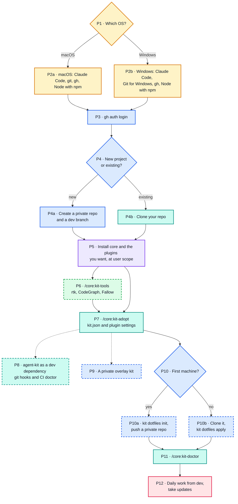

# Using the kit

**English** · [Українська](using.uk.md)

## From a bare machine to daily work

The path for one developer with their own projects. Node ids match the table below it, which
points at the section with the details; dashed steps are optional.



- Amber: the OS and its prerequisites
- Blue: GitHub, private repos and dotfiles
- Violet: Claude Code and the kit plugins
- Green: optional machine tools
- Teal: project set-up and checks
- Rose: daily work and updates
- Dashed outline: optional

| ID | Step | Details |
| --- | --- | --- |
| P1 | Pick the OS. The kit runs on macOS, Windows and Linux; on Windows its commands run in PowerShell 5.1 or Git Bash | § 1 |
| P2a | macOS: install Claude Code (desktop app or CLI), git, the GitHub CLI and Node with npm | § 1 |
| P2b | Windows: the same with Git for Windows. Put `%USERPROFILE%\.local\bin` on PATH if you will install rtk | § 1 |
| P3 | `gh auth login; gh auth setup-git` | § 4 |
| P4a | `gh repo create <you>/my-app --private --clone`, then a `dev` branch for integration | § 2, item 7 |
| P4b | Clone the repo; `kit.json` `baseBranch` names its integration branch if it is not `dev` | § 2, item 7 |
| P5 | Add the marketplace and install `core`, then each plugin you want, at user scope | § 1 |
| P6 | Optional tools, each asked for: rtk, CodeGraph, Fallow | § 1 |
| P7 | `/core:kit-adopt`, then commit `kit.json` and `.claude/settings.json` | § 2 |
| P8 | Optional: agent-kit as a dev dependency, for git hooks and the strict doctor in CI | § 2, items 4–5 |
| P9 | Optional: your own rules and skills in a private overlay kit | § 4 |
| P10a | First machine: seed your dotfiles, scan them, push them as a private repo | § 8 |
| P10b | Another machine: clone your dotfiles repo and apply it | § 8 |
| P11 | `/core:kit-doctor` | § 2, item 3 |
| P12 | Work branches and sessions from `dev`, landed with `/close-out`; take each new `stable` | § 2, item 7; § 3 |

## 1. Install

Install the kit plugins once per machine, at user scope. A project only declares the marketplace
and enables the plugins in its committed `.claude/settings.json`; it installs nothing.

| ID | Part | Where | Who |
| --- | --- | --- | --- |
| 1 | The installed plugins | User scope (`~/.claude/plugins`) | Each user, once per machine |
| 2 | The marketplace and the enabled plugins | `.claude/settings.json` of the project (commit it) | The project, once: `/core:kit-adopt` writes both |

```bash
claude plugin marketplace add 3meyc/agent-kit#stable; claude plugin install core@agent-kit --scope user
```

Repeat the install for each plugin you want (`sdlc`, `session`, `svelte`, `python`).

Then the machine tools the kit's hooks use, each optional: rtk (compressed shell output), CodeGraph
(a code graph) and Fallow (dead-code and duplication audits). In a Claude session run
`/core:kit-tools`, or in a terminal (it asks before each install, Y by default; `--yes` for all)
_(unverified: `npx` with a GitHub spec runs the package's `agent-kit` command)_:

```bash
npx github:3meyc/agent-kit#stable tools
```

It installs the pins in [tools.json](../plugins/core/tools.json) on Windows, macOS and Linux (rtk
from its GitHub release, sha256-checked; CodeGraph and Fallow with `npm install -g`), clears old
copies, and offers `codegraph init` for the repo. `core` says at session start when a tool is
missing or off its pin.

Why user scope only ([spikes](spikes.md) S11, tried with Claude Code 2.1.300 and 2.1.321):

1. A session loads the first install record in `~/.claude/plugins/installed_plugins.json` that
   applies to its folder. A user record always applies; a project record applies in every worktree
   of the repository it was made in. New records go to the end, so whichever came first wins, not
   the folder's own copy and not the newest one.
2. `claude plugin update` without `--scope` updates a project-scope copy when there is one, and
   `--scope project` updates the first copy of the repository, which may belong to another worktree.
   An update can report "already at the latest version" while the copy that runs is old.
3. Uninstalling a project-scope copy also removes the plugin from that folder's
   `.claude/settings.json`, a tracked file.
4. Claude Code still writes a project-scope record by itself in each folder whose settings enable
   the plugin, every worktree included, at the version the session there loaded (seen with the
   CLI the desktop app ships, 2.1.321). That is harmless while the user copy is current and comes
   first; `kit installs` lists the copies that differ (§ 3).

## 2. Configure the project

1. Add `kit.json` at the repo root ([example](architecture.md#kitjson)), or run `/core:kit-adopt`:
   it drafts one, declares the marketplaces and plugins in `.claude/settings.json`, and lists the
   local files the kit now supplies (it deletes nothing).
2. Set `ledger: false` if the project keeps no session ledger; `session` then skips its ledger hooks.
3. Run `/core:kit-doctor` (or `kit doctor` from a Claude session's shell): it checks `kit.json`,
   the enabled plugins and declared marketplaces, that each enabled plugin is installed on this
   machine, that no kit-owned file (or a test of one) is copied into the repo, and whether an
   installed plugin the project uses lags its channel. In a worktree under another checkout's
   `.claude/worktrees/` it warns when that checkout's `.claude/` differs from the worktree's:
   sessions there read the outer one (seen with the desktop app).
4. For git hooks outside Claude, where plugin commands are not on PATH, add the kit as a dev
   dependency and call its `agent-kit` command, for example `agent-kit ledger-scan-secrets` in the
   pre-commit hook:

```bash
pnpm add -D github:3meyc/agent-kit#stable
```

5. Keep copies out with CI: with that dev dependency, a CI step runs `kit doctor` in strict mode,
   which needs no Claude Code and no installed plugin. It judges the repo, not the machine: it
   fails on a copy of a kit-owned file (or a test of one), on a `kit.json` that fails the schema,
   and on a needed plugin or a marketplace missing from the shared `.claude/settings.json`;
   `settings.local.json` and the user's settings don't count, and installed versions and install
   scopes never fail it. It reads ownership from the plugin folders in the `agent-kit` package;
   for an overlay's plugins, add `--plugin-root <path>` (a plugin folder, or a folder of them,
   relative to the working directory; repeatable). `--offline` skips the remote version check.
   Exit codes: 0 passed, 1 a finding failed, 2 a usage error (an unknown flag, a root with no
   plugin in it).

```bash
pnpm exec agent-kit doctor --strict --offline
```

```bash
pnpm exec agent-kit doctor --strict --offline --plugin-root node_modules/my-overlay-tools/plugins
```

6. Keep an evolution log (optional, `session`): two pages in `paths.evolution` (default
   `docs/evolution`) draw how the project grew, one Mermaid flowchart each with a Sources table,
   a `version:` and a `last_verified:`. `process-evolution.md` takes each change to the way of
   working (agent rules, skills, hooks, CI, `kit.json`), stage by stage; `features-evolution.md`
   takes each shipped feature, release by release. Start them from a Claude session's shell; it
   adds a mirror per language the repo already keeps `*.<lang>.md` pages in (`--lang`,
   `--no-mirror` to choose). Then replace the first boxes with the real history and commit.
   From then on the pages are brought up to date once per release, not per session:
   `evolution status --since-release` lists the changelog's `## Unreleased` lines (or
   `## [Unreleased]`, the Keep a Changelog form; already triaged: each was worth a line) and the commits since the last release tag that changed the
   way of working, and the `evolution` skill turns them into a few boxes. The `kit release` dry
   run names a page not changed since the last release, so nobody has to remember; a project with
   its own release flow runs the skill before it. With a renderer for
   a printable version, set `commands.evolutionRender` (`{page}` is the page path); `evolution
   bump` runs it. `evolution check` fits a `checks` suite.

```bash
evolution init
```

7. Branch the same way in every repo: personal, work and kit repos alike. A repo that has a
   reason to differ sets `baseBranch` in `kit.json`.

| ID | Branch | Role |
| --- | --- | --- |
| 1 | `dev` | The integration branch, and the `baseBranch` default. Feature and session branches are cut from it and land back on it |
| 2 | `main` | Releases only. It moves forward from `dev` when a release is cut |
| 3 | `feat/<slug>-<ITEM-ID>`, `claude/…` | One piece of work each, cut from `dev` |

   Land by merge, not by pull request. In the branch's own worktree, merge `dev` into the
   branch, so the session that made the change resolves any conflict there. Run the checks. Then
   `worktree-flow land` fast-forwards `dev` to the branch; it never merges and never pushes.
   `/close-out` runs these steps. Push `dev` on the user's word. `/core:kit-adopt` picks `dev`
   (or `develop`, `development`) when the repo has one. `worktree-flow` prefers them when it guesses
   a base. Setting the forge's default branch to `dev`, so new clones and pull requests start
   there, is the repo owner's call.

   A merged branch that was pushed stays on `origin` until someone deletes it.
   `worktree-flow stale-remote [--base <b>] [<branch>…]` lists the ones `origin/<base>` already
   holds, or whose PR was merged into the base (a squash merge, checked with `gh`), and the ones
   it keeps with the reason; it deletes nothing. `/close-siblings` offers to delete the
   sub-sessions' stale branches, and `/close-out` this session's own, in the same question as
   the landing; the deletion is one `git push origin --delete …` on the user's word.

   A commit's `Closes #n` closes the issue only when the commit reaches the forge's default
   branch, so an issue fixed on `dev` stays open after the push. `worktree-flow issues [--base <b>]`
   lists the issues the landing's commits close or mention, with their state, and prints the
   `gh issue close` line for each one the push will leave open; it closes nothing. `/close-out`
   and `/close-siblings` name those issues in the resume and close them after the push, in the
   same question as the landing.

## 3. Take updates

Update explicitly, at user scope. A new `stable` takes two commands, then a new session:

```bash
claude plugin marketplace update agent-kit; claude plugin update core@agent-kit --scope user
```

1. Run the second command for each kit plugin you installed (`sdlc`, `session`, …). The first one
   only moves the catalog; the installed plugin stays where it was until the second
   ([spikes](spikes.md) S8). Always pass `--scope user`: without it the command picks a
   project-scope copy (§ 1).
2. The `core` plugin checks for you: at session start it says when the copy the session loads, or
   the user copy, lags its channel, and prints these commands for it. `/core:kit-doctor` reports
   the same, plus every project-scope copy of this repository that differs.
3. Auto-update can't be relied on: the desktop app turns it off, headless runs never update, and an
   interactive session applies an update only at the next launch (S8). Turning it on
   (`/plugin` → Marketplaces → `agent-kit`) is optional and doesn't replace the commands above.
4. Plugins install from the ref this machine registered the marketplace at, not from the ref the
   project declares. When your own `~/.claude/settings.json` `extraKnownMarketplaces` declares
   `agent-kit` without a `ref`, the marketplace tracks `HEAD`, and
   `claude plugin marketplace add 3meyc/agent-kit#stable` is refused because its source doesn't
   match that entry. Add `"ref": "stable"` to the user entry, then run the `add` command again.
   `/core:kit-doctor` warns about both cases (observed with one Claude Code version; the message
   may differ).
5. Project-scope copies from earlier installs, or written by Claude Code itself, stay at their old
   version. Claude Code has no command that updates or removes one folder's copy reliably (§ 1), so
   the kit clears them. After the user-scope update, from a Claude session's shell (`kit` is on
   its PATH), list them and clear them, then start a new session:

```bash
kit installs
```

```bash
kit installs --clean
```

6. `--clean` leaves a copy whose plugin has no user-scope install, or whose user copy lags the
   channel, and says which command to run first. For each other stale copy it runs
   `claude plugin uninstall <plugin>@agent-kit --scope project` from that copy's folder and then
   writes the folder's `.claude/settings.json` and `settings.local.json` back as they were; for a
   folder that no longer exists, it creates the folder for the call and removes it again. By hand,
   do the same: run the uninstall from the folder, then restore `.claude/settings.json`
   (`git checkout -- .claude/settings.json` when it had no local edits).

## 4. Private overlay kits

An overlay kit in a private repo is cloned with this machine's git credentials:

```bash
gh auth login; gh auth setup-git
```

With several GitHub accounts on one machine, check that the account that can read the overlay is
the one git uses for it.

## 5. Check your repos for drift

The kit schedules no check: keeping each repo in step with the kit is the developer's job. Run the
inventory by hand, for example after taking a new `stable` or before moving files into a kit.

1. **Set up once.** List your local clones in `~/.config/agent-kit/inventory.json` (or under
   `$XDG_CONFIG_HOME`). The list is your configuration and never goes into the kit. `reference` is
   the copy drift is measured against; `extraRoots` and `extraFiles` add folders and files to scan
   ([core README](../plugins/core/README.md), "Inventory repo list").

```json
{ "repos": { "app": "~/code/my-app", "api": "~/code/my-api" }, "reference": "app" }
```

2. **Run it.** Pull each repo's default branch first: the inventory reads every clone as it is.
   In a Claude session run `/core:kit-inventory`, or from its shell (`--out <dir>` writes the full
   report to files):

```bash
kit inventory
```

```bash
kit drift
```

3. **Act on the result.** Each file group is `same`, `drift(n)` or `single` across the repos:
   1. Marked `kit:<plugin>`: a copy the kit now supplies. Retire it in that repo; `/core:kit-doctor`
      there lists it ([core README](../plugins/core/README.md), "Retiring project copies").
   2. `drift`: copies that differ. `kit drift` gives the changed lines per repo; large drift means a
      merge, not a copy.
   3. `single`: in one repo only, project-specific unless you decide otherwise.
4. **Check each repo against `stable`.** The inventory does not compare a repo with `stable`. In
   each repo, `/core:kit-doctor` reports kit-owned copies and plugins that lag their channel; take
   updates as in § 3. CI with `kit doctor --strict` (§ 2) keeps copies out on every push.
5. **Keep it current.** Edit `inventory.json` when you add, move or retire a repo. The commands
   themselves update with the `core` plugin (§ 3).

## 6. Keep the ledger's Next list short

With `"ledger": true`, every session record ends with a `## Next` list, and its open items come
back in each new session's brief until `session-ledger --done <id8> <n>` marks them. In a busy
project most of them are settled long before anyone marks them, so the `session` plugin closes an
item on its own when one of these rules says it is settled:

| ID | Rule | Closes an item when |
| --- | --- | --- |
| 1 | Expired question | It opens with `Open question at Stop:` (the recap's unanswered question) and the record was last active more than `ledgerAutoClose.questionDays` days ago (default 7) |
| 2 | Until date | It carries `(until YYYY-MM-DD)` and that day has passed |
| 3 | Merged PR | It names a PR (`PR #12`, `pull request 12`, `owner/repo#12`, a `…/pull/12` link) that merged on or after the record's day. Merge subjects on the integration branches answer offline; `gh pr view` answers the rest, only for `--owed` and `--sweep` and only when `gh` is installed, cached in the git common dir. Without `gh` the item stays open |
| 4 | Landed branch | It is about landing, merging or pushing, and names a branch that landed in its base since the record's day began. The base is the one `worktree-flow base` recorded, else any integration branch for a `claude/…` session branch, else `baseBranch`. A deleted branch counts through its sessions' `Session-Id` commits or a merge subject. A branch named in a condition (`once`, `when`, `after`, `until`, `before`, `if` just before it) does not count: that item becomes due, not done |
| 5 | Pushed branch | It says push and names a branch other than the base whose remote-tracking ref holds what the branch held at the end of the record's day |

1. The brief hides closed items and says in one line how many there are.
2. `session-ledger --owed` lists the open items, then the auto-closed ones under their own
   heading, each with its reason.
3. `session-ledger --sweep` writes the done marks into the records, as
   `(done <date> <id8> auto: <reason>)`, signed with `--as`, the session id, or `sweep` outside a
   session; `--dry-run` only lists them. Nothing is deleted. `session-ledger --archive` then moves
   the records that owe nothing.
4. Give an item that matters only for a while an end date: `watch the error rate (until 2026-12-01)`.
5. Auto-close settles items; triage decides the rest. `/backlog triage` shows the open items as
   one table (What, Why, Source, a proposed verdict) and carries out your answer
   (`F1 keep, F5–F7 drop`): a Keep becomes a session whose charter is that item, a Defer becomes a
   row of `<paths.sdlc>/backlog.md` with an Until date 14 days out, a Drop is only marked done.
   Each of these leaves the list. **Open** is for a check only you can make by hand (on screen,
   behind a sign-in, on a live system): its item stays in `## Next` for you. The rows come in
   verdict order, Keep and Open first, then Defer, then Drop, each keeping its id, and each verdict
   carries a text marker: `☑︎ Keep`, `□ Open`, `↓ Defer`, `☒︎ Drop`. `/close-out` and `/close-siblings` run the same triage on
   the follow-ups of the work they land, so `## Next` stays an inbox, not a backlog. `/backlog`
   shows the backlog, `/backlog pick B3 B7` starts a session with those rows as its charter, and
   `/backlog expire` removes rows past their date. Each `## Next` item ends with `— why: <who is
   hurt if it is left undone>`; the triage reads it. The flow is drawn in the
   [session README](../plugins/session/README.md#follow-ups-charter-triage-backlog).
6. Change the question window in `kit.json`:

```json
{ "ledgerAutoClose": { "questionDays": 14 } }
```

```bash
session-ledger --sweep --dry-run
```

## 7. Try a kit change in a project

Installed plugins are read-only copies in Claude Code's plugin cache. To try a change to the base
kit or an overlay in a real project before it is released, start Claude Code there with the plugin
folders of your local checkouts (`--plugin-dir`, [changing](changing.md) step 3). `kit dev` builds
that command, so you don't list every plugin folder by hand.

1. Once per machine, map each marketplace name (the part after `@` in `enabledPlugins`) to its
   checkout in `~/.config/agent-kit/checkouts.json` (`$XDG_CONFIG_HOME/agent-kit/` when that is
   set). A path may start with `~/`; a relative one is read from that file's folder.
2. In the project, from a terminal, run the command below. Outside Claude Code `kit` is not on the
   PATH: `agent-kit dev` does the same where the root package is installed, and `kit dev` in a
   Claude session's shell prints the report too.
3. It reads `enabledPlugins` from `.claude/settings.json` (`settings.local.json` switches one on or
   off), finds each plugin in its marketplace's checkout through `.claude-plugin/marketplace.json`,
   adds the plugins they name in `dependencies`, and prints a numbered report: each plugin and the
   folder it loads from, the warnings, the `claude --plugin-dir …` command and the check.
4. It warns when a checkout has uncommitted files, is not on its base branch (`kit.json`
   `baseBranch`, else `dev`), is missing or holds no marketplace, and when an enabled plugin has
   no checkout: that one stays on the installed copy.
5. `--checkout <marketplace>=<path>` (repeatable) overrides the file for one run, for example to
   load the worktree where the change is; `--config <file>` reads another file.
6. `--run` starts the command in the project folder, with any arguments after `--` passed to
   `claude`. Run it from a terminal, not from inside a Claude session.
7. A `--plugin-dir` copy replaces the installed plugin of the same name silently, and
   `claude plugin list` still shows the installed one. In the new session, `/core:kit-doctor`
   lists each plugin "loaded for this session with --plugin-dir"; one it doesn't list runs from
   the installed copy.

```json
{ "agent-kit": "~/src/agent-kit", "my-overlay": "~/src/my-overlay" }
```

```bash
node ~/src/agent-kit/plugins/core/src/kit-cli.mjs dev
```

```bash
node ~/src/agent-kit/plugins/core/src/kit-cli.mjs dev --checkout agent-kit=~/src/agent-kit/.claude/worktrees/my-change --run
```

## 8. Carry your setup between machines

Your user-global layer lives in `~/.claude` on each machine, outside every project. `kit dotfiles`
keeps it in a private folder you push as a git repo of your own and links it back onto each
machine, so an edit on one machine reaches the others with a commit and a pull. In a session,
`/core:kit-dotfiles` runs the same steps and asks before it changes anything.

| ID | Kind | What |
| --- | --- | --- |
| 1 | Travels | `~/.claude/settings.json`, `~/.claude/CLAUDE.md` and the `RTK.md` it may import, your own skills, agents, commands and output styles, agent-kit's naming guard list ([dotfiles.json](../plugins/core/dotfiles.json)) |
| 2 | Stays on the machine | `skills/synced/`, the desktop app's managed copy of Anthropic's skills: left out and written into the folder's `.gitignore` |
| 3 | Never in the folder | Sign-in tokens (`~/.claude/.credentials.json`), `~/.claude.json`, installed plugins, session transcripts and memory (`~/.claude/projects`); `check` fails when one is there |

1. **First machine.** Seed the folder (`--dir <folder>`, else `KIT_DOTFILES`, else
   `~/.claude-dotfiles`). It copies what exists and scans the result: a `FAIL` line names a token
   or a secret value by file and line, never the value; a `warn` line names a machine-local path,
   such as an env value under your home folder, which another machine will not have.

```bash
kit dotfiles init --dry-run
```

```bash
kit dotfiles init
```

2. **Push it as a private repo**, once nothing in the scan needs fixing:

```bash
git -C "$HOME/.claude-dotfiles" init; git -C "$HOME/.claude-dotfiles" add .; git -C "$HOME/.claude-dotfiles" commit -m "chore: seed dotfiles"; gh repo create <you>/claude-dotfiles --private --source "$HOME/.claude-dotfiles" --push
```

3. **Each machine, the first one included.** Clone the repo into the folder and apply it. Each real
   file it replaces is kept as `<name>.backup-<time>`; merge anything machine-specific back from
   there. On Windows, folders link as junctions; files need Developer Mode (Settings → System →
   For developers), and without it `apply` copies them, so run it again after each pull.

```bash
git clone https://github.com/<you>/claude-dotfiles.git "$HOME/.claude-dotfiles"
```

```bash
kit dotfiles apply --dry-run
```

```bash
kit dotfiles apply
```

4. **Check now and then**: each path is linked, a copy that matches, or differs; the folder holds
   no secret and nothing that must never sync. Outside a session `agent-kit dotfiles check` runs it
   from a project that has the dev dependency (§ 2, item 4).

```bash
kit dotfiles check
```

5. **An overlay kit** can offer the same steps under its own command name, with its own manifest
   (the base list plus its paths) and its own default folder, from the `agent-kit` package
   ([core README](../plugins/core/README.md)).

## 9. Polish the UI one area at a time

`/ui-fixes <scope>` (`session`) starts a child session that polishes one area of the app: it
screenshots the area in the dev server, asks you for your list of fixes and enhancements, builds
the agreed items and lands on your branch through `/close-out`. Every such session starts from the
same brief, filled from the project's scope map.

1. **Write the scope map once**, at `kit.json` `paths.uiScopes` (default `docs/ui-scopes.md`), in
   four sections:
   1. **Harness**: how to open each page in the dev server, and any switch to set before a write
      (a mock backend, an administrator caller).
   2. **Scopes**: one row per area with its scope name, the code letter of its charter items, its
      harness route, UI folders, state (stores, services) and docs.
   3. **Names**: scope names that need a question (a name two pages share), and how free text is
      resolved.
   4. **Brief additions**: what every UI brief in the project also carries: the rule skills to
      load, a shared component to use, extra checks for done.
2. **Start one per area**, from the main session. `/ui-fixes <scope>` takes the next charter id
   (`F<n>`), cuts the child's worktree from your current branch, names the folders of running
   sibling sessions under **Avoid**, and titles it `<id>: <Scope> UI fixes and enhancements`.
   Without a scope it asks which; without a map it asks for the area's folders and records the
   missing map in the ledger record's `## Next`.
3. **In the child**, the first reply states the charter: your list plus at most five issues it
   spotted in the screenshots, numbered with the area's letter; an item joins only on your word.
   Done means the project's check and lint pass on the touched paths, each item is checked in the
   harness with a screenshot, and the area's docs are updated. The child pushes nothing and lands
   only on your word; the full test suite and build run in the parent at `/close-siblings`.
4. Run inside a child session, `/ui-fixes` starts nothing: it runs the brief in place.

## 10. Diagrams and markers in chat

`core`'s always-on chat rules shape two things you see in answers:

1. **Diagrams.** An answer about a flow, dependencies, steps between parties or states (about three
   or more related nodes) carries a `mermaid` diagram, drawn by the `core:diagrams` skill: one
   colour group per kind of node, in dark fills that read in light and dark themes, short quoted
   labels, and a numbered legend right after it. The desktop app's Code tab draws it; a terminal
   shows its source, which is kept small enough to read as text. A project's docs rules may set
   their own palette for diagrams in files.
2. **Markers.** Status and verdict markers are text symbols, not emoji: ☑︎ □ ↓ ☒︎ ✓ ✗ ● ○ ▸, each
   followed by U+FE0E where a system would draw it as emoji; ⚠︎ only for a warning that matters.
   The triage table (§ 6) marks its verdicts this way.

## Troubleshooting

| ID | Symptom | Check |
| --- | --- | --- |
| 1 | A skill or command is missing | `/plugin` lists the plugin as enabled for this project |
| 2 | An old behaviour persists | `claude plugin marketplace update agent-kit`, `claude plugin update <plugin>@agent-kit --scope user`, then a new session |
| 3 | A rule seems ignored | `/core:kit-doctor`; a project copy of a kit file shadows the kit |
| 4 | `marketplace add …#stable` is refused: its source doesn't match its `extraKnownMarketplaces` entry | Add `"ref": "stable"` to that marketplace in `~/.claude/settings.json`, run `add` again, then `claude plugin update <plugin>@agent-kit --scope user` per plugin (§ 3) |
| 5 | An update reports "already at the latest version", or a new session still runs the old kit | `kit installs`: a project-scope copy loads before the user copy or took the update; update at user scope, then `kit installs --clean` (§ 3) |
| 6 | An answer shows a `mermaid` block as code, not a picture | A terminal shows the source; the desktop app's Code tab draws it (§ 10) |
