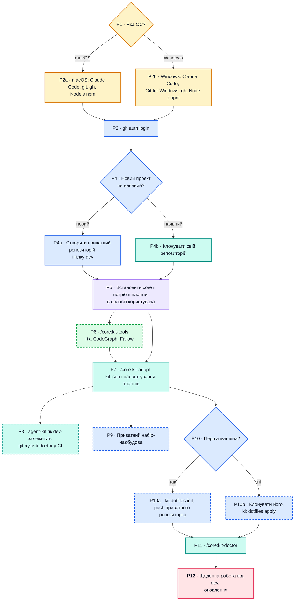

# Використання набору

[English](using.md) · **Українська**

## Від чистої машини до щоденної роботи

Шлях для одного розробника з власними проєктами. Ідентифікатори вузлів збігаються з таблицею під
схемою, яка вказує на розділ із подробицями; пунктирні кроки необов'язкові.



- Бурштиновий: ОС і її передумови
- Синій: GitHub, приватні репозиторії й dotfiles
- Фіолетовий: Claude Code і плагіни набору
- Зелений: необов'язкові машинні інструменти
- Бірюзовий: налаштування проєкту й перевірки
- Рожевий: щоденна робота й оновлення
- Пунктирна рамка: необов'язково

| ID | Крок | Подробиці |
| --- | --- | --- |
| P1 | Виберіть ОС. Набір працює на macOS, Windows і Linux; на Windows його команди виконуються в PowerShell 5.1 або Git Bash | § 1 |
| P2a | macOS: встановіть Claude Code (застосунок або CLI), git, GitHub CLI і Node з npm | § 1 |
| P2b | Windows: те саме з Git for Windows. Додайте `%USERPROFILE%\.local\bin` до PATH, якщо встановлюватимете rtk | § 1 |
| P3 | `gh auth login; gh auth setup-git` | § 4 |
| P4a | `gh repo create <you>/my-app --private --clone`, далі гілка `dev` для інтеграції | § 2, пункт 7 |
| P4b | Клонуйте репозиторій; `baseBranch` у `kit.json` називає його гілку інтеграції, якщо це не `dev` | § 2, пункт 7 |
| P5 | Додайте маркетплейс і встановіть `core`, потім кожен потрібний плагін, в області користувача | § 1 |
| P6 | Необов'язкові інструменти, кожен із запитанням: rtk, CodeGraph, Fallow | § 1 |
| P7 | `/core:kit-adopt`, потім закомітьте `kit.json` і `.claude/settings.json` | § 2 |
| P8 | Необов'язково: agent-kit як dev-залежність, для git-хуків і суворого doctor у CI | § 2, пункти 4–5 |
| P9 | Необов'язково: власні правила й скіли в приватному наборі-надбудові | § 4 |
| P10a | Перша машина: наповніть dotfiles, перевірте їх, запуште як приватний репозиторій | § 8 |
| P10b | Інша машина: клонуйте репозиторій dotfiles і застосуйте його | § 8 |
| P11 | `/core:kit-doctor` | § 2, пункт 3 |
| P12 | Робочі гілки й сесії від `dev`, злиті через `/close-out`; беріть кожен новий `stable` | § 2, пункт 7; § 3 |

## 1. Встановлення

Встановіть плагіни набору один раз на машину, в області користувача. Проєкт лише оголошує
маркетплейс і вмикає плагіни у своєму закоміченому `.claude/settings.json`; він нічого не встановлює.

| ID | Частина | Де | Хто |
| --- | --- | --- | --- |
| 1 | Встановлені плагіни | Область користувача (`~/.claude/plugins`) | Кожен користувач, один раз на машину |
| 2 | Маркетплейс і ввімкнені плагіни | `.claude/settings.json` проєкту (закомітьте його) | Проєкт, один раз: `/core:kit-adopt` записує обидва |

```bash
claude plugin marketplace add 3meyc/agent-kit#stable; claude plugin install core@agent-kit --scope user
```

Повторіть встановлення для кожного потрібного плагіна (`sdlc`, `session`, `svelte`, `python`).

Далі — машинні інструменти, якими користуються хуки набору, кожен необов'язковий: rtk (стиснутий
вивід оболонки), CodeGraph (граф коду) і Fallow (аудит мертвого коду й дублікатів). У сесії Claude
запустіть `/core:kit-tools`, або в терміналі (питає перед кожним встановленням, типово «так»;
`--yes` — для всіх) _(не перевірено: `npx` зі специфікацією GitHub запускає команду пакета
`agent-kit`)_:

```bash
npx github:3meyc/agent-kit#stable tools
```

Він ставить версії з [tools.json](../plugins/core/tools.json) на Windows, macOS і Linux (rtk — із
релізу на GitHub зі звіркою sha256; CodeGraph і Fallow — через `npm install -g`), прибирає старі
копії й пропонує `codegraph init` для репозиторію. `core` на старті сесії каже, коли інструмента
немає або версія не та.

Чому лише область користувача ([spikes](spikes.uk.md) S11, перевірено з Claude Code 2.1.300 і 2.1.321):

1. Сесія завантажує перший запис встановлення в `~/.claude/plugins/installed_plugins.json`, який
   стосується її теки. Запис користувача стосується завжди; запис проєкту — кожного worktree
   репозиторію, у якому його зроблено. Нові записи додаються в кінець, тож виграє той, що з'явився
   першим, а не власна копія теки й не найновіша.
2. `claude plugin update` без `--scope` оновлює копію в області проєкту, якщо вона є, а
   `--scope project` — першу копію репозиторію, яка може належати іншому worktree. Оновлення може
   сказати «already at the latest version», хоча запущена копія стара.
3. Видалення копії в області проєкту прибирає плагін і з `.claude/settings.json` тієї теки, а це
   файл під git.
4. Claude Code однаково сам пише запис в області проєкту в кожній теці, чиї налаштування вмикають
   плагін, у кожному worktree теж, з тією версією, яку там завантажила сесія (помічено з CLI, який
   постачає застосунок для робочого столу, 2.1.321). Це не шкодить, поки копія користувача свіжа й
   стоїть першою; `kit installs` показує копії, що відрізняються (§ 3).

## 2. Налаштування проєкту

1. Додайте `kit.json` у корінь репозиторію ([приклад](architecture.uk.md#kitjson)) або запустіть
   `/core:kit-adopt`: він складе чернетку, оголосить маркетплейси й плагіни в `.claude/settings.json`
   і перелічить локальні файли, які тепер дає набір (нічого не видаляє).
2. Встановіть `ledger: false`, якщо проєкт не веде журнал сесій; тоді `session` пропускає хуки журналу.
3. Запустіть `/core:kit-doctor` (або `kit doctor` в оболонці сесії Claude): він перевіряє `kit.json`,
   увімкнені плагіни й оголошені маркетплейси, те, що кожен увімкнений плагін встановлено на цій
   машині, що жоден файл набору (чи його тест) не скопійовано в репозиторій, і чи не відстає від
   свого каналу встановлений плагін, яким користується проєкт. У worktree всередині
   `.claude/worktrees/` іншої копії репозиторію він попереджає, коли `.claude/` тієї копії
   відрізняється від `.claude/` worktree: сесії там читають зовнішню (так поводиться застосунок для
   робочого столу).
4. Для git-хуків поза Claude, де команд плагінів немає в PATH, додайте набір як dev-залежність і
   викликайте його команду `agent-kit`, наприклад `agent-kit ledger-scan-secrets` у хуку pre-commit:

```bash
pnpm add -D github:3meyc/agent-kit#stable
```

5. Не пускайте копії через CI: з цією dev-залежністю крок CI запускає `kit doctor` у суворому
   режимі (`--strict`), якому не потрібні ні Claude Code, ні встановлені плагіни. Він оцінює
   репозиторій, а не машину: падає на копії файлу набору (чи тесті такого файлу), на `kit.json`,
   що не відповідає схемі, і на потрібному плагіні чи маркетплейсі, якого немає в спільному
   `.claude/settings.json`; `settings.local.json` і налаштування користувача не враховуються, а
   встановлені версії та області встановлення ніколи не валять перевірку. Власність файлів він
   читає з тек плагінів у пакеті `agent-kit`; для плагінів надбудови додайте
   `--plugin-root <шлях>` (тека плагіна або тека з такими теками, відносно робочої теки; можна
   кілька разів). `--offline` пропускає звірку версій з віддаленим репозиторієм. Коди виходу:
   0 — пройшло, 1 — якась перевірка впала, 2 — помилка виклику (невідомий прапорець, тека без
   плагіна).

```bash
pnpm exec agent-kit doctor --strict --offline
```

```bash
pnpm exec agent-kit doctor --strict --offline --plugin-root node_modules/my-overlay-tools/plugins
```

6. Ведіть журнал еволюції (необов'язково, `session`): дві сторінки в `paths.evolution` (типово
   `docs/evolution`) показують, як зростав проєкт, — по одній Mermaid-схемі з таблицею джерел,
   `version:` і `last_verified:`. `process-evolution.md` приймає кожну зміну способу роботи
   (правила агента, скіли, хуки, CI, `kit.json`), етап за етапом; `features-evolution.md` —
   кожну випущену функцію, реліз за релізом. Створіть їх з оболонки сесії Claude; команда додає
   дзеркало для кожної мови, у якій репозиторій уже має сторінки `*.<мова>.md` (`--lang` і
   `--no-mirror` — щоб вибрати). Потім замініть перші блоки справжньою історією й закомітьте.
   Далі сторінки оновлюються раз на реліз, а не після кожної сесії:
   `evolution status --since-release` показує рядки `## Unreleased` з changelog (або
   `## [Unreleased]`, форма Keep a Changelog; вже відібрані: кожен був вартий рядка) і коміти від останнього тегу релізу, що змінили спосіб
   роботи, а скіл `evolution` перетворює їх на кілька блоків. Пробний запуск `kit release`
   називає сторінку, не змінену від останнього релізу, тож пам'ятати про це нікому не треба;
   проєкт із власним процесом релізу запускає скіл перед ним. Якщо є рендерер
   друкованої версії, задайте `commands.evolutionRender` (`{page}` — шлях сторінки);
   `evolution bump` його запускає. `evolution check` підходить для набору `checks`.

```bash
evolution init
```

7. Гілки однакові в кожному репозиторії: особистому, робочому й у репозиторіях наборів. Репозиторій,
   що має причину відрізнятися, задає `baseBranch` у `kit.json`.

| ID | Гілка | Роль |
| --- | --- | --- |
| 1 | `dev` | Гілка інтеграції й типове значення `baseBranch`. Від неї відгалужуються гілки задач і сесій, і в неї ж вони вливаються |
| 2 | `main` | Лише релізи. Просувається вперед з `dev`, коли випускається реліз |
| 3 | `feat/<slug>-<ITEM-ID>`, `claude/…` | Кожна для однієї частини роботи, відгалужена від `dev` |

   Вливайте злиттям, а не pull request. У власному worktree гілки злийте `dev` у гілку, щоб
   конфлікт розв'язала та сесія, що зробила зміну. Запустіть перевірки. Потім `worktree-flow land`
   перемотує `dev` вперед до гілки; він ніколи не зливає і не пушить. `/close-out` виконує ці
   кроки. `dev` пушиться за словом користувача. `/core:kit-adopt` бере `dev` (або `develop`,
   `development`), коли вона є в репозиторії. `worktree-flow` віддає їм перевагу, коли вгадує
   базу. Чи зробити `dev` гілкою за замовчуванням на форджі, щоб нові клони й pull request
   починалися з неї, вирішує власник репозиторію.

   Злита гілка, яку колись запушили, лишається на `origin`, доки її хтось не видалить.
   `worktree-flow stale-remote [--base <b>] [<branch>…]` показує ті, що `origin/<base>` уже
   містить або чий PR злито в базу (squash-злиття, перевіряється через `gh`), і ті, що лишаються,
   з причиною; він нічого не видаляє. `/close-siblings` пропонує видалити застарілі гілки
   підсесій, а `/close-out` — власну гілку сесії, у тому ж питанні, що й злиття; видалення — одна
   команда `git push origin --delete …` за словом користувача.

   `Closes #n` у коміті закриває issue лише тоді, коли коміт потрапляє в гілку форджа за
   замовчуванням, тож issue, виправлене в `dev`, після пушу лишається відкритим.
   `worktree-flow issues [--base <b>]` показує issues, які коміти злиття закривають чи згадують, з
   їхнім станом, і друкує рядок `gh issue close` для кожного, яке пуш лишить відкритим; сам він
   нічого не закриває. `/close-out` і `/close-siblings` називають ці issues у підсумку й закривають
   їх після пушу, у тому ж питанні, що й злиття.

## 3. Оновлення

Оновлюйте явно, в області користувача. Новий `stable` — це дві команди, а потім нова сесія:

```bash
claude plugin marketplace update agent-kit; claude plugin update core@agent-kit --scope user
```

1. Запустіть другу команду для кожного встановленого плагіна набору (`sdlc`, `session`, …). Перша
   лише пересуває каталог; встановлений плагін лишається там, де був, до другої
   ([spikes](spikes.uk.md) S8). Завжди передавайте `--scope user`: без нього команда бере копію
   в області проєкту (§ 1).
2. Плагін `core` перевіряє за вас: на старті сесії він повідомляє, коли копія, яку завантажила
   сесія, або копія користувача відстає від свого каналу, і друкує для неї ці команди.
   `/core:kit-doctor` показує те саме, а ще кожну копію цього репозиторію в області проєкту, яка
   відрізняється.
3. На автооновлення не можна покладатися: застосунок для робочого столу його вимикає, headless-запуски
   ніколи не оновлюються, а інтерактивна сесія застосовує оновлення лише на наступному запуску (S8).
   Увімкнути його (`/plugin` → Marketplaces → `agent-kit`) можна, але воно не замінює команд вище.
4. Плагіни встановлюються з того ref, на якому маркетплейс зареєстровано на цій машині, а не з ref,
   який оголошує проєкт. Коли ваш власний `~/.claude/settings.json` `extraKnownMarketplaces`
   оголошує `agent-kit` без `ref`, маркетплейс стежить за `HEAD`, а
   `claude plugin marketplace add 3meyc/agent-kit#stable` відхиляється, бо його джерело не збігається
   з тим записом. Додайте `"ref": "stable"` до запису користувача й запустіть `add` ще раз.
   `/core:kit-doctor` попереджає про обидва випадки (помічено на одній версії Claude Code;
   повідомлення може відрізнятися).
5. Копії в області проєкту з давніших встановлень або записані самим Claude Code лишаються на старій
   версії. Claude Code не має команди, яка надійно оновлює чи видаляє копію однієї теки (§ 1), тож
   їх прибирає набір. Після оновлення в області користувача, з оболонки сесії Claude (`kit` є в її
   PATH), перегляньте їх і приберіть, потім почніть нову сесію:

```bash
kit installs
```

```bash
kit installs --clean
```

6. `--clean` лишає копію, чий плагін не встановлено в області користувача або чия копія
   користувача відстає від каналу, і каже, яку команду запустити спершу. Для кожної іншої застарілої
   копії він запускає `claude plugin uninstall <plugin>@agent-kit --scope project` з теки цієї копії,
   а потім повертає `.claude/settings.json` і `settings.local.json` теки такими, як були; для теки,
   якої вже немає, створює її на час виклику й видаляє знову. Вручну робіть те саме: видаліть з теки,
   потім відновіть `.claude/settings.json` (`git checkout -- .claude/settings.json`, коли в ньому не
   було локальних змін).

## 4. Приватні набори-надбудови

Надбудову з приватного репозиторію клонують з git-обліковими даними цієї машини:

```bash
gh auth login; gh auth setup-git
```

Якщо на машині кілька облікових записів GitHub, перевірте, що git для надбудови використовує
саме той, який має до неї доступ.

## 5. Перевірка розбіжностей між репозиторіями

Набір не запускає перевірку за розкладом: тримати кожен репозиторій узгодженим із набором —
відповідальність розробника. Запускайте інвентаризацію вручну, наприклад після нового `stable` або
перед перенесенням файлів у набір.

1. **Налаштуйте один раз.** Перелічіть свої локальні клони в `~/.config/agent-kit/inventory.json`
   (або в `$XDG_CONFIG_HOME`). Список — ваша конфігурація, він ніколи не потрапляє в набір.
   `reference` — копія, від якої міряють розбіжність; `extraRoots` і `extraFiles` додають теки й
   файли для сканування ([README core](../plugins/core/README.uk.md), «Список репозиторіїв для
   інвентаризації»).

```json
{ "repos": { "app": "~/code/my-app", "api": "~/code/my-api" }, "reference": "app" }
```

2. **Запустіть.** Спершу підтягніть гілку за замовчуванням кожного репозиторію: інвентаризація
   читає кожен клон таким, який він є. У сесії Claude запустіть `/core:kit-inventory` або з її
   оболонки (`--out <dir>` записує повний звіт у файли):

```bash
kit inventory
```

```bash
kit drift
```

3. **Дійте за результатом.** Кожна група файлів між репозиторіями — `same`, `drift(n)` або `single`:
   1. Позначка `kit:<plugin>`: копія, яку тепер постачає набір. Приберіть її в тому репозиторії;
      `/core:kit-doctor` там її показує ([README core](../plugins/core/README.uk.md), «Прибирання
      копій у проєкті»).
   2. `drift`: копії відрізняються. `kit drift` дає змінені рядки для кожного репозиторію; велика
      розбіжність означає злиття, а не копіювання.
   3. `single`: лише в одному репозиторії, специфічне для проєкту, якщо ви не вирішите інакше.
4. **Звірте кожен репозиторій зі `stable`.** Інвентаризація не порівнює репозиторій зі `stable`. У
   кожному репозиторії `/core:kit-doctor` показує копії файлів набору й плагіни, що відстають від
   свого каналу; оновлюйтеся, як у § 3. CI з `kit doctor --strict` (§ 2) не пускає копії на
   кожному push.
5. **Тримайте список актуальним.** Змінюйте `inventory.json`, коли додаєте, переносите чи
   прибираєте репозиторій. Самі команди оновлюються разом із плагіном `core` (§ 3).

## 6. Тримайте список Next у журналі коротким

З `"ledger": true` кожен запис сесії закінчується списком `## Next`, і його відкриті пункти
повертаються в брифі кожної нової сесії, доки `session-ledger --done <id8> <n>` не позначить їх. У
жвавому проєкті більшість із них вирішуються задовго до того, як хтось їх позначить, тож плагін
`session` закриває пункт сам, коли одне з цих правил каже, що його вирішено:

| ID | Правило | Закриває пункт, коли |
| --- | --- | --- |
| 1 | Застаріле питання | Він починається з `Open question at Stop:` (питання без відповіді з підсумку сесії), а запис востаннє оновлювався понад `ledgerAutoClose.questionDays` днів тому (типово 7) |
| 2 | Дата «until» | Він має `(until YYYY-MM-DD)`, і цей день минув |
| 3 | Злитий PR | Він називає PR (`PR #12`, `pull request 12`, `owner/repo#12`, посилання `…/pull/12`), злитий у день запису чи пізніше. Теми злиттів на інтеграційних гілках відповідають офлайн; решту з'ясовує `gh pr view`, лише для `--owed` і `--sweep` і лише коли `gh` встановлено, з кешем у спільній теці git. Без `gh` пункт лишається відкритим |
| 4 | Влита гілка | Він про влиття, злиття чи push і називає гілку, що потрапила у свою базу після початку дня запису. База — та, яку записав `worktree-flow base`, інакше будь-яка інтеграційна гілка для сесійної гілки `claude/…`, інакше `baseBranch`. Видалена гілка зараховується через коміти її сесій із `Session-Id` або через тему злиття. Гілка, названа в умові (`once`, `when`, `after`, `until`, `before`, `if` перед нею), не зараховується: такий пункт стає на черзі, а не виконаним |
| 5 | Відправлена гілка | Він каже push і називає гілку, відмінну від бази, чий віддалений відповідник містить те, що гілка мала наприкінці дня запису |

1. Бриф приховує закриті пункти й одним рядком каже, скільки їх.
2. `session-ledger --owed` показує відкриті пункти, а потім автоматично закриті під окремим
   заголовком, кожен із причиною.
3. `session-ledger --sweep` записує позначки виконання в записи як
   `(done <date> <id8> auto: <reason>)`, з підписом `--as`, ідентифікатором сесії або `sweep` поза
   сесією; `--dry-run` лише показує їх. Нічого не видаляється. Потім `session-ledger --archive`
   переносить записи, які нічого не винні.
4. Пунктові, що важливий лише якийсь час, дайте кінцеву дату: `watch the error rate (until 2026-12-01)`.
5. Автозакриття закриває вирішені пункти; про решту вирішує сортування (triage).
   `/backlog triage` показує відкриті пункти однією таблицею («що», «навіщо», джерело,
   запропонований вердикт) і виконує вашу відповідь (`F1 keep, F5–F7 drop`): Keep стає сесією,
   чий статут — цей пункт, Defer — рядком `<paths.sdlc>/backlog.md` із датою Until за 14 днів,
   Drop лише позначається виконаним. Кожен із них зникає зі списку. **Open** — для перевірки, яку
   можете зробити лише ви руками (на екрані, за входом, на живій системі): її пункт лишається в
   `## Next` для вас. Рядки йдуть у порядку вердиктів: спершу Keep і Open, потім Defer, потім Drop,
   і кожен зберігає свій ID; кожен вердикт має текстову позначку: `☑︎ Keep`, `□ Open`, `↓ Defer`,
   `☒︎ Drop`. `/close-out` і
   `/close-siblings` так само сортують подальшу роботу з того, що вони зливають, тож `## Next`
   лишається вхідними, а не беклогом. `/backlog` показує беклог, `/backlog pick B3 B7` запускає
   сесію з цими рядками як статутом, а `/backlog expire` прибирає прострочені рядки. Кожен пункт
   `## Next` закінчується на `— why: <кому зашкодить, якщо його не зробити>`; сортування читає це.
   Схему потоку див. у [README плагіна session](../plugins/session/README.uk.md#подальша-робота-статут-сортування-беклог).
6. Вікно для питань змінюється в `kit.json`:

```json
{ "ledgerAutoClose": { "questionDays": 14 } }
```

```bash
session-ledger --sweep --dry-run
```

## 7. Перевірка зміни набору в проєкті

Встановлені плагіни — це копії лише для читання в кеші плагінів Claude Code. Щоб перевірити
зміну базового набору чи надбудови в справжньому проєкті до релізу, запустіть там Claude Code з
теками плагінів ваших локальних копій (`--plugin-dir`, [зміни](changing.uk.md) крок 3). `kit dev`
складає цю команду, тож не треба перелічувати кожну теку плагіна вручну.

1. Один раз на машину зіставте назву кожного маркетплейсу (частину після `@` в `enabledPlugins`)
   з його копією в `~/.config/agent-kit/checkouts.json` (`$XDG_CONFIG_HOME/agent-kit/`, якщо його
   задано). Шлях може починатися з `~/`; відносний читається від теки цього файлу.
2. У проєкті, з термінала, запустіть команду нижче. Поза Claude Code `kit` немає в PATH:
   `agent-kit dev` робить те саме там, де встановлено кореневий пакет, а `kit dev` в оболонці
   сесії Claude теж друкує звіт.
3. Вона читає `enabledPlugins` з `.claude/settings.json` (`settings.local.json` вмикає чи вимикає
   окремий плагін), знаходить кожен плагін у копії його маркетплейсу через
   `.claude-plugin/marketplace.json`, додає плагіни, названі в їхніх `dependencies`, і друкує
   нумерований звіт: кожен плагін і теку, з якої він завантажується, попередження, команду
   `claude --plugin-dir …` і перевірку.
4. Вона попереджає, коли копія має незакомічені файли, не на своїй базовій гілці (`kit.json`
   `baseBranch`, інакше `dev`), відсутня чи не містить маркетплейсу, і коли увімкнений плагін не
   має копії: він лишається на встановленій копії.
5. `--checkout <marketplace>=<path>` (можна повторювати) перекриває файл на один запуск, наприклад
   щоб завантажити worktree зі зміною; `--config <file>` читає інший файл.
6. `--run` запускає команду в теці проєкту, передаючи `claude` аргументи після `--`. Запускайте з
   термінала, а не зсередини сесії Claude.
7. Копія з `--plugin-dir` мовчки заміняє встановлений плагін із тією самою назвою, а
   `claude plugin list` і далі показує встановлений. У новій сесії `/core:kit-doctor` показує
   кожен плагін як «loaded for this session with --plugin-dir»; той, якого там немає, працює зі
   встановленої копії.

```json
{ "agent-kit": "~/src/agent-kit", "my-overlay": "~/src/my-overlay" }
```

```bash
node ~/src/agent-kit/plugins/core/src/kit-cli.mjs dev
```

```bash
node ~/src/agent-kit/plugins/core/src/kit-cli.mjs dev --checkout agent-kit=~/src/agent-kit/.claude/worktrees/my-change --run
```

## 8. Перенесення налаштувань між машинами

Ваш користувацький шар живе в `~/.claude` на кожній машині, поза будь-яким проєктом.
`kit dotfiles` тримає його в приватній теці, яку ви пушите як власний git-репозиторій, і лінкує її
назад на кожну машину, тож зміна на одній машині доходить до інших комітом і pull. У сесії
`/core:kit-dotfiles` виконує ті самі кроки й питає, перш ніж щось змінити.

| ID | Вид | Що |
| --- | --- | --- |
| 1 | Переноситься | `~/.claude/settings.json`, `~/.claude/CLAUDE.md` і `RTK.md`, який він може імпортувати, ваші власні скіли, агенти, команди й стилі виводу, список перевірки назв agent-kit ([dotfiles.json](../plugins/core/dotfiles.json)) |
| 2 | Лишається на машині | `skills/synced/`, керована застосунком копія скілів Anthropic: її пропущено й записано в `.gitignore` теки |
| 3 | Ніколи в теці | Токени входу (`~/.claude/.credentials.json`), `~/.claude.json`, встановлені плагіни, стенограми сесій і пам'ять (`~/.claude/projects`); `check` падає, коли щось із цього там є |

1. **Перша машина.** Наповніть теку (`--dir <тека>`, інакше `KIT_DOTFILES`, інакше
   `~/.claude-dotfiles`). Команда копіює те, що є, і перевіряє результат: рядок `FAIL` називає
   токен чи секретне значення за файлом і рядком, ніколи не саме значення; рядок `warn` називає
   шлях, властивий цій машині, як-от значення змінної середовища у вашій домашній теці, якого
   інша машина не матиме.

```bash
kit dotfiles init --dry-run
```

```bash
kit dotfiles init
```

2. **Запуште її як приватний репозиторій**, коли в перевірці нічого не треба виправляти:

```bash
git -C "$HOME/.claude-dotfiles" init; git -C "$HOME/.claude-dotfiles" add .; git -C "$HOME/.claude-dotfiles" commit -m "chore: seed dotfiles"; gh repo create <you>/claude-dotfiles --private --source "$HOME/.claude-dotfiles" --push
```

3. **Кожна машина, разом із першою.** Клонуйте репозиторій у теку й застосуйте його. Кожен
   справжній файл, який команда замінює, зберігається як `<name>.backup-<time>`; перенесіть звідти
   те, що властиве машині. На Windows теки лінкуються як junction; файлам потрібен режим
   розробника (Параметри → Система → Для розробників), без нього `apply` копіює їх, тож запускайте
   його знову після кожного pull.

```bash
git clone https://github.com/<you>/claude-dotfiles.git "$HOME/.claude-dotfiles"
```

```bash
kit dotfiles apply --dry-run
```

```bash
kit dotfiles apply
```

4. **Час від часу перевіряйте**: кожен шлях або злінкований, або копія, що збігається, або
   відрізняється; у теці немає секретів і нічого, що ніколи не має синхронізуватися. Поза сесією
   `agent-kit dotfiles check` запускає це з проєкту, де є dev-залежність (§ 2, пункт 4).

```bash
kit dotfiles check
```

5. **Набір-надбудова** може пропонувати ті самі кроки під власною назвою команди, з власним
   маніфестом (базовий список плюс її шляхи) і власною типовою текою, з пакета `agent-kit`
   ([README core](../plugins/core/README.uk.md)).

## 9. Шліфування UI по одній області

`/ui-fixes <scope>` (`session`) запускає дочірню сесію, яка шліфує одну область застосунку: знімає
скриншоти області в dev-сервері, питає у вас список виправлень і покращень, робить погоджені пункти
й зливає їх у вашу гілку через `/close-out`. Кожна така сесія починається з того самого брифу,
заповненого з карти областей проєкту.

1. **Один раз напишіть карту областей** за шляхом `kit.json` `paths.uiScopes` (типово
   `docs/ui-scopes.md`), у чотирьох розділах:
   1. **Harness**: як відкрити кожну сторінку в dev-сервері і який перемикач виставити перед
      записом (мок бекенду, виклик від адміністратора).
   2. **Scopes**: рядок на область із назвою області, кодовою літерою пунктів її статуту,
      маршрутом у harness, теками UI, станом (стори, сервіси) і документацією.
   3. **Names**: назви областей, що потребують питання (назва, спільна для двох сторінок), і як
      розпізнається довільний текст.
   4. **Brief additions**: що ще несе кожен бриф UI в проєкті: скіли правил, які треба
      завантажити, спільний компонент, додаткові перевірки готовності.
2. **Запускайте по одній на область** з головної сесії. `/ui-fixes <scope>` бере наступний ID
   статуту (`F<n>`), відгалужує worktree дочірньої сесії від вашої поточної гілки, називає теки
   запущених сусідніх сесій у розділі **Avoid** і дає назву `<id>: <Scope> UI fixes and
   enhancements`. Без області питає яку; без карти питає теки області й записує відсутню карту в
   `## Next` запису журналу.
3. **У дочірній сесії** перша відповідь називає статут: ваш список плюс щонайбільше п'ять проблем,
   помічених на скриншотах, пронумерованих літерою області; пункт додається лише з вашого слова.
   Готово, коли перевірка й лінт проєкту проходять на змінених шляхах, кожен пункт перевірено в
   harness зі скриншотом, а документацію області оновлено. Дочірня сесія нічого не пушить і
   зливається лише з вашого слова; повний набір тестів і збірка йдуть у батьківській сесії на
   `/close-siblings`.
4. Запущена в дочірній сесії, `/ui-fixes` нічого не запускає: виконує бриф на місці.

## 10. Діаграми й позначки в чаті

Постійні правила чату з `core` визначають дві речі, які ви бачите у відповідях:

1. **Діаграми.** Відповідь про потік, залежності, кроки між сторонами чи стани (приблизно три й
   більше пов'язаних вузли) містить діаграму `mermaid`, намальовану за скілом `core:diagrams`: одна
   кольорова група на вид вузла, у темних заливках, що читаються у світлій і темній темах, короткі
   підписи в лапках і нумерована легенда одразу після неї. Вкладка Code настільного застосунку її
   малює; термінал показує її код, тому він досить малий, щоб читатися як текст. Правила
   документації проєкту можуть задавати власну палітру для діаграм у файлах.
2. **Позначки.** Позначки статусу й вердиктів — текстові символи, а не емодзі: ☑︎ □ ↓ ☒︎ ✓ ✗ ● ○ ▸,
   кожен із U+FE0E після себе там, де система намалювала б його як емодзі; ⚠︎ — лише для
   попередження, яке справді важить. Таблиця сортування (§ 6) так позначає свої вердикти.

## Розв'язання проблем

| ID | Симптом | Перевірте |
| --- | --- | --- |
| 1 | Немає скілу чи команди | `/plugin` показує плагін увімкненим для цього проєкту |
| 2 | Лишається стара поведінка | `claude plugin marketplace update agent-kit`, `claude plugin update <plugin>@agent-kit --scope user`, потім нова сесія |
| 3 | Правило ніби ігнорується | `/core:kit-doctor`; копія файлу набору в проєкті затуляє набір |
| 4 | `marketplace add …#stable` відхилено: джерело не збігається з його записом `extraKnownMarketplaces` | Додайте `"ref": "stable"` до цього маркетплейсу в `~/.claude/settings.json`, знову запустіть `add`, потім `claude plugin update <plugin>@agent-kit --scope user` для кожного плагіна (§ 3) |
| 5 | Оновлення каже «already at the latest version», або нова сесія все одно запускає старий набір | `kit installs`: копія в області проєкту завантажується раніше за копію користувача або забрала оновлення; оновіть в області користувача, потім `kit installs --clean` (§ 3) |
| 6 | Відповідь показує блок `mermaid` як код, а не малюнок | Термінал показує код; вкладка Code настільного застосунку його малює (§ 10) |
