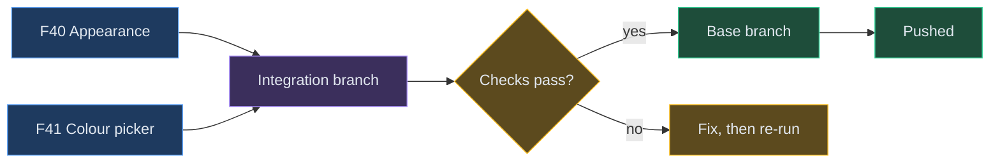

The always-on chat rule 10 says when to draw; this says how. It is for chat answers. A project's
docs rules may set their own palette and legend form for files; follow those in files.

1. **When.** A flow, dependencies, steps between parties, or states, with about three or more
   related nodes. Never for a plain list, a table's worth of facts or a single step.
2. **Kind.** One fenced `mermaid` block: `flowchart LR` (or `TD` when it is deep, not wide) for
   flows and dependencies, `sequenceDiagram` for steps between parties, `stateDiagram-v2` for
   states, `gantt` for work over time.
3. **Colour groups.** Group the nodes by what they are (the features, the branch work, a decision,
   the outcome), one `classDef` per group, then `class a,b,c <group>`. Dark fill, light border and
   light text, so it reads in a dark and a light theme:

   | ID | Group colour | `classDef` |
   | --- | --- | --- |
   | 1 | blue | `fill:#1e3a5f,stroke:#60a5fa,color:#e2e8f0` |
   | 2 | green | `fill:#1e4d3a,stroke:#34d399,color:#e2e8f0` |
   | 3 | amber | `fill:#5c4a1e,stroke:#fbbf24,color:#e2e8f0` |
   | 4 | violet | `fill:#3b2f5c,stroke:#a78bfa,color:#e2e8f0` |

   Use only as many groups as the diagram has kinds of thing; a fifth group means the diagram
   wants splitting. In a `sequenceDiagram`, colour with `box` groups or `rect rgb(…)` instead.
4. **Labels.** Short and quoted: `a["Integration branch"]`, `c{"Checks pass?"}`, edge text as
   `-->|"yes"|`. Ids are short readable words (`merge`, `checks`), never `A1`, so the source reads
   on its own.
5. **Legend.** Right after the block, a short numbered list with one item per colour group the
   diagram uses: `1. blue — the features`.
6. **Where it renders.** The Claude desktop app's Code tab draws the block; a plain terminal shows
   its source. Keep the source small and readable: a reader who sees only the text still follows
   the flow.

Example:

1. blue — the features
2. violet — the integration branch
3. amber — the check and its fix
4. green — landed and pushed
