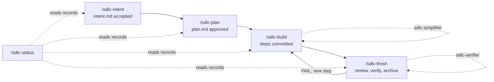

# sdlc plugin

**English** · [Українська](README.uk.md)

Spec-first work items in five skills (four the user invokes; the read-only `/sdlc-status` the agent
may run too), with two fresh-context agents for the independent passes. Every work item is a folder
of short documents in the project: what to build and why (intent), how to build and prove it
(plan), and the record of what happened.

```bash
claude plugin install sdlc@agent-kit
```

It needs `core` (installed with it) and uses `session` when that is enabled too.

## The flow



| ID | Skill or agent | Does | Writes |
| --- | --- | --- | --- |
| 1 | `/sdlc-intent` | Clarifies the request, reads the glossary, proposes a scope split | `<sdlc>/<slug>/intent.md` |
| 2 | `/sdlc-plan` | Looks up a matching recipe, checks impact, orders steps, maps Proof to outcomes; for shared state (locks, renewals, queues) models actors and interleavings | `<sdlc>/<slug>/plan.md` |
| 3 | `/sdlc-build` | Implements step by step, commits each step after its check, keeps glossary and recipes current; for shared state ends with an adversarial concurrency review | code, tests, ticks, Deviations |
| 4 | `/sdlc-finish` | Preflight, recipe and glossary check, independent review, verifier gate (no rerun when only nits remain), archive | `<sdlc>/archive/<date>-<slug>/` |
| 5 | `/sdlc-status` | Reports each item's stage and next command; changes nothing | — |
| 6 | `sdlc-simplifier` agent | Simplifies the finished change without changing behavior | a commit, or nothing |
| 7 | `sdlc-verifier` agent | Checks the item against intent and plan, read-only | `PASS`, `FAIL` or `PENDING` |

Intents and plans label items so other documents can cite them: outcomes `O1.`, important cases
`C1.`, open questions `Q1.` (a settled one gains `(resolved <date>)`); constraints and plan steps
use plain numbers.

The user starts each of the four stages in the session that runs it. A brief another agent wrote
(a session card, a sub-agent prompt) cannot start one, so a session started for an item prepares
and stops with the command for the user to type there.

## What it reads from kit.json

`sdlc-kit` (in `bin/`, on the Bash PATH while the plugin is enabled) prints these values with
their defaults; `sdlc-kit items` lists the work items; `sdlc-kit show <name>` prints the
plugin's workflow, templates and contracts. A project without `kit.json` gets the defaults.

| ID | Field | Default | Used for |
| --- | --- | --- | --- |
| 1 | `paths.sdlc` | `docs/sdlc` | Work-item folders and their `archive/` |
| 2 | `paths.glossary` | `docs/glossary.md` | Domain terms: intent reads it, build and finish keep it current |
| 3 | `paths.recipes` | `docs/recipes` | Recipe index (`README.md` or `index.md`): plan looks it up, finish checks it |
| 4 | `paths.decisions`, `paths.docs` | `docs/decisions`, `docs` | Design rules and documents a change must keep current |
| 5 | `baseBranch` | `origin/HEAD`, else a local `main` or `master` | The item's `base:` and comparison base |
| 6 | `itemPrefix` | none | Ticket ids (`APP-123`): the intent's `ticket:`, the slug and the branch name |
| 7 | `commands.check`, `lint`, `test`, `build` | none (step skipped) | Step checks, Proof and the finish gate |
| 8 | `commands.commit`, `commitAudit` | none | Commit flow when the `session` plugin is not enabled |
| 9 | `ledger` | `false` | Whether follow-ups go to the session record's `## Next` |

## With and without the session plugin

The skills check this session's skill list for the `session` plugin; nothing fails when it is
missing.

| ID | Concern | With `session` | Without it |
| --- | --- | --- | --- |
| 1 | Commit | Its `/git commit`: explicit paths from the session record, `commitAudit` | `commands.commit`, else `git add -- <paths>` and `git commit`; then `commitAudit` if set |
| 2 | Close-out | Its `/close-out`: resume, follow-up sessions, landing on one answer | A done / follow-up / not-done resume in chat; merge and push asked separately |
| 3 | Follow-ups | Session record `## Next` when `ledger` is on | The close-out resume |

## Extension points

An overlay kit or the project fills a point by providing a skill whose name starts with
`sdlc-ext-<point>`; the stage invokes every such skill listed in the session, in name order. An
empty point is skipped and reported.

| ID | Point | Stage | Fills in |
| --- | --- | --- | --- |
| 1 | `sdlc-ext-intent` | Intent | Checks against systems outside the repository (an external API's contract, a request to another team's service) |
| 2 | `sdlc-ext-plan` | Plan | Gates and environments Proof must include (an extension build and reload, a manual smoke, an end-to-end suite) |
| 3 | `sdlc-ext-preflight` | Finish | Static analysis against the comparison base, with introduced findings fixed |
| 4 | `sdlc-ext-docs` | Finish | The documentation review against the comparison base; without one, `commands.check` |

## Files

| ID | Path | Holds |
| --- | --- | --- |
| 1 | `skills/sdlc-*/SKILL.md` | The five stages; each pre-allows `Bash(sdlc-kit:*)` |
| 2 | `skills/sdlc-intent/assets/template.md`, `skills/sdlc-plan/assets/template.md` | Intent and plan templates |
| 3 | `references/workflow.md` | Shared rules: item and Git state, numbering, recipes and glossary, project bindings |
| 4 | `references/simplification.md`, `references/verification.md` | The agents' contracts |
| 5 | `agents/` | `sdlc-simplifier`, `sdlc-verifier` |
| 6 | `bin/sdlc-kit`, `scripts/sdlc-kit.mjs` | The helper; Node built-ins only |
