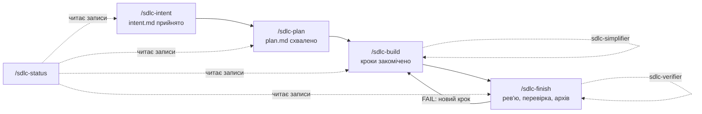

# Плагін sdlc

[English](README.md) · **Українська**

Робочі елементи за специфікацією: п'ять навичок (чотири викликає користувач; `/sdlc-status`, що лише
читає, може запустити й агент) і два агенти зі свіжим контекстом для незалежних перевірок. Кожен
робочий елемент — тека коротких документів у проєкті: що зробити й навіщо (intent), як зробити й
довести (plan) і запис того, що сталося.

```bash
claude plugin install sdlc@agent-kit
```

Він потребує `core` (встановлюється разом із ним) і використовує `session`, якщо той теж увімкнено.

## Процес



| ID | Навичка або агент | Що робить | Що пише |
| --- | --- | --- | --- |
| 1 | `/sdlc-intent` | Уточнює запит, читає глосарій, пропонує поділ обсягу | `<sdlc>/<slug>/intent.md` |
| 2 | `/sdlc-plan` | Шукає відповідний рецепт, перевіряє вплив, впорядковує кроки, прив'язує Proof до результатів; для спільного стану (блокування, продовження, черги) моделює учасників і чергування | `<sdlc>/<slug>/plan.md` |
| 3 | `/sdlc-build` | Реалізує крок за кроком, комітить кожен крок після його перевірки, підтримує глосарій і рецепти; для спільного стану завершується змагальним рев'ю конкурентності | код, тести, позначки, Deviations |
| 4 | `/sdlc-finish` | Попередня перевірка, перевірка рецептів і глосарію, незалежне рев'ю, шлюз верифікатора (без повторного запуску, коли лишилися тільки дрібниці), архів | `<sdlc>/archive/<date>-<slug>/` |
| 5 | `/sdlc-status` | Показує стадію кожного елемента й наступну команду; нічого не змінює | — |
| 6 | Агент `sdlc-simplifier` | Спрощує завершену зміну, не змінюючи поведінки | коміт або нічого |
| 7 | Агент `sdlc-verifier` | Звіряє елемент з intent і plan, лише читає | `PASS`, `FAIL` або `PENDING` |

Intent і plan позначають пункти, щоб інші документи могли на них посилатися: результати `O1.`,
важливі випадки `C1.`, відкриті питання `Q1.` (розв'язане отримує `(resolved <date>)`); обмеження
й кроки плану нумеруються звичайними числами.

Кожну з чотирьох стадій запускає користувач у тій сесії, яка її виконує. Бриф, який написав інший
агент (картка сесії, запит до субагента), стадію не запускає, тож сесія, створена для елемента,
готується й зупиняється з командою, яку користувач набере там.

## Що він читає з kit.json

`sdlc-kit` (у `bin/`, у PATH для Bash, поки плагін увімкнено) друкує ці значення разом зі
значеннями за замовчуванням; `sdlc-kit items` показує робочі елементи; `sdlc-kit show <name>`
друкує workflow, шаблони й контракти плагіна; `sdlc-kit kit-repo <plugin>` називає репозиторій
GitHub, у якому відкривають issue про прогалину набору (`docs/changing.md`, Як повідомити про
прогалину). Проєкт без `kit.json` отримує значення за замовчуванням.

| ID | Поле | За замовчуванням | Для чого |
| --- | --- | --- | --- |
| 1 | `paths.sdlc` | `docs/sdlc` | Теки робочих елементів та їхній `archive/` |
| 2 | `paths.glossary` | `docs/glossary.md` | Доменні терміни: intent читає, build і finish підтримують актуальними |
| 3 | `paths.recipes` | `docs/recipes` | Індекс рецептів (`README.md` або `index.md`): plan шукає в ньому, finish перевіряє |
| 4 | `paths.decisions`, `paths.docs` | `docs/decisions`, `docs` | Правила дизайну й документи, які зміна має тримати актуальними |
| 5 | `baseBranch` | гілка `dev` (локальна чи на `origin`), інакше `origin/HEAD`, інакше локальна `main` або `master` | `base:` елемента й база для порівняння |
| 6 | `itemPrefix` | немає | Номери задач (`APP-123`): `ticket:` в intent, slug і назва гілки |
| 7 | `commands.check`, `lint`, `test`, `build` | немає (крок пропускається) | Перевірки кроків, Proof і шлюз finish |
| 8 | `commands.commit`, `commitAudit` | немає | Коміти, коли плагін `session` не ввімкнено |
| 9 | `ledger` | `false` | Чи йдуть подальші задачі в `## Next` запису сесії |

## З плагіном session і без нього

Навички шукають плагін `session` у списку навичок сесії; якщо його немає, нічого не ламається.

| ID | Що | З `session` | Без нього |
| --- | --- | --- | --- |
| 1 | Коміт | Його `/git commit`: явні шляхи із запису сесії, `commitAudit` | `commands.commit`, інакше `git add -- <paths>` і `git commit`; потім `commitAudit`, якщо задано |
| 2 | Завершення | Його `/close-out`: підсумок, наступні сесії, злиття за однією відповіддю | Підсумок «зроблено / далі / не зроблено» в чаті; злиття й push — окремими питаннями |
| 3 | Подальші задачі | `## Next` запису сесії, коли `ledger` увімкнено | Підсумок завершення |

## Точки розширення

Overlay-кіт або проєкт заповнює точку навичкою, назва якої починається з `sdlc-ext-<point>`;
стадія викликає кожну таку навичку зі списку сесії за порядком назв. Порожня точка пропускається,
і про це сказано у звіті.

| ID | Точка | Стадія | Що додає |
| --- | --- | --- | --- |
| 1 | `sdlc-ext-intent` | Intent | Перевірки щодо систем поза репозиторієм (контракт зовнішнього API, запит до сервісу іншої команди) |
| 2 | `sdlc-ext-plan` | Plan | Шлюзи й середовища, які має містити Proof (збірка й перезавантаження розширення, ручна перевірка, end-to-end тести) |
| 3 | `sdlc-ext-preflight` | Finish | Статичний аналіз щодо бази порівняння; внесені зміною зауваження виправлено |
| 4 | `sdlc-ext-docs` | Finish | Рев'ю документації щодо бази порівняння; без нього — `commands.check` |

## Файли

| ID | Шлях | Що містить |
| --- | --- | --- |
| 1 | `skills/sdlc-*/SKILL.md` | П'ять стадій; кожна заздалегідь дозволяє `Bash(sdlc-kit:*)` |
| 2 | `skills/sdlc-intent/assets/template.md`, `skills/sdlc-plan/assets/template.md` | Шаблони intent і plan |
| 3 | `references/workflow.md` | Спільні правила: стан елемента й Git, нумерація, рецепти й глосарій, прив'язки до проєкту |
| 4 | `references/simplification.md`, `references/verification.md` | Контракти агентів |
| 5 | `agents/` | `sdlc-simplifier`, `sdlc-verifier` |
| 6 | `bin/sdlc-kit`, `scripts/sdlc-kit.mjs` | Помічник; лише вбудовані модулі Node |
