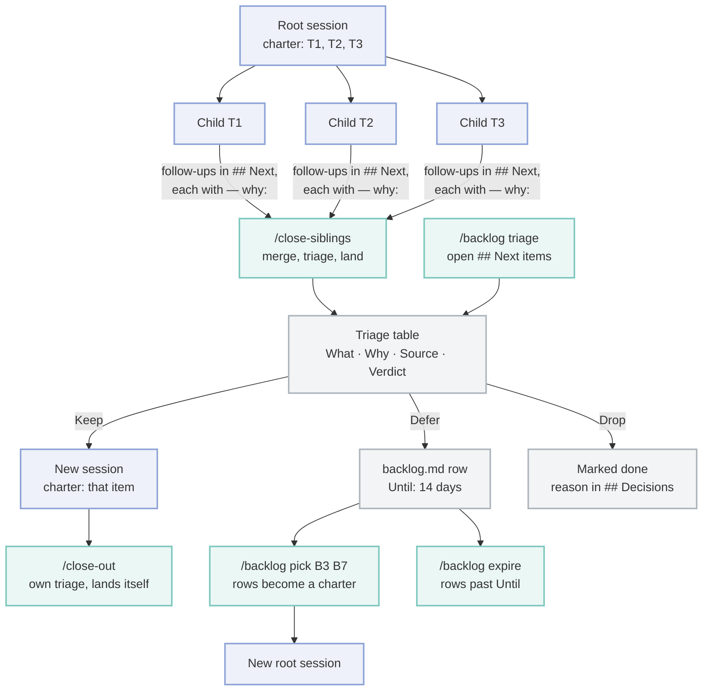

# session plugin

**English** · [Українська](README.uk.md)

The session side of the kit: a ledger record per Claude Code session, hand-off and close-out
commands, commits that take only one session's files in a shared working tree, and the worktree
flow from set-up to landing. Depends on `core`.

## What it does

| ID | Part | What it does |
| --- | --- | --- |
| 1 | Session ledger | At every Stop, writes one Markdown record per session (intent, decisions, next, files touched) into the ledger folder and rebuilds its `INDEX.md`. At session start, puts a short brief of recent records and owed work into context, leaving out owed items that an auto-close rule settled ([using § 6](../../docs/using.md#6-keep-the-ledgers-next-list-short)) |
| 2 | Commit script | `git-commit-session` commits only this session's paths with `git commit --only`, stops when another session claims a path, adds a `Session-Id` trailer, runs the project's commit audit on the committed paths, and counts the project's skipped optional steps (`preflight`) |
| 3 | Worktree flow | `worktree-flow` shows every worktree's base and verdict, predicts conflicts, lands a branch on its base by fast-forward only, removes merged worktrees, and lists the branches on origin that the base already holds (`stale-remote`, read-only). A SessionStart hook prepares each new linked worktree |
| 4 | Commands | `/handoff` writes the record mid-task; `/close-out` sorts the work, lands it and writes the session resume; `/close-siblings` lands the side sessions' work and deletes their merged branches, locally and on origin, on the user's word; `/backlog` triages follow-ups (Keep, Defer, Drop, each with its What and Why) into `<sdlc>/backlog.md`, picks rows into a new session's charter and expires old rows; `/git` runs git chores in the `git-ops` agent, and `/git commit --review` reviews the diff before committing |
| 5 | Evolution pages | `process-evolution.md` and `features-evolution.md` in `paths.evolution`: one Mermaid flowchart each of how the way of working and the features grew, with a Sources table. `evolution` starts, lists what is missing, bumps and checks them. They are brought up to date once per release, from the changelog's `## Unreleased` lines and the process commits since the last release tag, through the `evolution` skill; core's `kit release` dry run names a page the release has not updated |

Commands are namespaced by Claude Code as `/session:handoff`, `/session:close-out`,
`/session:close-siblings`, `/session:backlog` and `/session:git`; the agent is `session:git-ops`. The short form
(`/handoff`) works while no other command has the same name.

A project adds its own close-out steps (a status check of its clones, rows in its own log) as a
skill named `session-ext-close-out` or `session-ext-close-out-<name>`: `/close-out` and
`/close-siblings` load every such skill listed in the session, in name order, before landing.

## Sub-sessions and the main session

A session that fans work out to sub-sessions lands them with `/close-siblings`. Steps that need the
whole merged tree, or that edit files every sub-session shares, run there once instead of in each
sub-session, where they repeat on overlapping diffs and conflict at the merge.

| ID | Step | In a sub-session | In the main session |
| --- | --- | --- | --- |
| 1 | `preflight` step with `"scope": "main"` (a docs review) | No reminder; named in the close-out resume as deferred to the parent | `/close-siblings` § 3 after the merges, before the push; `/close-out` in a session with no parent |
| 2 | Extension skill whose description says `Main session only.` (`sdlc-ext-preflight`, `sdlc-ext-docs`, `session-ext-close-out`) | Skipped; recorded as `deferred to the parent: <skill>` | `/close-siblings` § 3, against the merge base of its branch and its base |
| 3 | Whole `test` suite and `build` | `check`, `lint` and the tests that cover the changed files | `/close-siblings` § 3 on the merged tree |
| 4 | Another session's ledger item done | Its own record's `## Next` says `mark done: <id8> <n> — <why>`; `session-ledger --done` refuses | `/close-siblings` § 2 step 4 runs `session-ledger --done` |
| 5 | `kit.json` `parentFiles` and top-level `<paths.sdlc>/*.md` (changelog lines, roadmap and backlog ticks, release notes) | Its record's `## Next` says `for the parent: <file>: <edit>`; a commit of one prints `parent-files:` | `/close-siblings` § 2 step 4 writes them after the merges |
| 6 | A conflict in a generated file | `worktree-flow regenerate` rebuilds the files a `kit.json` `regenerate` rule names | The same, when merging the sub-sessions |
| 7 | A follow-up found along the way | No session card and no triage: its record's `## Next` gets the item with its What and `— why:` | `/close-siblings` § 1 triages it against the main session's charter (`/backlog` § triage): Keep, Defer to `<paths.sdlc>/backlog.md`, or Drop |

Whether this is a sub-session is the desktop app's answer (`/close-out` § 2 step 6). The scripts
cannot ask the app, so they read git: `worktree-flow role child` records it, and a recorded base on
another session's `claude/*` branch means child too; `worktree-flow role` shows which. With
neither, a script treats the session as the main one and behaves as before.

## Follow-ups: charter, triage, backlog

A session that starts sub-sessions works from a fixed **charter**, the items it set out to do.
Follow-ups found along the way never start sessions of their own: they wait in the ledger's
`## Next`, each with its What and Why, until a triage decides them. A small Keep inside the
charter is done in the session that runs the triage, before its checks.



- <small>navy — sessions</small>
- <small>teal — commands</small>
- <small>gray — the triage table, the backlog and ledger marks</small>

1. **Keep** only when leaving the item undone hurts: a defect a user sees, a release blocker, a
   failing or missing check, an unfinished charter item. **Defer** polish, wording, refactors and
   process tweaks. **Drop** an item whose Why does not hold up.
2. The user answers the table by ids (`F1 keep, F5–F7 drop`); unnamed rows keep the proposal.
3. `<paths.sdlc>/backlog.md` is written by main sessions only, and `merge=union` lets two of them
   add rows at once; one session at a time picks and expires rows, normally a daily one.

## Hook ids

Claude Code cannot switch off one hook of a plugin, so every hook here reads `kit.json`
`hooks.off` and exits 0 without doing anything when its id is listed. The ledger hooks also stay
quiet unless `kit.json` sets `"ledger": true`.

| ID | Hook id | Event | Needs `"ledger": true` | What it does |
| --- | --- | --- | --- | --- |
| 1 | `ledger-stop` | Stop | yes | Writes the session's record and `INDEX.md` |
| 2 | `ledger-brief` | SessionStart | yes | Prints the brief of recent records into the session's context, then the record rules (also with an empty ledger) |
| 3 | `ledger-shell-deletions` | (none here: core's `shell-deletions`) | yes | Former copy of core's `shell-deletions` hook, which snapshots tracked files a script deletes so the record credits the deletion. Both ran and logged every snapshot twice, so only core's remains; listing this id still switches it off |
| 4 | `ledger-summarize` | (spawned by `ledger-stop`) | yes | Fills a record nobody wrote with a cheap model through `claude -p`. Spends tokens; list it to turn it off, or set `LEDGER_NO_SUMMARY=1` |
| 5 | `worktree-setup` | SessionStart | no | In a new linked worktree: installs dependencies (`commands.install`, else pnpm or npm from the lockfile), builds a CodeGraph index when the main checkout has one, trusts RTK filters already trusted elsewhere. Each step is skipped when its tool is not installed. A worktree the app cut from an older commit (no commits of its own, `baseBranch` moved past it) gets a line naming the `worktree-flow adopt <base>` that moves it to the current files |

```json
{ "hooks": { "off": ["ledger-summarize", "worktree-setup"] } }
```

## kit.json fields it reads

| ID | Field | Default | Used by |
| --- | --- | --- | --- |
| 1 | `ledger` | `false` | Every ledger hook; `session-ledger` writes no record without it |
| 2 | `paths.ledger` | `.claude/ledger` | Where records, `INDEX.md` and `archive/` live |
| 3 | `paths.sdlc` | `docs/sdlc` | `worktree-flow` reads an item's `base:` from `<item>/intent.md`; `git-commit-session --worktree` accepts renames inside it as the session's |
| 4 | `paths.recipes` | `docs/recipes` | `/close-out` and `/handoff` name areas by recipe |
| 5 | `baseBranch` | `dev` | `worktree-flow` prefers it when guessing a base; `/git branch` cuts from it |
| 6 | `itemPrefix` | none | `/git branch <ITEM-ID>` and commit footers |
| 7 | `commands.commitAudit` | none | Run after each commit that holds code; its output is shown, never its exit code. `{files}` in it becomes the committed paths, quoted; they are also in `KIT_COMMIT_PATHS`, one per line, so the audit can report only findings in them |
| 8 | `commands.check`, `lint`, `test`, `build` | none | The checks `/close-out` and `/close-siblings` run before landing |
| 9 | `devServer.port` | none | The closing line of the worktree set-up |
| 10 | `commands.commitMessage` | none | Checks a new commit message before `git-commit-session` commits; `{file}` becomes the quoted path of a file with the message (appended without it); a non-zero exit refuses the commit (exit 9) |
| 10 | `hooks.off` | `[]` | The hook ids above |
| 11 | `commands.install` | lockfile guess | The worktree set-up's install step, run through the shell when a known lockfile is newer than the last install |
| 12 | `preflight` | none | Optional steps to run now and then before committing; each commit they touch counts a skip, shown once it reaches `remindAfter` |
| 13 | `paths.evolution` | `docs/evolution` | Where `evolution` and `kit release` find the evolution pages; none there means the project keeps none |
| 14 | `commitSubject` | Conventional Commits | The subject form `/git commit` writes, a template such as `<slug>: <subject>` (`<type>`, `<scope>`, `<slug>`, `<ITEM-ID>`, `<subject>`); `git-branch-context` passes it to `git-ops` |
| 14 | `commands.evolutionRender` | none | Renders a page's printable version after `evolution bump`; `{page}` becomes the quoted page path (appended without it) |
| 15 | `ledgerAutoClose.questionDays` | `7` | Days after a record was last active before its `Open question at Stop` item counts as closed: hidden from the brief, listed apart by `--owed`, marked by `--sweep` |
| 16 | `parentFiles` | `[]` | Globs of shared summary files only the main session edits; a sub-session's commit of one prints `parent-files:` |
| 17 | `regenerate` | none | `[{ "match": [globs], "command": "…" }]`: generated files `worktree-flow regenerate` rebuilds after a merge conflict |

`preflight` names a project's optional steps, never a tool the kit knows: each has a
`description`, an optional `command`, optional `match` globs (left out: any commit outside the
ledger), `remindAfter` (default 1) and `scope` (`any`, the default, or `main`: run once in the main
session, never reminded in a sub-session). The counts live in the repository's common git folder,
shared by its worktrees, so a sub-session's commits count towards the parent's run.
`preflight run <id>` runs the command and clears the count on success; `preflight done <id>` clears
a step that ran another way, such as a skill.

```json
{
  "commands": { "commitAudit": "npx some-audit --base HEAD~1 --only {files}" },
  "preflight": {
    "docs-review": { "description": "Docs review: the project's docs-review skill", "match": ["docs/**", "*.md"], "remindAfter": 3, "scope": "main" },
    "audit": { "description": "Dead-code and dependency audit", "command": "pnpm run audit" }
  },
  "parentFiles": ["CHANGELOG.md", "docs/roadmap.md"],
  "regenerate": [{ "match": ["src/i18n/types.ts"], "command": "pnpm run i18n:types" }]
}
```

The checkout comes from the hook payload's `cwd` (or the shell's working directory), so a worktree
session works on the worktree's own `kit.json`, ledger and files.

## Commands on the Bash PATH

The plugin's `bin/` is on the Bash tool's PATH in a session. Agents and commands call these;
a project may allow them in `.claude/settings.json` (`Bash(session-ledger --files:*)` and so on).

| ID | Command | What it does |
| --- | --- | --- |
| 1 | `session-ledger` | `--files`, `--record`, `--refresh`, `--conflicts`, `--owed`, `--done`, `--sweep`, `--archive`, `--backfill`; `--help` lists them |
| 2 | `git-commit-session` | Commit by path; `--help` lists flags and exit codes |
| 3 | `worktree-flow` | `status`, `resolve`, `base`, `role`, `adopt`, `conflicts`, `land`, `regenerate`, `remove`, `stale-remote`; `--help` lists them. `adopt <base>` moves a fresh worktree onto `<base>`, then, when a lockfile or package manifest differs between the two commits or `node_modules` is missing, runs `kit.json` `commands.install` (spawned without a shell; a command with shell syntax, or none set, gets a hint instead). A failed install is reported; the move stands |
| 4 | `worktree-setup` | The set-up the `worktree-setup` hook runs |
| 5 | `git-branch-context` | Branch, upstream, base branch and item prefix as JSON, for `/git` |
| 6 | `ledger-export` | Renders a record as a hand-off file outside the repo (`/handoff --export`) |
| 7 | `scan-ledger-secrets` | Pre-commit backstop: fails on secret-shaped text in staged records (without paths: the staged files in the ledger folder) |
| 8 | `preflight` | `status [--scope main]`, `run <id>`, `done <id>` for the `kit.json` `preflight` steps |
| 9 | `evolution` | `status [--since-release [<tag>] \| --base <ref>]`, `init`, `bump <page>`, `check` for the evolution pages; `--help` lists them |
| 10 | `kit-repo` | `<plugin\|plugin@marketplace\|path> [--json]`: the GitHub repo a kit gap is opened in, from the plugin's marketplace source, for `/close-out` and `/handoff` |

Outside a session (a shell, a git hook), plugin commands are not on PATH. For the secret scan in a
git hook, add this repo as a dev dependency (`github:3meyc/agent-kit#<ref>`) and call
`agent-kit ledger-scan-secrets` (for example from lefthook's `pre-commit`); anything else runs
directly as `node <plugin>/scripts/<name>.mjs`.
