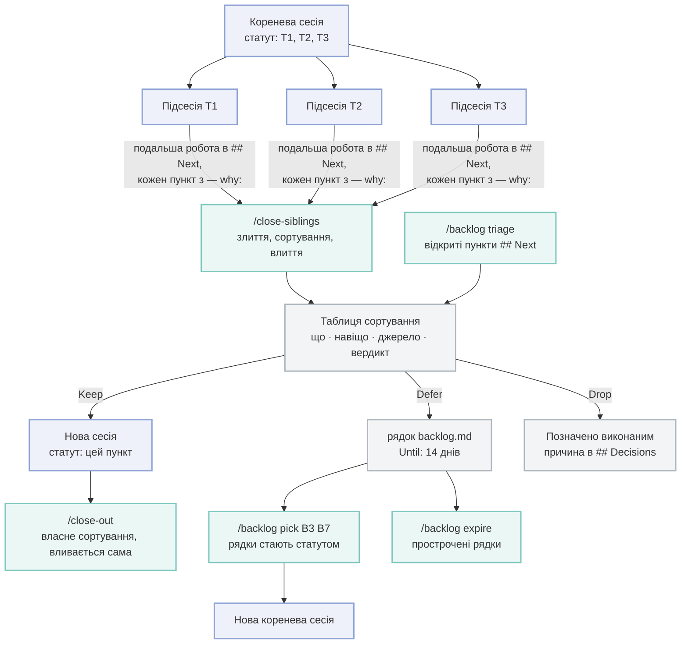

# Плагін session

[English](README.md) · **Українська**

Сесійна частина набору: запис у журналі (ledger) для кожної сесії Claude Code, команди передачі
та завершення роботи, коміти, що беруть лише файли однієї сесії в спільному робочому дереві, і
потік роботи з worktree від підготовки до злиття. Залежить від `core`.

## Що він робить

| ID | Частина | Що робить |
| --- | --- | --- |
| 1 | Журнал сесій | На кожному Stop пише один Markdown-запис на сесію (намір, рішення, наступні кроки, змінені файли) у теку журналу й перебудовує її `INDEX.md`. На старті сесії додає в контекст короткий огляд недавніх записів і невиконаної роботи, без пунктів, які закрило правило автозакриття ([using § 6](../../docs/using.uk.md#6-тримайте-список-next-у-журналі-коротким)) |
| 2 | Скрипт коміту | `git-commit-session` комітить лише шляхи цієї сесії через `git commit --only`, зупиняється, коли шлях заявляє інша сесія, додає трейлер `Session-Id`, запускає аудит коміту проєкту на закомічених шляхах і рахує пропущені необов'язкові кроки проєкту (`preflight`) |
| 3 | Потік worktree | `worktree-flow` показує базу й вердикт кожного worktree, передбачає конфлікти, зливає гілку в базу лише перемоткою (fast-forward), прибирає злиті worktree і показує гілки на origin, які база вже містить (`stale-remote`, лише читання). Хук SessionStart готує кожен новий linked worktree |
| 4 | Команди | `/handoff` пише запис посеред задачі; `/close-out` сортує роботу, зливає її й пише підсумок сесії; `/close-siblings` зливає роботу бічних сесій і за словом користувача видаляє їхні злиті гілки, локально й на origin; `/backlog` сортує подальшу роботу (Keep, Defer, Drop, кожен пункт зі своїми «що» і «навіщо») у `<sdlc>/backlog.md`, переносить рядки в статут нової сесії й прибирає прострочені рядки; `/git` виконує git-завдання в агенті `git-ops`, а `/git commit --review` переглядає diff перед комітом |
| 5 | Сторінки еволюції | `process-evolution.md` і `features-evolution.md` у `paths.evolution`: по одній Mermaid-схемі того, як зростали спосіб роботи й функції, з таблицею джерел. `evolution` створює їх, показує, чого бракує, піднімає версію й перевіряє. Їх оновлюють раз на реліз — з рядків `## Unreleased` у changelog і комітів процесу від останнього тегу релізу — через скіл `evolution`; пробний запуск `kit release` з core називає сторінку, яку реліз не оновив |

Claude Code дає командам простір імен: `/session:handoff`, `/session:close-out`,
`/session:close-siblings`, `/session:backlog` і `/session:git`; агент зветься `session:git-ops`. Коротка форма
(`/handoff`) працює, поки жодна інша команда не має такої ж назви.

Проєкт додає власні кроки завершення (перевірку стану своїх клонів, рядки у власному журналі)
скілом з назвою `session-ext-close-out` або `session-ext-close-out-<назва>`: `/close-out` і
`/close-siblings` завантажують кожен такий скіл, доступний у сесії, за порядком назв, перед злиттям.

## Підсесії й головна сесія

Сесія, що роздає роботу підсесіям, зливає їх через `/close-siblings`. Кроки, яким потрібне все
злите дерево або які правлять файли, спільні для всіх підсесій, виконуються там один раз, а не в
кожній підсесії, де вони повторюються на diff, що перекриваються, і конфліктують під час злиття.

| ID | Крок | У підсесії | У головній сесії |
| --- | --- | --- | --- |
| 1 | Крок `preflight` з `"scope": "main"` (огляд документації) | Без нагадування; у підсумку close-out названий як відкладений для батьківської сесії | `/close-siblings` § 3 після злиттів, перед push; `/close-out` у сесії без батьківської |
| 2 | Скіл-розширення, чий опис каже `Main session only.` (`sdlc-ext-preflight`, `sdlc-ext-docs`, `session-ext-close-out`) | Пропускається; записується як `deferred to the parent: <skill>` | `/close-siblings` § 3, від merge base її гілки та її бази |
| 3 | Увесь набір `test` і `build` | `check`, `lint` і тести, що покривають змінені файли | `/close-siblings` § 3 на злитому дереві |
| 4 | Пункт журналу іншої сесії виконано | `## Next` її власного запису каже `mark done: <id8> <n> — <чому>`; `session-ledger --done` відмовляє | `/close-siblings` § 2 крок 4 запускає `session-ledger --done` |
| 5 | `parentFiles` з `kit.json` і `<paths.sdlc>/*.md` верхнього рівня (рядки changelog, позначки в roadmap і backlog, release notes) | `## Next` її запису каже `for the parent: <file>: <правка>`; коміт такого файлу друкує `parent-files:` | `/close-siblings` § 2 крок 4 пише їх після злиттів |
| 6 | Конфлікт у згенерованому файлі | `worktree-flow regenerate` перебудовує файли, які називає правило `regenerate` з `kit.json` | Те саме, під час злиття підсесій |
| 7 | Подальша робота, знайдена дорогою | Ні картки сесії, ні сортування: у `## Next` її запису з'являється пункт із «що» й `— why:` | `/close-siblings` § 1 сортує її за статутом головної сесії (`/backlog` § triage): Keep, Defer у `<paths.sdlc>/backlog.md` або Drop |

Чи це підсесія, відповідає десктопний застосунок (`/close-out` § 2 крок 6). Скрипти не можуть
спитати застосунок, тож читають git: `worktree-flow role child` записує це, і записана база на
гілці `claude/*` іншої сесії теж означає підсесію; `worktree-flow role` показує, що саме. Без
жодного з них скрипт вважає сесію головною й поводиться, як раніше.

## Подальша робота: статут, сортування, беклог

Сесія, що запускає підсесії, працює за незмінним **статутом** — переліком того, що вона взялася
зробити. Подальша робота, знайдена дорогою, ніколи не запускає власних сесій: вона чекає в
`## Next` журналу, кожен пункт зі своїми «що» й «навіщо», доки сортування (triage) не вирішить
його долю. Невеликий Keep у межах статуту виконує та сесія, що сортує, перед своїми перевірками.



- <small>синій — сесії</small>
- <small>бірюзовий — команди</small>
- <small>сірий — таблиця сортування, беклог і позначки в журналі</small>

1. **Keep** лише тоді, коли невиконаний пункт шкодить: дефект, який бачить користувач, блокер
   релізу, зламана чи відсутня перевірка, незавершений пункт статуту. **Defer** — шліфування,
   формулювання, рефакторинг і дрібні зміни процесу. **Drop** — пункт, чиє «навіщо» не
   витримує перевірки.
2. Користувач відповідає на таблицю за ідентифікаторами (`F1 keep, F5–F7 drop`); неназвані
   рядки зберігають запропонований вердикт.
3. `<paths.sdlc>/backlog.md` пишуть лише головні сесії, а `merge=union` дає двом із них додавати
   рядки одночасно; переносить і прибирає рядки одна сесія за раз, зазвичай щоденна.

## Ідентифікатори хуків

Claude Code не вміє вимкнути один хук плагіна, тож кожен хук тут читає `hooks.off` у `kit.json` і
завершується з кодом 0, нічого не роблячи, коли його ідентифікатор у списку. Хуки журналу також
мовчать, поки `kit.json` не задає `"ledger": true`.

| ID | Ідентифікатор хука | Подія | Потрібен `"ledger": true` | Що робить |
| --- | --- | --- | --- | --- |
| 1 | `ledger-stop` | Stop | так | Пише запис сесії та `INDEX.md` |
| 2 | `ledger-brief` | SessionStart | так | Виводить огляд недавніх записів у контекст сесії, а потім правила запису (і з порожнім журналом) |
| 3 | `ledger-shell-deletions` | (тут немає: `shell-deletions` з core) | так | Колишня копія хука `shell-deletions` з core, що знімає стан відстежуваних файлів, які видаляє скрипт, щоб запис зарахував видалення. Обидва працювали й писали кожен знімок двічі, тож лишився тільки хук core; цей id у `hooks.off` і далі його вимикає |
| 4 | `ledger-summarize` | (запускає `ledger-stop`) | так | Заповнює запис, який ніхто не написав, дешевою моделлю через `claude -p`. Витрачає токени; додайте його до списку, щоб вимкнути, або задайте `LEDGER_NO_SUMMARY=1` |
| 5 | `worktree-setup` | SessionStart | ні | У новому linked worktree: ставить залежності (`commands.install`, інакше pnpm або npm за lock-файлом), будує індекс CodeGraph, коли він є в основному checkout, довіряє фільтрам RTK, яким уже довіряють деінде. Кожен крок пропускається, коли його інструмент не встановлено. Worktree, який застосунок вирізав зі старішого коміту (без власних комітів, а `baseBranch` пішов далі), отримує рядок із `worktree-flow adopt <base>`, що переносить його на поточні файли |

```json
{ "hooks": { "off": ["ledger-summarize", "worktree-setup"] } }
```

## Поля kit.json, які він читає

| ID | Поле | Типово | Хто читає |
| --- | --- | --- | --- |
| 1 | `ledger` | `false` | Кожен хук журналу; без нього `session-ledger` не пише записів |
| 2 | `paths.ledger` | `.claude/ledger` | Де лежать записи, `INDEX.md` і `archive/` |
| 3 | `paths.sdlc` | `docs/sdlc` | `worktree-flow` читає `base:` елемента з `<item>/intent.md`; `git-commit-session --worktree` зараховує перейменування всередині сесії |
| 4 | `paths.recipes` | `docs/recipes` | `/close-out` і `/handoff` називають області за рецептами |
| 5 | `baseBranch` | `dev` | `worktree-flow` віддає їй перевагу, коли вгадує базу; `/git branch` відгалужується від неї |
| 6 | `itemPrefix` | немає | `/git branch <ITEM-ID>` і футери комітів |
| 7 | `commands.commitAudit` | немає | Запускається після кожного коміту з кодом; показується вивід, код виходу — ніколи. `{files}` у ній стає закоміченими шляхами в лапках; вони також є в `KIT_COMMIT_PATHS`, по одному в рядку, тож аудит може показати лише знахідки в них |
| 8 | `commands.check`, `lint`, `test`, `build` | немає | Перевірки, які `/close-out` і `/close-siblings` запускають перед злиттям |
| 9 | `devServer.port` | немає | Завершальний рядок підготовки worktree |
| 10 | `commands.commitMessage` | немає | Перевіряє нове повідомлення коміту, перш ніж `git-commit-session` комітить; `{file}` стає шляхом у лапках до файлу з повідомленням (без нього шлях додається в кінці); ненульовий код виходу відхиляє коміт (код 9) |
| 10 | `hooks.off` | `[]` | Ідентифікатори хуків вище |
| 11 | `commands.install` | здогад за lock-файлом | Крок встановлення під час підготовки worktree; запускається через shell, коли відомий lock-файл новіший за останнє встановлення |
| 12 | `preflight` | немає | Необов'язкові кроки, які час від часу варто запускати перед комітом; кожен коміт, що їх зачіпає, рахується як пропуск і показується, коли сягає `remindAfter` |
| 13 | `paths.evolution` | `docs/evolution` | Де `evolution` і `kit release` шукають сторінки еволюції; якщо там їх немає, проєкт їх не веде |
| 14 | `commitSubject` | Conventional Commits | Форма теми коміту, яку пише `/git commit`, шаблоном на кшталт `<slug>: <subject>` (`<type>`, `<scope>`, `<slug>`, `<ITEM-ID>`, `<subject>`); `git-branch-context` передає його `git-ops` |
| 14 | `commands.evolutionRender` | немає | Рендерить друковану версію сторінки після `evolution bump`; `{page}` стає шляхом сторінки в лапках (без нього шлях додається в кінець) |
| 15 | `ledgerAutoClose.questionDays` | `7` | Скільки днів після останнього оновлення запису його пункт `Open question at Stop` лишається відкритим; потім бриф його приховує, `--owed` показує окремо, `--sweep` позначає |
| 16 | `parentFiles` | `[]` | Шаблони спільних підсумкових файлів, які править лише головна сесія; коміт такого файлу в підсесії друкує `parent-files:` |
| 17 | `regenerate` | немає | `[{ "match": [шаблони], "command": "…" }]`: згенеровані файли, які `worktree-flow regenerate` перебудовує після конфлікту злиття |

`preflight` називає необов'язкові кроки проєкту, а не інструменти, відомі набору: кожен має
`description`, необов'язкову `command`, необов'язкові шаблони `match` (без них — будь-який коміт поза
журналом), `remindAfter` (типово 1) і `scope` (`any`, типово, або `main`: виконується один раз у
головній сесії, у підсесії без нагадувань). Лічильники лежать у спільній git-теці репозиторію,
однаковій для всіх його worktree, тож коміти підсесії враховуються для запуску в батьківській.
`preflight run <id>` запускає команду й при успіху обнуляє лічильник; `preflight done <id>` обнуляє
крок, виконаний іншим способом, наприклад скілом.

```json
{
  "commands": { "commitAudit": "npx some-audit --base HEAD~1 --only {files}" },
  "preflight": {
    "docs-review": { "description": "Docs review: the project's docs-review skill", "match": ["docs/**", "*.md"], "remindAfter": 3, "scope": "main" },
    "audit": { "description": "Dead-code and dependency audit", "command": "pnpm run audit" }
  },
  "parentFiles": ["CHANGELOG.md", "docs/roadmap.md"],
  "regenerate": [{ "match": ["src/i18n/types.ts"], "command": "pnpm run i18n:types" }]
}
```

Checkout визначається з `cwd` у даних хука (або з робочої теки shell), тож сесія у worktree
працює з власними `kit.json`, журналом і файлами цього worktree.

## Команди в PATH для Bash

Тека `bin/` плагіна є в PATH інструмента Bash у сесії. Їх викликають агенти й команди; проєкт
може дозволити їх у `.claude/settings.json` (`Bash(session-ledger --files:*)` тощо).

| ID | Команда | Що робить |
| --- | --- | --- |
| 1 | `session-ledger` | `--files`, `--record`, `--refresh`, `--conflicts`, `--owed`, `--done`, `--sweep`, `--archive`, `--backfill`; `--help` перелічує їх |
| 2 | `git-commit-session` | Коміт за шляхами; `--help` перелічує прапорці й коди виходу |
| 3 | `worktree-flow` | `status`, `resolve`, `base`, `role`, `adopt`, `conflicts`, `land`, `regenerate`, `remove`, `stale-remote`; `--help` перелічує їх. `adopt <base>` переносить свіжий worktree на `<base>`, а коли lock-файл чи маніфест пакета відрізняється між двома комітами або `node_modules` немає, запускає `kit.json` `commands.install` (без оболонки; команда із синтаксисом оболонки або її відсутність дає підказку). Збій установлення повідомляється; перенесення лишається |
| 4 | `worktree-setup` | Підготовка, яку запускає хук `worktree-setup` |
| 5 | `git-branch-context` | Гілка, upstream, базова гілка й префікс елементів у JSON, для `/git` |
| 6 | `ledger-export` | Перетворює запис на файл передачі поза репозиторієм (`/handoff --export`) |
| 7 | `scan-ledger-secrets` | Запобіжник для pre-commit: падає на тексті, схожому на секрет, у staged-записах (без шляхів — staged-файли в теці журналу) |
| 8 | `preflight` | `status [--scope main]`, `run <id>`, `done <id>` для кроків `preflight` з `kit.json` |
| 9 | `evolution` | `status [--since-release [<tag>] \| --base <ref>]`, `init`, `bump <page>`, `check` для сторінок еволюції; `--help` перелічує їх |
| 10 | `kit-repo` | `<plugin\|plugin@marketplace\|path> [--json]`: репозиторій GitHub, у якому відкривають issue про прогалину набору, з джерела marketplace плагіна, для `/close-out` і `/handoff` |

Поза сесією (у shell, у git-хуку) команд плагіна немає в PATH. Для перевірки секретів у git-хуку
додайте цей репозиторій як dev-залежність (`github:3meyc/agent-kit#<ref>`) і викликайте
`agent-kit ledger-scan-secrets` (наприклад, з `pre-commit` у lefthook); решту запускайте напряму:
`node <plugin>/scripts/<name>.mjs`.
